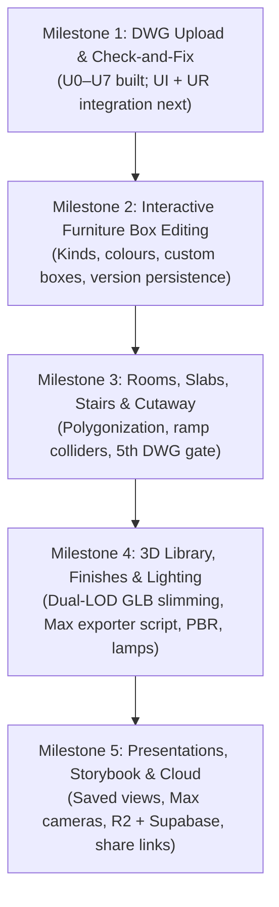

# Project Walkthrough: Critique, Technical Architecture Guide & Improvement Roadmap

**Date:** 5 November 2026  
**Scope:** Comprehensive review of [walkthrough_app_plan.md](../../walkthrough_app_plan.md), [app/docs/STATUS.md](STATUS.md), [app/docs/upload/DESIGN.md](upload/DESIGN.md), [app/docs/upload/WORK_BREAKDOWN.md](upload/WORK_BREAKDOWN.md), and the active `milestone-upload` implementation.

---

## 1. Executive Review of the Current Plan

### 1.1 Overall Rating: **9.5 / 10 (Exceptional)**
The current project plan is unusually strong because every architectural choice is backed by empirical measurements on your own studio's files rather than assumptions:

1. **Deterministic CAD Geometry First, AI Opt-In Only:**
   - CAD drawings already contain exact vector coordinates. Using deterministic geometry rules (`ezdxf` + `shapely`) for walls, openings, and furniture boxes—while keeping AI **off by default** and using it only for optional layer/room suggestions (`gemini-3.5-flash`)—gives $0 per-project operating cost, zero NDA/privacy friction, and byte-reproducible builds.
2. **Strict Separation of Development-Set vs. Held-Out Accuracy:**
   - Tracking blind held-out runs separately from tuned runs (95% on the bank branch's first run; 72% on the held-out tower floors `L29`/`L30`, then 54/54 after general fixes) prevented premature claims of "100% automation" and directly informed the design of the **Check-and-Fix screen**.
3. **Hardware-Grounded 3D & 3ds Max Validation:**
   - Testing generated `.ms` scripts in real 3ds Max proved that `Spline + Extrude (Editable Mesh)` keeps walls live and editable for the 3D team.
   - Benchmarking actual studio furniture ([furniture_test/README.md](../../furniture_test/README.md), [bank_furnished/README.md](../../furniture_test/bank_furnished/README.md)) proved that raw exports (up to 241,326 triangles for a single chair) fail the 60 fps budget on integrated graphics (`Intel Iris Xe`), while a one-time simplify on import (~5,000 triangles/chair) runs as fast as plain boxes.
4. **Single Viewer Package Across Three Targets:**
   - Keeping `packages/viewer` framework-free (`Three.js` + `three-mesh-bvh`) allows one codebase to compile into:
     1. The React + Vite staff application (`apps/web`),
     2. Lightweight client share links, and
     3. Self-contained 1–2.5 MB offline `.html` files for meeting rooms without Wi-Fi.
5. **Contract-First Parallel Agent Execution:**
   - Freezing TypeScript/Pydantic/TypedDict interfaces (`contracts.ts`, `upload-contracts.ts`, `walkthrough_builder/contracts.py`) so independent builder steps (`U0`–`U7`) can work in parallel without stepping on each other's files has already proven a **3×–5× wall-clock speedup** over traditional development.

### 1.2 The One Calibration Gap in the Written Plan
- **Human Hours vs. Agent Wall-Clock Time:** Section 5 of [walkthrough_app_plan.md](../../walkthrough_app_plan.md) estimates **~1,225 hours** total (and ~205 h for the Upload milestone) in *solo human developer hours*. In reality, the ~40 h application foundation was built and verified in **~27 elapsed hours** (~13 active hours + ~14 hours of rate-limit waits), and steps `U0`–`U7` of the ~205 h Upload milestone were completed in a single day on 4 November. Section 5 of this guide provides a **dual-unit timeline** (Human Reference Hours vs. Parallel Agent Sprints) so scheduling reflects reality.

---

## 2. Immediate Technical Guide: Finishing Milestone 1 (`milestone-upload`)

### 2.1 Current State of the `milestone-upload` Branch
Inspection of the repository shows that on `milestone-upload`:
- **Completed:** `U0` (Scaffold, vendored LibreDWG 0.14, pinned Python 3.14.3 builder venv, reference oracle) and **all seven parallel builders (`U1` through `U7`)** have finished their code and unit tests.
- **Remaining:** Only **Step `UI` (Integration)** and **Step `UR` (Independent Review & Fix)** from [upload/WORK_BREAKDOWN.md](upload/WORK_BREAKDOWN.md) remain before merging `milestone-upload` to `main`.

### 2.2 Cross-Builder Contract Reconciliation Checklist (for Step `UI`)
Each builder (`U0`–`U7`) recorded interface seam notes in [upload/contract-issues/](upload/contract-issues/). Step `UI` should resolve these exact items before running the full acceptance suite:

| Issue ID | Files Involved | Technical Resolution for Step `UI` |
|---|---|---|
| **U1-8 / U5-2** | `services/api/walkthrough_api/jobs/` & `walkthrough_builder/job.py` | Already aligned: `U5` populates `JobSpec.paths.versionModel` on both `prepare` and `build` runs so `U1`/`U2` can seed floor keys, names, levels, and `.ms` file names for seeded projects that lack `project-data.json`. Verify in integration test. |
| **U2-1 / U3-1 / U4-9** | `walkthrough_builder/step.py` & `job.py` | Ensure `step.py` / `job.py` catches: <br>1. `walkthrough_builder.read.ReadFailed` → maps to `read_failed` with its plain sentence.<br>2. `walkthrough_builder.build.BuildError` → maps to `err.code` (`no_floors`, `bad_settings`, `area_empty`, `align_failed`, `detect_failed`, `build_failed`).<br>3. `walkthrough_builder.out.maxscript.MaxScriptRefused` → maps to `build_failed` with its plain message. |
| **U3-3 / U4-2** | `walkthrough_builder/build/fixes.py` & `out/overlay.py` | `U3` added `key` (the matched cache key) to `FixesReport.setAside` rows. Update `out/overlay.py` to read `row.get("key") or row["fix"]["key"]` (or have `U3` emit `keys: list[str]` for all removed subtree/sig anchors) so `OverlayFloor.setAside` highlights items matched by `elementId` or `sig`, not just exact handle keys. |
| **U4-1 / U7-6** | `walkthrough_builder/out/presentation.py` & `upload/DESIGN.md` U-11.2 | Accept `U4`'s iterative camera back-off (`away * s`, `s = 1.0, 1.05, ...` until all slab corners sit $\ge 8\text{ px}$ inside the $1400 \times 880$ canvas and clear of the 372 px left panel) and `U7`'s `upload-walk.spec.ts` check ("right of the left panel"). |
| **U4-3 / U6-5** | `apps/web/test/e2e/upload-kit.ts` & `out/maxscript.py` | Confirm that `uploadProfileScript` in `upload-kit.ts` calls `python -m walkthrough_builder.out <model.json> --date "<d Mon yyyy>" --sources dwg:mm,dwg:mm --converter-version 0.14 --out <file.ms>` using the local date of `inputs.json`'s `builtAt` so `ACCEPTANCE A-7` matches byte-for-byte. |
| **U4-5 / U1-4 / U2-4** | `tools/upload/make-fixtures.py` & `fixtures/README.md` | Remove `part_maxtexts` from `make-fixtures.py` so it cannot overwrite `U4`'s final `fixtures/upload/max-texts/{bank-27oct,hotel-2nov,upload}.json`, refresh the provisional conversion/drawing/plan fixtures if needed, and update `fixtures/README.md` SHA-1s. |
| **U5-3** | `upload/upload-contracts.ts` & `apps/web/src/upload/contracts.ts` | Add `BuildFlagsFile` (`{ format: 'build-flags/1'; flags: Flag[] }`) for `versions/<n>/source/flags.json` so all raw files have a documented contract type. |
| **U6-2** | `services/api/walkthrough_api/settings_check.py` | Verify `settings_issues()` accepts a valid slug in `settings.office` even before `data/mappings/<id>.json` is created at `saveBuild` (so picking `"New office..."` on the Floors or Save step passes validation). |
| **U6-4** | `tests/e2e/web.spec.ts` | Filter out `e2e-*` projects in the first test's card-assertion loop (`for (const p of list.filter(x => !x.id.startsWith('e2e-')))`) so a draft project created by another spec never breaks the seeded-card test. |
| **U6-6 / U7-1** | `apps/web/src/plan/` & `apps/web/src/build/` | Already aligned: `PlanCanvas` handles `Escape` (`onSelect([], 'replace')`) and lets `Delete`/`Backspace` bubble to `U6`'s Check step container, which triggers Set Aside. |

### 2.3 Integration Verification Sequence
When executing Step `UI`, run the checks in this strict order (using isolated `WT_TMP=%TEMP%\wt-ui` and never touching the prototype folders):
1. `npm run check:pins` & `npm run typecheck`
2. `npm run test:unit` & `npm run test:builder`
3. `npm run seed` & `npm run test:api` (then with `WT_INTEGRATION=1`)
4. `npm run gen:api` & `node tools/check-openapi-additive.mjs` & `npm run build`
5. Run acceptance builds `A-1`, `A-3`, `A-4`, `A-5`, `A-8`, `A-9`, `A-10` and generate `app/docs/upload/GAPS.md` via `tools/upload/gap-report.py`.
6. Run `npm run test:e2e` (including `upload.spec.ts`, `plan-canvas.spec.ts`, and `upload-walk.spec.ts`).

---

## 3. Technical Architecture Guide for Future Milestones (Milestones 2–5)



---

### 3.1 Milestone 2: Interactive Furniture Box Editing (~20 h ref / 1–2 days agent time)

**Goal:** Let staff rename/recolor furniture kinds, move one or multiple pieces (especially grey `'other'` boxes) to an existing or new kind, and draw/resize/rotate/delete custom furniture boxes directly in the staff app—with all changes surviving new drawing versions and flowing into the CSV, offline HTML, and 3ds Max script.

#### Technical Design
1. **Version-Safe Persistence Model (`furniture-edits.json`):**
   - Instead of mutating `model.json` destructively, store an overlay `versions/<n>/furniture-edits.json` (and merge it into `BuildSettings.fixes.furniture` when starting a new build `from` version `n`):
   ```ts
   export interface FurnitureEditsFile {
     format: 'furniture-edits/1';
     revision: number;
     updatedAt: string;
     /** Kind overrides & custom kinds added by staff */
     kinds: Record<string, { label: string; color: string; heightMm: number; stopsWalk: boolean }>;
     /** Piece-level overrides keyed by stable piece ID AND CAD signature (eid / rsig / sig) */
     pieceOverrides: Record<string, {
       ref?: ItemRef;          // Matches across DWG re-uploads even if piece ID renumbers
       kind?: string;
       label?: string;
       rotationDeltaDeg?: 0 | 90 | 180 | 270;
       nudgeM?: [number, number];
       deleted?: boolean;
     }>;
     /** Hand-added boxes (not in the CAD file), in model coordinates (plus sheet coordinates for re-uploads) */
     addedBoxes: Array<{
       id: string;             // e.g. "custom-L1-001"
       floor: string;
       kind: string;
       label: string;
       center: [number, number]; // metres in model frame
       size: [number, number];   // [widthM, depthM]
       rotationDeg: number;
       onTopOf?: string | null;  // optional supporting table/counter ID
     }>;
   }
   ```
2. **Matching Across Re-Uploads:**
   - When a project receives a revised DWG (v2 → v3), `pieceOverrides` match first by `ref.elementId` (Revit ID) + `rsig`, second by `ref.sig` (geometry hash within 1 mm), and third by `(floor, family, nearest center within 0.25 m)`.
   - `addedBoxes` carry their floor key and model coordinates, so they automatically carry forward into v3 unless staff delete them.
3. **3D & 2D Box Placement UX:**
   - In the viewer (Orbit or Top/Plan preset), clicking **"Add box"** raycasts against the active floor's slab plane (`y = floor.ffl`).
   - Dragging defines `[width, depth]` (snapping to 50 mm increments or typed in mm in the side panel); `R` rotates by 90°/15°; `Delete` removes the selected box.
   - BVH colliders (`packages/viewer/src/furniture/`) rebuild only for the modified floor in `< 5 ms`, keeping `Keep doorways clear` doorway-approach exemptions active.
4. **Downstream Synchronization:**
   - **CSV Download:** Applies `U7-9` / `U5`'s formula-injection guard (prefixing `'`, `=`, `+`, `-`, `@`, `TAB`, `CR`) to all user-typed kind names and piece labels.
   - **3ds Max Script (`.ms`):** Regenerates the `Box` primitives list dynamically from `model.json + furniture-edits.json` so hand-added boxes, recolored kinds, and new heights appear in 3ds Max with matching layer names (`<Prefix>_<Floor>_Furn_<Kind>`).

---

### 3.2 Milestone 3: Room Polygons, True Slabs, Walkable Stairs & Exterior Cutaway (~60–75 h ref / 4–6 days agent time)

**Goal:** Close the remaining Phase 0 technical items inside the general builder (`services/builder/walkthrough_builder/`): true room polygons, slabs with stairwell/lift voids, climbable stairs in Walk mode, and exterior wall cutaway.

#### A. Room & Slab Polygonization Algorithm (`walkthrough_builder/build/rooms.py`)
Currently, floor plates are an approximate buffered hull around the walls. Replace this with exact topological polygonization:

1. **Build the Closed Planar Graph:**
   - Take the union of all merged wall solids, glass partitions, and columns on floor $i$: $W_i = \bigcup \text{wall\_polys}$.
   - For every detected opening (door, window, passage) of width $w \le 4.0\text{ m}$, insert a thin virtual closure strip ($0.04\text{ m}$ thick) connecting the two wall jambs.
   - For drawings with open corridor sides or unclosed balconies (like the Presidential Suite), include accepted `room-outline` / `balustrade` segments.
2. **Extract Bounded Faces (`shapely.ops.polygonize`):**
   - Polygonize the boundary rings of $W_i \cup C_{\text{openings}}$.
   - Filter out faces that lie inside solid walls/columns or have area $< 0.8\text{ m}^2$ (shafts/columns).
   - Each remaining interior face $R_{i,k}$ is a **Room Polygon**.
   - The union of all room polygons plus the wall footprints forms the **True Floor Slab** $S_i = \text{buffer}(\bigcup R_{i,k} \cup W_i, 0)$.
3. **Punch Stairwell & Lift Voids:**
   - On floor $i > 0$, subtract the footprint of stairs arriving from floor $i-1$ (`stair.void`) and any core/lift shaft polygons (`role == 'core'` or closed X-box shafts) from $S_i$.
4. **Room Naming Hierarchy:**
   - **Pass 1 (CAD Text):** Spatial join (`R_{i,k}.contains(point)`) against `room-name` layer `TEXT`/`MTEXT` entities (ignoring pure numbers and door/window tags).
   - **Pass 2 (Heuristic from Furniture):** If a room has no text label, infer from its furniture kinds (e.g., `bed` → `"Bedroom"`, `sanitary` → `"Bathroom"`, `sofa` + `tv` → `"Living"`, `table` + $\ge 6$ `chair` → `"Meeting / Dining"`).
   - **Pass 3 (Optional AI / Staff Override):** If AI is enabled for the project, translate Thai labels to English via `gemini-3.5-flash` (`src/config/ai-models.ts`); otherwise let staff type/edit the room name in the Check screen.

#### B. Climbable Stairs & Ramp Colliders (`walkthrough_builder/build/stairs.py` & `packages/viewer`)
1. **Tread Ordering & Riser Geometry:**
   - Group parallel lines on `stair` layers into flight clusters (straight, L-shaped with landing, U-shaped with half-landing).
   - Determine walking direction from the `UP` arrow block/text or staff click on the bottom tread in the Check screen.
   - Given lower floor $\text{FFL}_0$, upper floor $\text{FFL}_1$, and $N$ treads:
     $$\Delta h = \frac{\text{FFL}_1 - \text{FFL}_0}{N}, \qquad z_k = \text{FFL}_0 + k \cdot \Delta h \quad (k = 1 \dots N)$$
   - Generate extruded step boxes for rendering and for the 3ds Max script.
2. **Invisible Ramp Collider for Smooth First-Person Walking:**
   - Stepping up discrete $17.6\text{ cm}$ vertical faces in a raycast/BVH walker causes camera judder.
   - Alongside the visible steps, emit an **invisible sloped ramp mesh** from $(\text{tread}_0, \text{FFL}_0)$ to $(\text{tread}_N, \text{FFL}_1)$ through any intermediate landing polygons, tagged as `walkable-ramp`.
   - In `packages/viewer`, the downward floor raycast hits `walkable-ramp` and smoothly interpolates eye height $y_{\text{eye}} = z_{\text{ramp}}(x, z) + h_{\text{eye}}$. When the player crosses the mid-flight threshold ($z > \frac{1}{2}(\text{FFL}_0 + \text{FFL}_1)$), automatically switch the active floor state from $L_1$ to $L_2$ so upper-floor walls and furniture become active.

#### C. Exterior Wall Cutaway & Ceiling Toggle
1. **Exterior Wall Tagging:**
   - During room/slab polygonization, any wall segment whose outer face borders the exterior (i.e., lies within $0.25\text{ m}$ of the outer boundary of $S_i$) is tagged in `model.json` with `"exterior": true` and an outward unit normal $\vec{n} = [n_x, n_z]$.
2. **View-Dependent Cutaway in `packages/viewer`:**
   - When **Cutaway** is active in Orbit/Walk mode, compute on each camera move the dot product in the horizontal plane between the wall's outward normal $\vec{n}$ and the vector from the wall midpoint to the camera $\vec{v}_{\text{cam}}$:
     $$\text{cutaway} = (\vec{n} \cdot \vec{v}_{\text{cam}} > 0.15)$$
   - Walls facing the camera drop to a $0.35\text{ m}$ sill height (or fade to $15\%$ opacity) so the interior is unobstructed while back walls remain full height to frame the room.

---

### 3.3 Milestone 4: Real 3D Furniture Library, Finishes & Lighting (~65–85 h ref / 5–7 days agent time)

**Goal:** Turn the studio's own 3ds Max furniture and material library into a fast, drag-and-drop browser experience without exceeding the 2M-triangle laptop budget.

#### A. Solving the 3ds Max Export Problem Once and For All (`Walkthrough_Export_Piece.ms`)
The tests in [furniture_test/README.md](../../furniture_test/README.md) and [bank_furnished/README.md](../../furniture_test/bank_furnished/README.md) showed that manual exports from 3ds Max fail in four predictable ways:
1. Object exported at its world position in the scene (e.g., $26\text{ m}$ from origin, rotated $60^\circ$).
2. Non-uniform or unapplied object scale ($0.38\times$).
3. V-Ray (`VRayMtl`) or Corona (`CoronaPhysicalMtl`) materials export as black `fallback Material` in glTF.
4. High-poly chamfer/turbosmooth modifiers left at render subdivisions (241k triangles for one chair).

**Recommendation:** Ship a 1-click MAXScript macro (`tools/max/Walkthrough_Export_Piece.ms`) for the 3D team:
- Copies the selected nodes in memory (never mutating the artist's open `.max` scene).
- Collapses stack to Editable Mesh, computes world bounding box, moves base center `[center.x, center.y, min.z]` to `[0, 0, 0]`, resets rotation so front faces `-Y`, and applies `ResetXForm`.
- Automatically converts `VRayMtl` and `CoronaPhysicalMtl` / `CoronaLegacyMtl` on the copy into 3ds Max `PhysicalMaterial` (copying `texmap_diffuse` → `base_color_map`, `diffuse` color → `base_color`, `texmap_reflectionGlossiness` → inverted `roughness_map`) so the built-in 3ds Max glTF exporter writes valid PBR materials and UV0 coordinates.

#### B. Automated Server-Side GLB Import & Dual-LOD Simplification
When a `.glb` is uploaded to the **Library** page in the staff app:
1. **Normalize & Merge Draw Calls:**
   - Using `@gltf-transform/core` + `meshoptimizer` (or a Python worker step), merge mesh primitives that share the same material. As proven in `chair_test.html`, draw call count matters on integrated Intel GPUs.
2. **Generate Two Browser Copies (Keep Original for Max):**
   - **Standard Copy (`lod1`):** Simplified with `meshopt_simplify` to the per-kind budget (Chair: `5,000` tris, Stool: `3,000`, Sofa: `5,000`, Table/Desk: `2,000`, Monitor: `2,500`).
   - **Close-Up / Ultra Copy (`lod0`):** Simplified to $2\times$ the standard budget (`10,000` tris for chairs/sofas, `4,000` for tables).
3. **Automated Quality Gate on Import:**
   - Render orthographic silhouettes (Front, Side, Top) and check surface Hausdorff distance against the original mesh. If the gap exceeds $3\text{ mm}$ ($1.5\text{ mm}$ for `lod0`) or silhouette area differs by $>2\%$, step the budget up by $1.5\times$ or $2\times$ and show a visual side-by-side preview card on the Library page.
4. **Exact Placement via CAD Block Transform (`pieces.json`):**
   - Use the `FurniturePlacements` (`pieces.json`) already built by `U3` in the Upload milestone: place each model at the CAD `INSERT`'s insertion point (not the bounding box center), rotated by the block's angle, and apply a local `scale.y = -1` (with normal flip) when `drawnVariant === 'mirrorY'` (handling Revit's internal mirrored blocks so all chairs face desks and tables).

#### C. Finishes & Real-Time Lighting
1. **Room-Based Finishes:**
   - Default material table keyed by room name category (Bathroom → porcelain tile floor/wall; Bedroom/Living → warm oak plank floor + matte off-white wall; Office/Bank → terrazzo/stone tile + acoustic ceiling).
   - Staff can override `floorMaterial`, `wallMaterial`, and `ceilingMaterial` per room in the **Finishes** tab.
2. **Sun + Pooled Local Lights:**
   - **Day mode:** `RoomEnvironment` IBL + 1 directional sun light with cascaded/contact shadows, controlled by a compass azimuth slider ($0^\circ\text{–}360^\circ$) and time-of-day slider (08:00–18:00).
   - **Night / Interior mode:** Extract light fittings from the `lighting` CAD layer (`U2`/`U3` role `lighting`). Every fitting renders an emissive mesh (`bloom` / glow, zero GPU light cost), while a lightweight spatial manager attaches **4 pooled `THREE.PointLight`s** (no shadow maps) to the 4 light clusters closest to the camera as you walk through the building.

---

### 3.4 Milestone 5: Presentations, Storybook Mode & Cloud Rollout (~190 h ref / 1.5–2 weeks agent time)

1. **Saved Views & 3ds Max Physical Camera Sync:**
   - Saving a view in the Camera tool stores `{ id, name, mode, floor, position, yaw, pitch, fovMm, shiftVertical, aspect }`.
   - Ordered views form a **Presentation Tour** (Next/Prev via arrow keys or spacebar, with smooth 1.2 s cubic-bezier flight when on the same floor or cross-dissolve between floors).
   - In `out/maxscript.py`, each saved view emits a 3ds Max `Physical` camera (`film_width_mm: 36.0`, `focal_length_mm: view.fovMm`, `auto_vertical_tilt_correction: view.shiftVertical`) so renders in V-Ray/Corona match the exact framing approved by the client in the browser.
2. **Storybook Render Style:**
   - A single custom post-processing pass (normal + depth Sobel edge detection for clean architectural ink lines, plus a 3-band stepped irradiance ramp on diffuse materials) that gives the "Sumsum Storybook" hand-painted look while reducing fragment shader cost on weak laptops and phones.
3. **Cloud Deployment (Cloud Run + Cloudflare Pages + R2 + Supabase):**
   - The local `Store` protocol (`services/api/walkthrough_api/store/base.py`) and `JobRunner` protocol (`jobs/base.py`) were already designed with clean abstractions.
   - Add `R2Store` (using `boto3` S3-compatible presigned URLs for the 8 MiB multipart upload parts already implemented in `U5`/`U6`) and `CloudRunJobRunner` (triggering the containerized `services/builder` image).

---

## 4. Probability of Improving the Application Further

| Milestone / Capability | Success Probability | Why Confidence Is High | Residual Risk & Mitigation |
|---|---|---|---|
| **1. DWG Upload & Check-and-Fix (`milestone-upload`)** | **95%** | `U0`–`U7` are already implemented and tested against the 6 real drawings; bank v2 reproduces byte-for-byte (`c3a94083...`). | Minor seam mismatches between `U1`–`U7` during `UI` integration; easily fixed in 1 pass using the table in Section 2.2. |
| **2. Interactive Furniture Box Editing** | **92%** | Pure deterministic state management + 2D/3D raycasting; `ItemRef` (`eid`/`rsig`/`sig`) already exists in `U0`/`U2`/`U3`. | Keeping custom edits aligned if an architect shifts the whole building origin in a new DWG → solved by storing edits relative to the aligned model frame. |
| **3. Room Polygons & Slabs with Voids** | **85%** | `shapely.ops.polygonize` on merged walls + virtual door bridges is fast ($<0.5\text{ s}$) and exact on closed plans. | Open-plan spaces or unclosed perimeter lines (like the Presidential Suite's north/south glazing) → handled by letting staff accept `room-outline` edges in the Check screen. |
| **4. Walkable Stairs (Solids + Ramp Colliders)** | **80%** | Straight, L, and U stairs with clear tread lines and floor levels convert cleanly to step boxes + an invisible ramp mesh. | Drawings where upper and lower stair plans disagree (e.g., Bank North Stair) or curved feature stairs → fallback: let staff draw a 2-point "Stair Ramp Box" in the Check screen in 10 seconds. |
| **5. Real 3D Furniture Library & Dual-LOD Slimming** | **90%** | `chair_test.html` and `bank_furnished` already proved 60 fps at 5k/10k triangles on Intel Iris Xe and solved Revit's mirrored blocks. | Artists exporting broken materials or off-origin meshes from 3ds Max → solved by giving them the 1-click `Walkthrough_Export_Piece.ms` script. |
| **6. Blind Unseen DWG Generalization ($\ge 80\%$ First-Pass)** | **75%–80%** | Detector already scores 95% held-out on Revit (`bank`) and 97%–100% on development sets after the Oct 28 fixes. | Every new architecture firm has quirks (e.g., walls drawn on layer `0`, curtain-wall mullions drawn like windows). Even when blind accuracy is 75%, the Check-and-Fix screen lets staff fix the remaining 25% in $<15\text{ minutes}$. |
| **7. Cloud Rollout & Client Share Links** | **90%** | Multipart chunked uploads, static SPA routing, and isolated worker jobs are already structured for R2 + Cloud Run. | IT/firewall rules or cloud account setup delays → offline single-file `.html` exports already work today with zero cloud dependency. |

---

## 5. Calibrated Timeline & Execution Schedule

Because this project uses **contract-first parallel AI agent sprints** (`U0` scaffold → parallel `U1..Un` builders → `UI` integration → `UR` adversarial review), calendar time is **~4×–6× faster** than traditional solo developer estimates.

| Phase / Milestone | Plan's Human Dev Estimate | Parallel Agent Sprint Time | Calendar Time (Part-Time Owner Direction) | Key Deliverable |
|---|---:|---:|---:|---|
| **M1. Finish DWG Upload (`UI` + `UR`)** | ~205 h *(~85% done)* | ~3 – 5 active hrs | **1 – 2 days** | Full DWG/DXF upload in staff app, loss check, layer mapping, 2D Check-and-Fix canvas, rebuild & save version. |
| **M2. Furniture Box Editing** | ~20 h | ~4 – 6 active hrs | **1 – 2 days** | Rename/recolor kinds, re-kind grey boxes, draw/resize/delete custom boxes on floor plan, persist across versions. |
| **M3. Rooms, Slabs, Stairs & Cutaway** | ~65 h | ~12 – 18 active hrs | **4 – 6 days** | Polygonized rooms & slabs with stair voids, walkable stairs (ramp colliders), exterior wall cutaway, 5th DWG blind check. |
| **M4. 3D Library, Finishes & Lights** | ~75 h | ~15 – 20 active hrs | **5 – 7 days** | Company GLB library with auto-slimming (`5k`/`10k`), 3ds Max exporter script, room finishes, sun + pooled interior lights. |
| **M5. Tours, Storybook & Cloud (Phase 2)** | ~190 h | ~25 – 35 active hrs | **1.5 – 2 weeks** | Saved camera tours, Max Physical Cameras, Storybook render mode, Supabase login, R2 storage, expiring share links. |
| **M6. Phase 3 Add-ons (Optional)** | ~250 – 470 h | Modular (1–3 days per add-on) | **2 – 4 weeks** *(as needed)* | Measure & pins tool, surface finish callouts, opt-in Gemini AI Photo Mode (`gemini-3.1-flash-image-preview`), server-side Blender light baking. |

### Summary Roadmap
- **Within 2 Days:** Merge `milestone-upload` (`M1`) so staff can upload new DWG files directly in the app.
- **Within 2 to 3 Weeks (Milestones 1–4):** Complete local studio production tool with DWG upload, Check-and-Fix, custom box editing, climbable stairs, room slabs, cutaway walls, and real 3D team furniture models.
- **Within 4 to 5 Weeks (Milestone 5):** Full cloud-hosted platform with expiring client share links, presentation tours, and Storybook mode.

