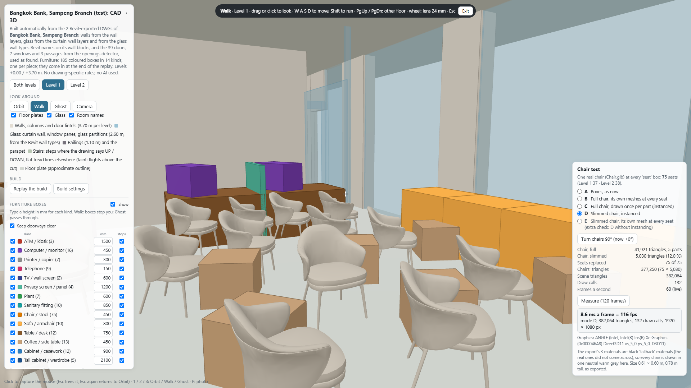

# Chair test: can the walkthrough carry real furniture?

One real chair from the 3D team (`Chair.glb`, one chair of a round-table set) stands at every chair / stool box of the
bank branch (75 seats: 37 on level 1, 38 on level 2), drawn four ways (plus a fifth as an extra check), and timed on
this laptop.
Open `chair_test.html`: it is the bank page as it is, plus a **Chair test** panel at the bottom right.

## The chair

- glTF 2.0 binary, 1.84 MB: 5 parts, **41,921 triangles**, 41,598 vertices. That is as many triangles as 3,500 of our boxes.
- Positions and normals only. No texture coordinates are declared (the vertex data has 8 spare bytes per vertex that look
  like texture coordinates, but the file does not say so), no textures.
- 3 materials, all called `fallback Material` and all black: the real materials did not come across. The test draws every
  chair in one neutral warm grey instead.
- It was exported where it stood in its Max scene: turned 60° and about 26 m from the origin, with a 0.38 scale on it. The
  page undoes the turn and the position, keeps the scale, centres the chair and puts it on the floor: 0.61 m wide,
  0.60 m deep, 0.78 m tall. Its seat faces Max's -Y, the same way the CAD blocks are drawn.

**Slimmed once** in Node with three.js's SimplifyModifier (`slim_chair.mjs`, 25 ms): **5,030 triangles (12 %)**, 2,576
vertices, 61 KB. `chair_full_vs_slimmed.png` shows the two side by side under the same light. From a few metres away
you can't tell them apart. Close up, the slimmed chair shows a few flat facets on the back and the seat edge, and the
seam lines are gone.

## Results

The ways of drawing (the radio buttons in the panel):
**A** boxes, as now. **B** the full chair, a separate copy at every seat (what a plain import does).
**C** the full chair, instanced (each part drawn once for all the chairs on a level). **D** the slimmed chair, instanced.
**E** (an extra check) the slimmed chair, a separate copy at every seat.

All numbers are at 1920 × 1080. Each one is the median of three Measures of 120 frames. Milliseconds a frame / frames a
second, as Measure reports them:

| View | Way | Triangles | Draw calls | Intel Iris Xe (what Edge uses) | NVIDIA MX570 A |
|---|---|---:|---:|---:|---:|
| Orbit, both levels | A boxes | 6,434 | 401 | 6.7 ms / 148 fps | 2.0 ms / 510 fps |
| | B full, copies | 3,149,609 | 626 | 10.8 ms / 92 fps | 4.3 ms / 234 fps |
| | C full, instanced | 3,149,609 | 261 | **18.8 ms / 53 fps** | 3.8 ms / 267 fps |
| | D slimmed, instanced | 382,784 | 253 | 6.6 ms / 152 fps | 1.8 ms / 553 fps |
| | E slimmed, copies | 382,784 | 326 | 4.9 ms / 205 fps | 3.9 ms / 258 fps |
| Walk, level 1 lounge | A boxes | 5,198 | 194 | 8.0 ms / 124 fps | 3.1 ms / 321 fps |
| | B full, copies | 1,270,736 | 280 | 8.3 ms / 121 fps | 3.1 ms / 326 fps |
| | C full, instanced | 3,148,889 | 140 | **19.6 ms / 51 fps** | 3.7 ms / 268 fps |
| | D slimmed, instanced | 382,064 | 132 | 8.4 ms / 119 fps | 2.1 ms / 483 fps |
| | E slimmed, copies | 165,774 | 162 | 7.0 ms / 144 fps | 2.6 ms / 391 fps |

The graphics chips, as WebGL names them: `ANGLE (Intel, Intel(R) Iris(R) Xe Graphics (0x000046A8) Direct3D11 vs_5_0
ps_5_0, D3D11)` and `ANGLE (NVIDIA, NVIDIA GeForce MX570 A (0x000025AA) Direct3D11 vs_5_0 ps_5_0, D3D11)`.
The page's live counter, which cannot go above the screen's 60, showed 60 everywhere except mode C on the Intel chip:
57 in Orbit and 48 in Walk. In Walk, B and E draw fewer triangles because chairs out of sight are skipped one by one; an
instanced group is drawn whole.

Measure finishes each frame on the chip before it starts the next, so its numbers are a little worse than normal use.
Anything over 16.7 ms a frame cannot hold 60 frames a second. Other work was running on the machine: the CPU was 12 %
busy before Edge started, 21 % on average during the Intel run (56 % at most) and 31 % during the NVIDIA run (79 % at
most). Runs of the same mode differed by up to 1 - 2 ms, so read the numbers as a guide.

## What it means for the furniture step

- **Triangles are what counts.** 75 full chairs make 3.1 million triangles, already more than the plan's 2 million
  laptop budget, and the bank has 185 pieces. On the Intel chip they held 60 frames a second only as plain copies. A
  weaker laptop would probably not manage it.
- **Slimming works.** At 12 % the chair looks the same at walkthrough distance, and 75 of them cost about what the boxes
  cost, on both chips. At about 5,000 triangles a piece, all 185 pieces of the bank would be about 0.9 million triangles,
  well inside the budget. So: slim every model once on import, to about 5,000 triangles for a chair.
- **Instancing is not a cure.** It saves draw calls, but the chip still draws every triangle. On the Intel chip the
  instanced full chairs were *slower* than plain copies (18.8 ms against 10.8 ms), and the chip itself took about twice
  as long over them. Merging the chair's 5 parts into one, or unpacking its vertex data, did not change that
  (`check_instancing.mjs`). On the NVIDIA chip instancing helped a little. With the slimmed chair both ways stay well
  under 16.7 ms on both chips, though on the Intel chip plain copies were still a little faster (E against D: 4.9
  against 6.6 ms in Orbit, 7.0 against 8.4 ms in Walk). Keep instancing for identical pieces, but only after slimming.
- **Which way the chairs face.** Each chair takes its box's turn, but that turn comes from the outline drawn in the CAD,
  folded into 0 - 180° (a box looks the same turned round). For a near-square chair it cannot even tell the front from
  the side, so many chairs face the wrong way. In the level 1 meeting room, two of the four chairs face away from the
  table. The **Turn chairs 90°** button turns them all at once, so it cannot fix single chairs. Placing real models needs
  each block's own rotation and mirror from the drawing (the furniture list has the DXF handle of 174 of the 185
  pieces, all 75 seats among them, so these can be read back; the other 11 sit inside another block or are loose
  shapes).

## For the 3D team: how to export each model

- **One piece per file, at the origin** (0, 0, 0), not where it stands in the Max scene (this chair came out 26 m away and
  turned 60°). A table set comes as one table and one chair.
- **Facing one fixed direction:** seat front towards Max's -Y (the Front view), the way the CAD and Revit blocks are drawn.
- **Base on the floor** (z = 0), real size, with no scale left on the object (this one carries 0.38). Z up as usual: the
  glTF exporter turns it.
- **Materials converted from V-Ray / Corona to Physical Material** before exporting, so the colours and textures come
  across (in this file all three came out black).
- **Texture coordinates kept** (the UVW map), with the textures packed in the GLB.
- **File named after the CAD family** (for example `mollie_chair_a685_revit - A685 2.glb`), so it can be matched to the
  boxes.

## Trying it on another laptop

1. Copy `chair_test.html` (3.2 MB; the chair is inside it). It needs the internet, like the other prototype pages
   (three.js comes from the web).
2. Open it in Edge or Chrome, full screen (F11). Numbers compare with the table above only at 1920 × 1080.
3. On the start card, click **Skip: show the finished model**.
4. In the Chair test panel, pick **A**, wait two seconds and press **Measure**. The page freezes for a few seconds while
   it draws 120 frames, then shows milliseconds a frame and frames a second. Do the same for B, C, D and E.
5. For the Walk view in the table, add this to the end of the page's address in the address bar and press Enter (it
   skips the start card): `?build=0&mode=walk&floor=L1&x=0&z=5.2&yaw=-26.6&pitch=-8`
6. The **Graphics** line names the chip that did the drawing. If it says `SwiftShader`, no graphics chip was used and the
   numbers mean little.

## Files

- `chair_test.html`: the test page. `chair_compare.html`: the two chairs side by side (drag to turn them);
  `chair_full_vs_slimmed.png` is a screenshot of it.
- `slim_chair.mjs` writes `chair_slim.json` (`node slim_chair.mjs`). It reads three.js 0.186.1 from `../app/node_modules`
  and installs nothing.
- `make_chair_test.mjs` builds both pages (`node make_chair_test.mjs`). It reads `../bank_test/bank_3d_preview.html`
  without changing it. The copy gets a new tab title and one script added before its end; everything else is the bank
  page byte for byte. The pieces it adds are `chair_load.js`, `chair_test_module.js` and `chair_compare_module.js`.
- `measure_chairs.mjs` runs the timing in headless Edge, with no window on screen (`node measure_chairs.mjs`; add
  `ADAPTER=nvidia` for the NVIDIA chip). It writes `measure_results_<chip>.json`: here `measure_results_intel.json` and
  `measure_results_nvidia.json`.
  `check_instancing.mjs` times the extra ways of drawing the full chair. `browser.mjs` drives Edge and waits its turn
  with the app's one-Edge-at-a-time lock.
