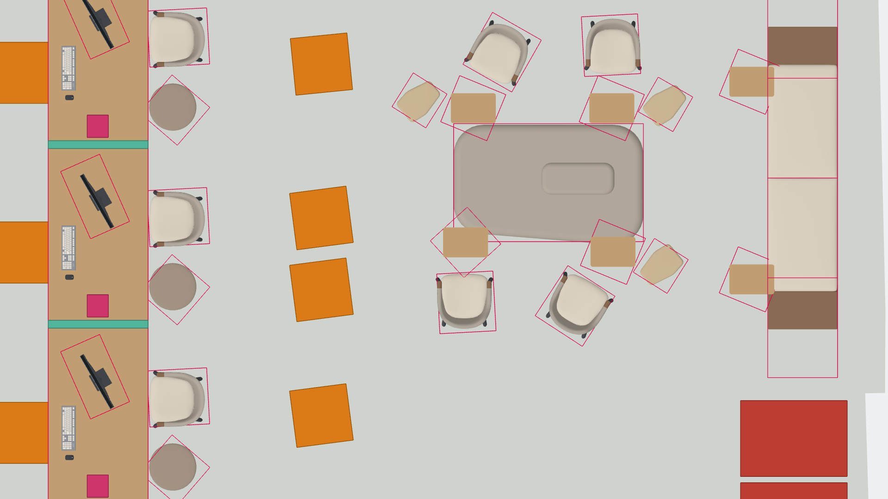

# The bank's own furniture in the browser: how much detail it needs

The 3D team sent their furniture for this very project, the bank branch (Bangkok Bank Sampeng): eight models in `banquet/`. They were put on the bank page at every piece of their families, drawn at full detail and slimmed, timed on this laptop, judged by eye, and then checked again independently. This page is the summary. The details are in `RESULTS.md` (the timings), `analysis.md` (what the files hold and where each belongs) and `judge/JUDGE.md` (the pictures).

**In short:** real furniture works in the browser if every model is slimmed once on import to a few thousand triangles. Full detail does not: the bank's own visitor chair alone is 241,326 triangles.

## What was tested

- **The models:** 8 files (9.2 MB): banquet, monitor, side table, sofa, stool, two visitor chairs and a working table. They belong to 8 of the bank's 54 families and stand at 65 of its 185 pieces. All 23 of their materials came out black, so the page draws each part in one plain colour.
- **On the page** (`bank_furnished.html`: the bank page plus a Furniture test panel): each model stands at every piece of its family (65 pieces, 62 copies, because the banquet is one bench for a run of four), placed and turned by that piece's CAD block. The other 120 pieces stay boxes.
- **Ways of drawing:** A boxes; B full detail; C slimmed to 20,000 / 10,000 / 5,000 / 2,500 triangles a piece; D full detail close by and 5,000 further away; E only the heavy chair slimmed; P all 185 pieces with a model (a projection of the whole bank).
- **Timed** on this laptop at 1920 × 1080 on both graphics chips, in Orbit and in Walk views. Each number is the middle of three Measures of 120 frames.
- **Judged by eye:** each model, and the chair test's chair, slimmed to several levels and shown beside the original at walking distance (3 m) and close up.
- **Checked independently** afterwards (see the end of this page).

## Results

Milliseconds a frame: less is better, and over 16.7 ms the picture can no longer keep up 60 frames a second. "Widest view" is the Walk view on level 1 with the most furniture in sight. The first number is from the build; the re-check is in brackets.

| Way | Model triangles | Download | Intel chip: Orbit | Intel chip: widest view | NVIDIA chip: Orbit / widest | How it looks |
|---|---:|---:|---:|---:|---:|---|
| A boxes, as now | 0 | 0 | 8.9 (8.7 - 9.7) | 11.4 (11.2 - 12.1) | 4.0 / 5.2 | boxes |
| B full detail, the 65 pieces | 4.89 million | 9.2 MB | 14.2 (12.6 - 14.6) | 16.1 (13.8 - 14.9) | 7.3 / 8.3 | as exported |
| C 20,000 a piece | 0.69 million | 2.0 MB | 10.7 | 12.3 | 6.3 / 7.0 | the same as full, even close up |
| C 10,000 a piece | 0.41 million | 1.3 MB | 11.2 | 13.8 | 4.9 / 6.8 | fine close up |
| C 5,000 a piece | 0.23 million | 0.9 MB | 10.7 (10.6 - 11.0) | 12.8 (12.6 - 15.9) | 6.9 / 6.9 | the same at 3 m; a chair's backrest a little lumpy close up |
| C 2,500 a piece | 0.13 million | 0.5 MB | 10.3 | 12.9 | 6.7 / 7.5 | lumps on the chair even at 3 m |
| P whole bank (185 pieces), full detail | 7.05 million | 11 MB | 15.3 - 23.3 (22.0) | **18.4 (17.5)** | 15.1 / **16.3** | too heavy |
| P whole bank, 10,000 a piece | 1.17 million | 1.6 MB | 14.2 (14.0) | 15.7 (14.7) | 11.5 / 12.9 | as C |
| P whole bank, 5,000 a piece | 0.77 million | 1.1 MB | 14.5 (13.8) | 14.5 (14.2) | 9.4 / 12.5 | as C |

- **Full detail is too heavy.**
  - The eight families alone are 4.89 million triangles, 2.4 times the laptop budget of 2 million, and 9.2 MB to download (7.7 MB of it one chair).
  - With every piece at that detail, the widest view took 17.5 - 18.4 ms on the Intel chip and 16.3 ms on the NVIDIA chip, and Orbit up to 23 ms when the laptop was busy. That is not smooth.
- **Once slimmed, the number hardly matters for speed.** From 20,000 down to 2,500 a piece, every way ran within the noise of the others (about 2 ms) on both chips. So the number a model is slimmed to is a question of looks and download size.
- **One chair decides.** The mollie chair (visitor chair01, 19 pieces) is 94 % of all the triangles. Slimmed to 4,940 it looks the same at 3 m; at 19,744 you cannot tell it apart even standing at it (`judge/visitor_chair01.png`).
- **Level of detail (way D) did not help speed.** It was no faster than slimming everything, and it needs the full models downloaded.

## The recommended spec

Each model gets two copies for the browser, made once on import. The original stays in the library for Max.

| Kind | Every piece | Close-up copy (within 2 m, and on Ultra) |
|---|---:|---:|
| Chair (task, visitor, dining, small armchair) | 5,000 | 10,000 |
| Stool, pouf | 3,000 | 6,000 |
| Sofa, bench | 5,000 | 10,000 |
| Table, desk, side table | 2,000 | 4,000 |
| Monitor, small electronics | 2,500 | 5,000 |

Kinds not seen yet, by likeness: cabinet 2,000; plant 5,000; sanitary fitting 2,500; ATM 5,000; TV or privacy screen 500. Their close-up copy is twice that.

- **At or below its kind's number,** a model is used as it is. The light models lost their shape quickly when slimmed: the 104-triangle desk could lose nothing.
- **Above it,** a model is slimmed once to the number and the computer compares it with the original: no gap over 3 mm, the same outline from the front, the side and the top, and the surface kept. If it fails, 1.5, 2 and 3 times the number are tried; if all fail, the model is flagged for the 3D team.
- **Someone looks at each model once** on the Library page. The computer's comparison misses shading faults, such as a streak on the round stool at 2,500 or faint bands on the monitor's screen.
- **At this spec** the bank's furniture comes to about 0.69 million triangles at the busiest place, a third of the budget. These eight families are about 1 MB to download, before textures (none came with these files, so textures are not measured yet).

## What it means for the application

- **Budget:** the 2 million triangles for a laptop still hold. Slimmed furniture uses about a third; full detail would use all of it and more.
- **Slimming on import:** yes, automatically, with the comparison and one look by eye. The slimming itself takes a fraction of a second; with the comparison, about a minute a model.
- **Level of detail:** yes, but switching to the close-up copy, not the original, for the pieces within 2 m of you. The switching was smooth in the test, with no frame over 33 ms.
- **Ultra setting:** the close-up copy everywhere, about 1.3 million triangles for the bank (the whole bank at 10,000 a piece ran at 14 - 16 ms here). Never the original. This changes plan section 2.5, which says the full model is shown close up and on Ultra.
- **Copies or instancing:** plain copies, as the plan says; in the chair test, instancing was slower on the Intel chip. Also merge a model's parts that share a material on import, so there are fewer separate meshes to draw. That gain was not measured on its own.
- **Downloads** are counted per family, not per piece: each family's model is sent once, however many pieces use it.

## Which way the furniture faces

Each box's turn comes from the outline drawn in the CAD, folded into 0 - 180°, so it cannot tell front from back. Using it to turn the models:
- Of the 5 models whose turn could be checked, the box turn was right for 2 (one of them only because a backless bench looks the same turned round), a quarter turn off for 2 (the mollie chair and the bench with a back) and a half turn off for 1 (the monitor).
- Across the 65 pieces, 10 of the 19 mollie chairs, 2 of the 16 monitors and 1 of the 3 benches would face backwards.

Turned by **the CAD block's own turn** (read back from the drawing for each piece), every piece came out right:
- all 19 mollie chairs face a desk, a table or a counter;
- all 16 screens face the staff chair;
- all 5 desks have their visitor side towards the visitor chair.

The application also has to do two things:
- **Revit's flips:** no block is mirrored in the drawing itself, but Revit draws a flipped piece as a mirror image inside its block. That is 26 pieces in 9 families here, 9 of them mollie chairs. Each piece's drawing must be compared with its family's, as this page does.
- **Place by the block's insertion point, not the box centre:** the box is only the drawn outline; the insertion point is where the family sits. Placed that way, the monitor's screen lands exactly where the CAD draws it.

174 of the bank's 185 pieces carry the drawing handle needed for this. The other 11 sit inside another block or are loose lines; none of them is in these 8 families.

## Trying the page and pressing Measure

1. Open `bank_furnished.html` in Edge by double-clicking it. It is 20 MB because the models are inside it, and it needs the internet, like the other prototype pages.
2. Make the window full screen (F11). The numbers only compare with the table at 1920 × 1080.
3. On the start card, click **Skip: show the finished model**.
4. In the **Furniture test** panel at the bottom right, pick a way (A to E, plus a budget button for C), wait two seconds and press **Measure (120 frames)**. The page freezes for a few seconds, then shows milliseconds a frame and frames a second. Then try the next way.
5. For the widest Walk view, add this to the end of the page's address and press Enter: `?build=0&mode=walk&floor=L1&x=3.00&z=5.60&yaw=36&pitch=-8`
6. The **Graphics** line at the bottom of the panel names the chip that did the drawing. Edge uses the Intel chip unless told otherwise. For the NVIDIA chip: Windows Settings > System > Display > Graphics, pick Microsoft Edge, set it to High performance, and restart Edge.

The numbers move by 1 - 2 ms from run to run, and more when other programs are busy. Compare ways measured one after the other, not with numbers from another day.

## How sure this is: the independent check

- **Which piece each file belongs to:** worked out again from scratch, from the 3D files and the bank model. It gives the same pieces at the same distances (the working table 2 mm from its piece, the mollie chair 19 mm) and the same three doubtful files (sofa, stool, side table).
- **Placement on the page:**
  - Every one of the 62 copies stands on its box: its bottom within 3 mm of the floor or desk top, and all of it inside the box, except the monitor's keyboard, which the CAD draws elsewhere.
  - Desks and screens face exactly the way their blocks say, and the chairs within 4°.
  - The slimmed copies stand within about 1 mm of the full ones.
  - Seen from above, every model sits on its CAD box (`recheck/plan_*.png`; one is at the top of this page).
- **Boxes:** the 65 replaced boxes are hidden but still stop you in Walk, at exactly the same place as when they are shown. The other 120 boxes are untouched, Ghost still flies through, and Orbit still turns.
- **Panel counts:** the triangles and draw calls in the panel equal what the graphics chip was asked to draw, in every way.
- **Timings:** the Intel Measures were run again (A, B, C 5,000 and P, in three views). 22 of the 27 numbers are within 1.5 ms of the build's; the others came during busy moments on the laptop. The CPU was 11 - 23 % busy before Edge started and 18 - 54 % on average during the Measures (76 % at most). Every conclusion above held. The same boxes on the chair test's page took 8.3 ms now against 6.7 ms this morning: the laptop itself varies by about 2 ms.
- **The pictures:** the check agrees with the judge's verdicts. The monitor's sheet did not show the 5,000 level that its verdict rests on; it does now.
- **Three things fixed:** the monitor sheet; how `measure_furnished.mjs` records the CPU load (it now takes the shared Edge lock first, so waiting for other sessions no longer counts); and notes about this in `RESULTS.md`.

## Files

- `bank_furnished.html`: the test page. `bank_furnished_module.js` is its module; `make_bank_furnished.mjs` builds it.
- `RESULTS.md`: all the timings, how they were taken, and the build's scripts and data files.
- `analysis.md`, `analysis.json`, `models_on_drawing.png`, `models_in_block_frames.png`: what the eight files hold, where each one belongs and which way it faces.
- `judge/JUDGE.md` and the picture sheets `judge/*.png`: how far each model can be slimmed.
- `recheck/`: the independent check. `recheck_results.json` holds all its numbers, `plan_*.png` the pictures from above. `recheck.mjs` (with `page_helpers.js`) runs the browser checks and Measures inside the shared Edge lock; `rederive.py` and `semantic.py` redo the matches and the facing check.
- `FEEDBACK_FOR_3D_TEAM.md`: what to change in the next batch of exports.
