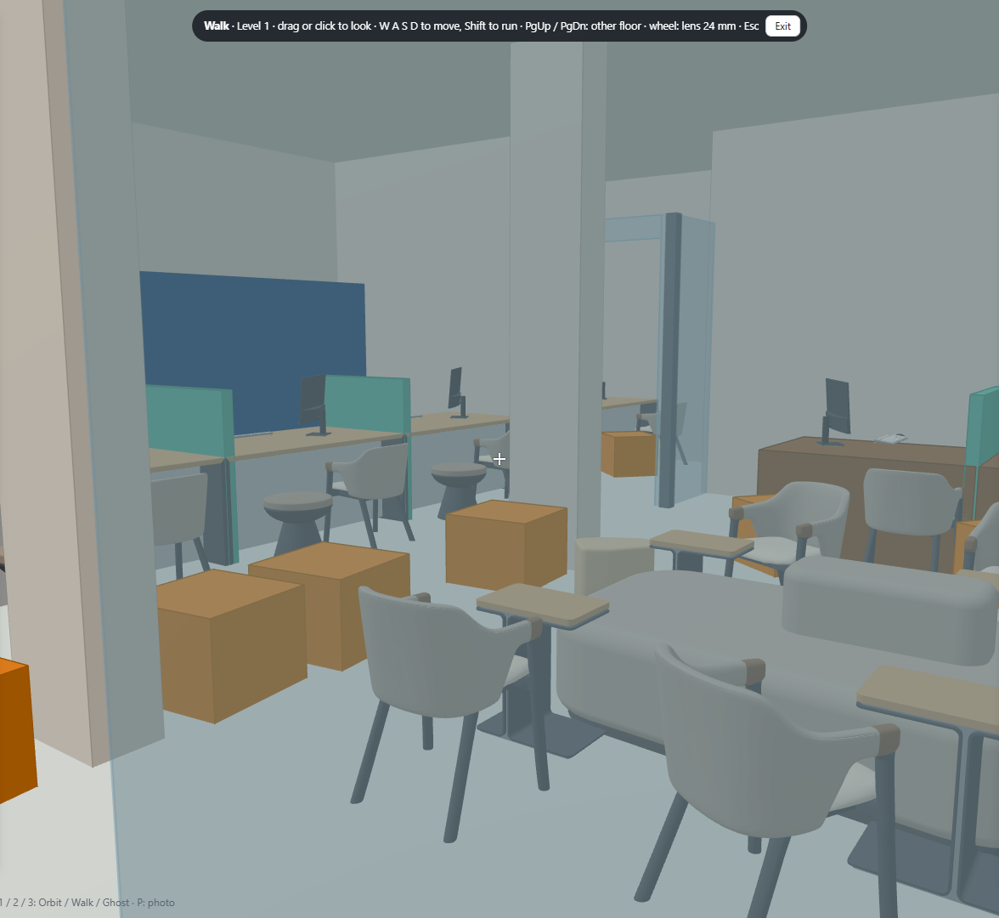
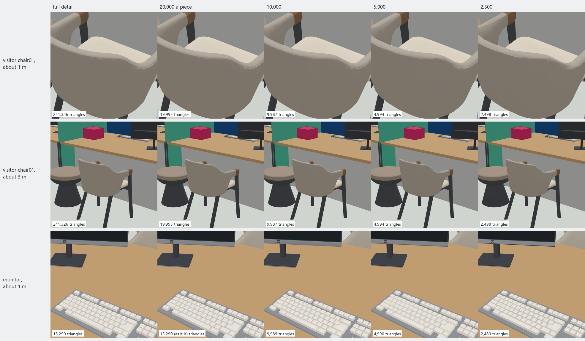

# The bank's own furniture in the browser: how much detail it can carry

The 3D team's eight models of this very project (`banquet/`, the bank branch Bangkok Bank Sampeng) stand at the 65 pieces of
their eight families in the bank page, and the page was timed on this laptop on both graphics chips at 1920 × 1080: at full
detail, slimmed to 20,000 / 10,000 / 5,000 / 2,500 triangles a piece, with a level of detail, with only the one heavy chair
slimmed, and (as a projection) with a model at every one of the bank's 185 pieces.
Open `bank_furnished.html`: it is the bank page as it is, plus a **Furniture test** panel at the bottom right.

## The answer for the furniture step (from the timings; the spec per kind, with the judge's pictures and the independent check, is in README.md)

- **Full detail is not a default.** These eight families alone are 4.89 million triangles at their 65 pieces (2.4 times the
  plan's 2 million laptop budget), and 9.2 MB to download, of which 7.7 MB is one chair. This laptop still drew them (Orbit:
  14.2 ms a frame on the Intel chip, 7.3 ms on the NVIDIA chip), but with a model of the same kind of detail at all 185 pieces
  (7.1 million triangles) the Walk view with the most models in sight took 18.4 ms (Intel) and 16.3 ms (NVIDIA): over the
  16.7 ms that 60 frames a second allow, on a laptop that was half busy with other work. When it was busier still (CPU 93 %
  busy) the whole bank at full detail took 23.3 ms a frame in Orbit on the Intel chip. A weaker or busier client laptop would
  stutter.
- **Slim every model once on import to 10,000 triangles a piece, never more than 20,000.** At 10,000 the mollie chair (241,326
  triangles as it came) looks like the full one even from 1 m (`slimmed_closeup.png`); the whole bank would be 1.2 million
  triangles (1.9 million at 20,000, just inside the budget). On both chips the four budgets measured the same within the
  noise, so the budget is a question of looks and download, not of frame time. 5,000 is enough for pieces seen from walking
  distance (at 3 m nothing shows); at 1 m the chair's backrest rim gets a little wavy at 5,000 and faceted at 2,500.
- **Below about a million triangles, the number of meshes costs more than the triangles.** On the Intel chip a plane through
  the 13 Orbit Measures gives 0.44 ms per million triangles but 1.1 ms per hundred draw calls. With every piece furnished (182
  copies, 765 draw calls instead of 553) the Orbit frames at the same 2,500 budget were 1.2 - 2.1 ms longer on the Intel chip
  and 2.4 - 6.6 ms longer on the NVIDIA chip (two runs each), and with all 185 pieces furnished the budget below 20,000 made
  no steady difference any more.
  So on import also **merge a model's parts that share a material** (here 28 parts in 23 materials; the working table's 3
  parts share one) and keep the parts of a model few.
- **Level of detail is not needed for speed.** Full within 3 m and 5,000 beyond (way D) was no faster than 5,000 everywhere,
  and switching was smooth (no frame over 33 ms in six walks through the busiest spots), but it needs the full models
  downloaded (9.7 MB against 0.9 MB). Keep full detail for the **Ultra** setting or for a piece the client walks up to, loaded
  on demand.
- **One outlier decides.** The mollie chair (visitor chair01) is 94 % of the triangles and 84 % of the bytes of the eight
  files; slimming it alone (way E, 0.5 million triangles) gave almost the frame times of slimming all (at most 1.5 ms more).
- **Loading is not the problem on the laptop itself:** the eight full GLBs were decoded in 35 ms and put on the chip in about
  50 ms; the first frame with them came 0.4 - 0.65 s after opening the page (from disk). Over a network the bytes count:
  9.2 MB (4.9 MB gzipped) at full detail, 1.3 MB at 10,000, 0.9 MB (0.5 MB gzipped) at 5,000. On the chip they take 9.2 MB of
  buffers at full detail, 0.9 MB at 5,000; no textures yet, since none came with the files.

## The page

`bank_furnished.html` (20 MB; everything is inside it, three.js still comes from the web as on the other prototype pages) is
`bank_test/bank_3d_preview.html` byte for byte, with its title changed and, before its end, the models as base64 text blocks
and one module (`bank_furnished_module.js`).

- **Where the models go.** Each model is normalised once (its place and turn in the team's Max scene undone against its own
  piece, with the analysis's block-frame matrix) and put at every piece of its family by that piece's CAD block: insertion
  point, turn and Revit's baked-in mirror (`placements.json`, from `analysis.json` and the analysis step's INSERT reading). The
  sofa, stool and side table use the analysis's suggested placement (their exports did not stand on their pieces); the banquet
  is **one** 3 m bench for its run of four DIOR modules. 65 pieces get 62 copies; at its own piece each unsuggested model lands
  within 0.002 mm of where it was exported, and every piece's box sits in the same place of its block (within 9 mm).
  Those pieces' boxes are not drawn but stay Walk's colliders; the other 120 pieces stay boxes. A typed height moves what
  stands on a box (a monitor follows its desk). Known from the analysis and visible in the page: at L2-computer-001 to -003 the
  monitor's keyboard and mouse stand past the edge of the 0.6 m deep work cabinet.
- **Materials.** All 23 materials of the eight files came out as black 'fallback' materials, so each model part is drawn in one
  neutral colour of its own (calm greys and warm tones: oak top, charcoal legs, linen cushions ...); the panel says so and shows
  the swatches.
- **Ways of drawing** (radio buttons): **A** boxes, as now; **B** full detail, plain copies (each piece its own meshes, sharing
  the model's geometry); **C** slimmed to a budget a piece, plain copies, with buttons for 20,000 / 10,000 / 5,000 / 2,500 (a
  model under the budget is drawn as it is); **D** level of detail (three's LOD: full within 3 m of the camera, the 5,000
  version beyond, 10 % hysteresis); **E** full detail, but visitor chair01 at 10,000; **P** (extra check, the projection below)
  all 185 pieces with a model. A way's models are decoded when it is first picked and put on the chip before its first frame.
- **The panel** shows per model the pieces it furnishes and its triangles (full, and in the way shown), the models' and the
  scene's triangles, draw calls, live frames a second, the download for this way (GLB bytes and gzipped; all ways under
  'Download for the models, per way'), the models' buffers on the chip, how long the last switch took (decode, upload),
  **Measure** (as the chair test: 120 frames back to back, each finished on the chip with a 1-pixel `readPixels`) and the
  graphics chip's name.
- Address: `?furniture=A|B|C|D|E|P&budget=full|20000|10000|5000|2500`. Test hook: `window.__bankFurnished`.

## The models, full and slimmed

Slimmed once in Node (`slim_models.mjs`, 14 s for all) with three.js 0.186.1's `SimplifyModifier` (meshoptimizer), part by
part: the budget is shared out by triangles, each part welded by position (0.1 mm), slimmed, its normals worked out again
(creased at 40°), and written as a GLB already in its piece's frame. Chair.glb (the chair test's chair) was slimmed the same
way for the projection.

<!-- table:slim -->
| Model | Pieces | Full | 20,000 | 10,000 | 5,000 | 2,500 | GLB full | at 10,000 | at 5,000 |
|---|---:|---:|---:|---:|---:|---:|---:|---:|---:|
| banquet | 4 | 4,720 | as it is | as it is | as it is | 2,496 (52.88 %) | 0.16 MB | 0.16 MB | 0.16 MB |
| monitor | 16 | 15,290 | as it is | 9,989 (65.33 %) | 4,990 (32.64 %) | 2,489 (16.28 %) | 0.90 MB | 0.42 MB | 0.23 MB |
| side table | 9 | 1,564 | as it is | as it is | as it is | as it is | 0.08 MB | 0.08 MB | 0.08 MB |
| sofa | 3 | 2,223 | as it is | as it is | as it is | as it is | 0.07 MB | 0.07 MB | 0.07 MB |
| stool | 5 | 2,680 | as it is | as it is | as it is | 2,498 (93.21 %) | 0.09 MB | 0.09 MB | 0.09 MB |
| visitor chair01 | 19 | 241,326 | 19,993 (8.28 %) | 9,987 (4.14 %) | 4,994 (2.07 %) | 2,498 (1.04 %) | 7.73 MB | 0.29 MB | 0.16 MB |
| visitor chair02 | 4 | 6,084 | as it is | as it is | 4,998 (82.15 %) | 2,498 (41.06 %) | 0.18 MB | 0.18 MB | 0.09 MB |
| working table | 5 | 104 | as it is | as it is | as it is | as it is | 0.01 MB | 0.01 MB | 0.01 MB |
| Chair.glb (chair test; projection only) |  | 41,921 | 19,990 (47.68 %) | 9,986 (23.82 %) | 4,991 (11.91 %) | 2,497 (5.96 %) | 1.75 MB | 0.27 MB | 0.16 MB |
<!-- /table:slim -->

From 3 m the five versions cannot be told apart. At 1 m, 20,000 is the full chair; 10,000 nearly; at 5,000 the top of the
backrest gets slightly wavy; at 2,500 it is faceted. The monitor's keyboard (11,440 triangles of keys) still reads as a
keyboard at 2,489 triangles for the whole monitor; only the key bevels and the logo soften.

## Frame times

1920 × 1080, Edge headless with `--use-angle=d3d11` (the Intel chip, which Edge uses by default) and with
`--use-adapter-luid=0,61888` read from edge://gpu (the NVIDIA chip). Each number is the median of three Measures of 120
frames; milliseconds a frame / frames a second. 'Models' triangles' are all the copies in the scene; 'triangles drawn' are what
the chip drew after leaving out what is out of sight (renderer.info); in way D, '(4 full)' counts the models within 3 m, drawn
at full detail. 'CPU %' is the whole machine's load during that row's Measures. Anything over 16.7 ms cannot hold 60 frames a second;
Measure waits for each frame to finish, so it reads a little worse than normal use. The live counter (capped by the screen at
60) showed 60 everywhere except way P at full detail and at 20,000 in the widest level 1 view on the Intel chip (56 and 58).

The graphics chips, as WebGL names them: `ANGLE (Intel, Intel(R) Iris(R) Xe Graphics (0x000046A8) Direct3D11 vs_5_0 ps_5_0,
D3D11)` and `ANGLE (NVIDIA, NVIDIA GeForce MX570 A (0x000025AA) Direct3D11 vs_5_0 ps_5_0, D3D11)`.

**Where the Walk views are** (bank model coordinates, which are the DWG's less 1.212 m east and 0.348 m north; eye 1.6 m,
looking 8° down; `walk_spots.json`, `find_walk_spots.py`):
- **L1 busiest**: the spot with the most model triangles within 3 m: (0.60, -0.40), between the row of desks and the manager's
  room, looking east into the glass-walled MO 4 PAX room. 17 models within 3 m (7 mollie chairs, 2 VISIONA stools, 2 SE104
  stools, 3 side tables, 2 monitors, the SE107 bench; 1.74 million triangles at full detail), 9 in view.
- **L2 busiest**: (-1.40, 1.40), by the CSO 5PAX desk, looking south along the counter: 7 models within 3 m (4 mollie chairs,
  3 monitors; 1.01 million triangles), 9 in view (5 mollie chairs, 3 monitors, a side table).
- **L1 widest** (an extra: the spot and direction with the most model triangles in view): (3.00, -5.60) by the lift hall,
  looking north-west over the lounge and the desks through the glass of the waiting area: 27 models in view, all 11 of level
  1's mollie chairs among them.
- **L2 widest**: (-1.80, -6.20) by the lift hall and the pantry, looking north-west along the counter: 12 models in view (6
  mollie chairs, 6 monitors).

<!-- table:frames -->
| View | Way | Models' triangles | Triangles drawn | Draw calls | Intel Iris Xe | NVIDIA MX570 A | CPU % (Intel / NVIDIA) |
|---|---|---:|---:|---:|---:|---:|---:|
| Orbit, both levels | A boxes | 0 | 6,434 | 401 | 8.9 ms / 112 fps | 4.0 ms / 247 fps | 32 / 54 |
|  | B full, copies | 4,893,555 | 4,899,209 | 553 | 14.2 ms / 71 fps | 7.3 ms / 136 fps | 31 / 53 |
|  | C 20,000 | 688,228 | 693,882 | 553 | 10.7 ms / 94 fps | 6.3 ms / 160 fps | 35 / 64 |
|  | C 10,000 | 413,298 | 418,952 | 553 | 11.2 ms / 89 fps | 4.9 ms / 204 fps | 37 / 44 |
|  | C 5,000 | 234,103 | 239,757 | 553 | 10.7 ms / 93 fps | 6.9 ms / 146 fps | 35 / 68 |
|  | C 2,500 | 133,529 | 139,183 | 553 | 10.3 ms / 97 fps | 6.7 ms / 150 fps | 34 / 59 |
|  | D level of detail | 234,103 | 239,757 | 553 | 11.3 ms / 88 fps | 6.5 ms / 153 fps | 29 / 47 |
|  | E chair01 at 10,000 | 498,114 | 503,768 | 553 | 11.6 ms / 86 fps | 7.0 ms / 143 fps | 33 / 49 |
|  | P all 185, full | 7,051,863 | 7,056,077 | 765 | 15.3 ms / 65 fps | 15.1 ms / 66 fps | 34 / 58 |
|  | P all 185, 20,000 | 1,881,572 | 1,885,786 | 765 | 14.6 ms / 69 fps | 15.3 ms / 65 fps | 36 / 77 |
|  | P all 185, 10,000 | 1,166,466 | 1,170,680 | 765 | 14.2 ms / 71 fps | 11.5 ms / 87 fps | 37 / 66 |
|  | P all 185, 5,000 | 767,491 | 771,705 | 765 | 14.5 ms / 69 fps | 9.4 ms / 107 fps | 39 / 54 |
|  | P all 185, 2,500 | 412,621 | 416,835 | 765 | 12.4 ms / 81 fps | 9.1 ms / 109 fps | 35 / 55 |
| Walk, L1 busiest | A boxes | 0 | 4,388 | 69 | 8.3 ms / 121 fps | 3.5 ms / 290 fps | 31 / 67 |
|  | B full, copies | 4,893,555 | 756,251 | 78 | 9.2 ms / 109 fps | 4.8 ms / 207 fps | 39 / 71 |
|  | C 20,000 | 688,228 | 92,252 | 78 | 8.8 ms / 114 fps | 4.5 ms / 220 fps | 36 / 62 |
|  | C 10,000 | 413,298 | 56,933 | 78 | 7.3 ms / 136 fps | 4.1 ms / 245 fps | 37 / 49 |
|  | C 5,000 | 234,103 | 36,955 | 78 | 8.3 ms / 121 fps | 4.9 ms / 205 fps | 32 / 90 |
|  | C 2,500 | 133,529 | 24,560 | 78 | 8.7 ms / 115 fps | 4.7 ms / 213 fps | 32 / 47 |
|  | D level of detail (4 full) | 953,399 | 509,619 | 78 | 9.8 ms / 102 fps | 6.0 ms / 167 fps | 36 / 67 |
|  | E chair01 at 10,000 | 498,114 | 62,234 | 78 | 9.2 ms / 109 fps | 3.9 ms / 255 fps | 28 / 39 |
|  | P all 185, full | 7,051,863 | 847,465 | 90 | 10.3 ms / 98 fps | 6.6 ms / 152 fps | 36 / 72 |
|  | P all 185, 20,000 | 1,881,572 | 139,604 | 90 | 11.2 ms / 89 fps | 6.0 ms / 168 fps | 34 / 64 |
|  | P all 185, 10,000 | 1,166,466 | 84,277 | 90 | 10.8 ms / 93 fps | 5.0 ms / 199 fps | 36 / 56 |
|  | P all 185, 5,000 | 767,491 | 54,309 | 90 | 10.6 ms / 94 fps | 4.6 ms / 216 fps | 29 / 48 |
|  | P all 185, 2,500 | 412,621 | 33,512 | 90 | 8.7 ms / 115 fps | 4.7 ms / 215 fps | 31 / 54 |
| Walk, L2 busiest | A boxes | 0 | 4,772 | 134 | 9.7 ms / 103 fps | 4.4 ms / 227 fps | 43 / 68 |
|  | B full, copies | 4,893,555 | 1,511,432 | 167 | 9.8 ms / 102 fps | 6.6 ms / 152 fps | 37 / 62 |
|  | C 20,000 | 688,228 | 183,434 | 167 | 11.5 ms / 87 fps | 6.4 ms / 156 fps | 35 / 74 |
|  | C 10,000 | 413,298 | 107,495 | 167 | 9.7 ms / 103 fps | 6.7 ms / 150 fps | 36 / 66 |
|  | C 5,000 | 234,103 | 62,540 | 167 | 9.6 ms / 105 fps | 6.3 ms / 159 fps | 32 / 69 |
|  | C 2,500 | 133,529 | 39,697 | 167 | 11.3 ms / 89 fps | 6.5 ms / 155 fps | 25 / 54 |
|  | D level of detail (4 full) | 727,367 | 298,872 | 167 | 10.9 ms / 92 fps | 7.0 ms / 142 fps | 24 / 73 |
|  | E chair01 at 10,000 | 498,114 | 123,398 | 167 | 10.2 ms / 98 fps | 5.8 ms / 171 fps | 45 / 57 |
|  | P all 185, full | 7,051,863 | 2,054,310 | 233 | 12.6 ms / 79 fps | 9.8 ms / 102 fps | 38 / 83 |
|  | P all 185, 20,000 | 1,881,572 | 507,002 | 233 | 12.3 ms / 81 fps | 8.5 ms / 118 fps | 35 / 69 |
|  | P all 185, 10,000 | 1,166,466 | 331,023 | 233 | 12.8 ms / 78 fps | 8.9 ms / 112 fps | 35 / 65 |
|  | P all 185, 5,000 | 767,491 | 236,118 | 233 | 11.6 ms / 86 fps | 7.3 ms / 137 fps | 35 / 58 |
|  | P all 185, 2,500 | 412,621 | 130,001 | 233 | 10.3 ms / 97 fps | 4.8 ms / 209 fps | 32 / 45 |
<!-- /table:frames -->

The widest Walk views (the most models in sight):

<!-- table:framesWidest -->
| View | Way | Models' triangles | Triangles drawn | Draw calls | Intel Iris Xe | NVIDIA MX570 A | CPU % (Intel / NVIDIA) |
|---|---|---:|---:|---:|---:|---:|---:|
| Walk, L1 widest | A boxes | 0 | 5,822 | 298 | 11.4 ms / 88 fps | 5.2 ms / 192 fps | 35 / 60 |
|  | B full, copies | 4,893,555 | 3,745,955 | 413 | 16.1 ms / 62 fps | 8.3 ms / 120 fps | 49 / 43 |
|  | C 20,000 | 688,228 | 539,965 | 413 | 12.3 ms / 82 fps | 7.0 ms / 143 fps | 41 / 55 |
|  | C 10,000 | 413,298 | 326,692 | 413 | 13.8 ms / 73 fps | 6.8 ms / 148 fps | 41 / 58 |
|  | C 5,000 | 234,103 | 185,565 | 413 | 12.8 ms / 78 fps | 6.9 ms / 145 fps | 48 / 57 |
|  | C 2,500 | 133,529 | 104,394 | 413 | 12.9 ms / 78 fps | 7.5 ms / 133 fps | 37 / 68 |
|  | D level of detail | 234,103 | 185,565 | 413 | 13.0 ms / 77 fps | 8.7 ms / 115 fps | 44 / 58 |
|  | E chair01 at 10,000 | 498,114 | 395,033 | 413 | 12.6 ms / 79 fps | 8.9 ms / 112 fps | 30 / 56 |
|  | P all 185, full | 7,051,863 | 5,292,468 | 580 | 18.4 ms / 54 fps | 16.3 ms / 61 fps | 37 / 80 |
|  | P all 185, 20,000 | 1,881,572 | 1,408,133 | 580 | 15.2 ms / 66 fps | 14.2 ms / 71 fps | 33 / 71 |
|  | P all 185, 10,000 | 1,166,466 | 885,431 | 580 | 15.7 ms / 64 fps | 12.9 ms / 78 fps | 41 / 68 |
|  | P all 185, 5,000 | 767,491 | 589,798 | 580 | 14.5 ms / 69 fps | 12.5 ms / 80 fps | 30 / 85 |
|  | P all 185, 2,500 | 412,621 | 314,822 | 580 | 13.8 ms / 72 fps | 11.7 ms / 86 fps | 36 / 62 |
| Walk, L2 widest | A boxes | 0 | 5,150 | 186 | 11.6 ms / 86 fps | 5.1 ms / 197 fps | 58 / 47 |
|  | B full, copies | 4,893,555 | 1,804,634 | 264 | 15.8 ms / 63 fps | 8.2 ms / 123 fps | 68 / 58 |
|  | C 20,000 | 688,228 | 307,716 | 264 | 14.3 ms / 70 fps | 8.3 ms / 120 fps | 75 / 83 |
|  | C 10,000 | 413,298 | 182,015 | 264 | 13.5 ms / 74 fps | 7.7 ms / 130 fps | 58 / 85 |
|  | C 5,000 | 234,103 | 93,522 | 264 | 13.8 ms / 73 fps | 7.1 ms / 141 fps | 92 / 58 |
|  | C 2,500 | 133,529 | 49,265 | 264 | 13.0 ms / 77 fps | 8.0 ms / 125 fps | 63 / 72 |
|  | D level of detail (2 full) | 480,735 | 197,678 | 264 | 13.3 ms / 75 fps | 8.0 ms / 126 fps | 50 / 66 |
|  | E chair01 at 10,000 | 498,114 | 240,040 | 264 | 12.2 ms / 82 fps | 7.8 ms / 128 fps | 33 / 79 |
|  | P all 185, full | 7,051,863 | 2,747,536 | 366 | 19.3 ms / 52 fps | 11.4 ms / 88 fps | 58 / 69 |
|  | P all 185, 20,000 | 1,881,572 | 855,860 | 366 | 15.4 ms / 65 fps | 8.8 ms / 114 fps | 53 / 55 |
|  | P all 185, 10,000 | 1,166,466 | 550,087 | 366 | 14.1 ms / 71 fps | 10.3 ms / 97 fps | 48 / 85 |
|  | P all 185, 5,000 | 767,491 | 371,684 | 366 | 15.1 ms / 66 fps | 10.1 ms / 99 fps | 54 / 67 |
|  | P all 185, 2,500 | 412,621 | 193,575 | 366 | 14.3 ms / 70 fps | 10.4 ms / 96 fps | 51 / 82 |
<!-- /table:framesWidest -->

The machine was busy with other work all along (other sessions' browser checks and builds): the CPU was 81 % busy in the 5 s
before the Intel run started (taken before it waited for the shared Edge lock) and 54 % on average from then on, the wait included (16 - 100 %); 76 % and 63 % (24 - 100 %) for the NVIDIA
run. The CPU load of each row is in the table. Runs of the same row differed by up to 3.8 ms (median 1.0 - 1.4 ms), so
differences of 2 ms or less between ways are noise; the NVIDIA numbers suffer more from it (an NVIDIA frame is also copied to
the Intel chip for the screen). The Orbit view was measured again on both chips at the end, as a check of the spread:

<!-- table:repeat -->
| Way | Intel, first run | Intel, again | NVIDIA, first run | NVIDIA, again | CPU % again (Intel / NVIDIA) |
|---|---:|---:|---:|---:|---:|
| A boxes | 8.9 ms | 9.2 ms | 4.0 ms | 3.4 ms | 84 / 46 |
| B full, copies | 14.2 ms | 14.9 ms | 7.3 ms | 6.6 ms | 76 / 45 |
| C 20,000 | 10.7 ms | 12.2 ms | 6.3 ms | 6.2 ms | 64 / 72 |
| C 10,000 | 11.2 ms | 13.0 ms | 4.9 ms | 5.5 ms | 60 / 51 |
| C 5,000 | 10.7 ms | 12.8 ms | 6.9 ms | 6.1 ms | 63 / 59 |
| C 2,500 | 10.3 ms | 12.4 ms | 6.7 ms | 6.2 ms | 70 / 59 |
| D level of detail | 11.3 ms | 13.0 ms | 6.5 ms | 5.6 ms | 66 / 48 |
| E chair01 at 10,000 | 11.6 ms | 13.9 ms | 7.0 ms | 5.7 ms | 66 / 65 |
| P all 185, full | 15.3 ms | 23.3 ms | 15.1 ms | 13.9 ms | 75 / 68 |
| P all 185, 20,000 | 14.6 ms | 16.9 ms | 15.3 ms | 10.4 ms | 66 / 58 |
| P all 185, 10,000 | 14.2 ms | 17.0 ms | 11.5 ms | 11.1 ms | 73 / 64 |
| P all 185, 5,000 | 14.5 ms | 15.6 ms | 9.4 ms | 11.7 ms | 62 / 66 |
| P all 185, 2,500 | 12.4 ms | 13.6 ms | 9.1 ms | 12.8 ms | 56 / 71 |

CPU during the repeats: Intel 84 % before the run, 93 % on average (32 - 100 %); NVIDIA 96 % before the run, 63 % on average (28 - 99 %); as above, taken before the wait for the Edge lock and averaged over it (the per-row loads in the tables are from the Measures themselves; `measure_furnished.mjs` now takes the lock first).
<!-- /table:repeat -->

## Walking through: does the level of detail jolt?

A straight walk through each level's busiest spot, 240 frames each way, there, back and there again (720 frames), the camera
moved by hand along the line at eye height, each frame finished on the chip. 'Switches' counts the models that changed
between full and slimmed on the way.

<!-- table:walk -->
| Level, line | Way | Intel: median | 95 % | worst | over 16.7 / 33 ms | NVIDIA: median | 95 % | worst | over 16.7 / 33 ms | Switches (Intel / NVIDIA) |
|---|---|---:|---:|---:|---:|---:|---:|---:|---:|---:|
| L1: 3.25 m from (0.79, -0.63) to (-1.3, 1.86) | B full, copies | 11.8 ms | 13.8 ms | 37.4 ms | 6 / 1 | 6.4 ms | 10.2 ms | 49.1 ms | 2 / 1 | 0 / 0 |
|  | C 5,000 | 12.3 ms | 15.2 ms | 29.4 ms | 14 / 0 | 6.0 ms | 7.6 ms | 13.5 ms | 0 / 0 | 0 / 0 |
|  | D level of detail | 12.2 ms | 14.1 ms | 28.2 ms | 28 / 0 | 5.4 ms | 8.9 ms | 17.6 ms | 1 / 0 | 22 / 22 |
| L2: 2.5 m from (-1.44, 1.15) to (-1.01, 3.62) | B full, copies | 12.7 ms | 16.0 ms | 37.0 ms | 24 / 1 | 6.6 ms | 10.2 ms | 42.3 ms | 2 / 1 | 0 / 0 |
|  | C 5,000 | 11.7 ms | 15.1 ms | 23.0 ms | 20 / 0 | 5.5 ms | 9.3 ms | 15.3 ms | 0 / 0 | 0 / 0 |
|  | D level of detail | 11.7 ms | 15.0 ms | 24.4 ms | 40 / 0 | 6.2 ms | 10.9 ms | 19.9 ms | 6 / 0 | 12 / 12 |
<!-- /table:walk -->

The level of detail switched 22 (L1) and 12 (L2) times without a frame over 33 ms; its median frame was the same as 5,000
everywhere. Full detail (B) had the worst single frames (37 - 49 ms) on both chips.

## Loading, and memory on the chip

The page opened afresh three times in each way (`?furniture=...`), medians; times from the start of the navigation. 'Decode'
is base64 to bytes plus three's GLTFLoader; 'upload' draws every geometry the way uses once, so it is on the chip before the
first frame that counts. The bank page as it is drew its first frame at 0.20 s; this page's 20 MB of embedded models delay its
bank frame to 0.3 - 0.6 s (the HTML is read and parsed first), which would not happen with separate files.

<!-- table:load -->
| Opened in | Intel: bank's first frame | Intel: first frame with the models | decode (base64 + GLB parse) | build copies | upload | first frame | NVIDIA: bank's first frame | NVIDIA: first frame with the models | decode | upload |
|---|---:|---:|---:|---:|---:|---:|---:|---:|---:|---:|
| bank_3d_preview.html as it is | 0.20 s | | | | | | 0.20 s | | | |
| A boxes | 0.57 s | 0.59 s | 0 ms (0 + 0) | 0 ms | 0 ms | 11 ms | 0.32 s | 0.35 s | 0 ms | 0 ms |
| B full, copies | 0.43 s | 0.56 s | 35 ms (18 + 16) | 8 ms | 43 ms | 18 ms | 0.53 s | 0.65 s | 37 ms | 55 ms |
| C 20,000 | 0.39 s | 0.45 s | 11 ms (3 + 8) | 6 ms | 23 ms | 11 ms | 0.43 s | 0.49 s | 18 ms | 21 ms |
| C 10,000 | 0.40 s | 0.45 s | 10 ms (2 + 7) | 5 ms | 23 ms | 13 ms | 0.49 s | 0.57 s | 13 ms | 23 ms |
| C 5,000 | 0.34 s | 0.39 s | 10 ms (2 + 8) | 5 ms | 24 ms | 12 ms | 0.52 s | 0.58 s | 13 ms | 16 ms |
| C 2,500 | 0.33 s | 0.39 s | 9 ms (1 + 7) | 5 ms | 26 ms | 13 ms | 0.46 s | 0.53 s | 12 ms | 22 ms |
| D level of detail | 0.52 s | 0.65 s | 43 ms (20 + 21) | 13 ms | 38 ms | 13 ms | 0.33 s | 0.44 s | 32 ms | 44 ms |
| E chair01 at 10,000 | 0.35 s | 0.42 s | 11 ms (3 + 8) | 6 ms | 23 ms | 14 ms | 0.51 s | 0.60 s | 17 ms | 23 ms |
<!-- /table:load -->

<!-- table:memory -->
| Way | Model geometries on the chip | Their vertex and index buffers | renderer.info.memory (the whole page) |
|---|---:|---:|---:|
| A boxes | 0 | 0.00 MB | 32 geometries, 0 textures |
| B full, copies | 28 | 9.20 MB | 60 geometries, 0 textures |
| C 20,000 | 28 | 2.00 MB | 64 geometries, 0 textures |
| C 10,000 | 28 | 1.27 MB | 76 geometries, 0 textures |
| C 5,000 | 28 | 0.87 MB | 90 geometries, 0 textures |
| C 2,500 | 28 | 0.52 MB | 109 geometries, 0 textures |
| D level of detail | 42 | 9.67 MB | 109 geometries, 0 textures |
| E chair01 at 10,000 | 28 | 1.76 MB | 109 geometries, 0 textures |
| P all 185, full | 33 | 10.9 MB | 114 geometries, 0 textures |
| P all 185, 20,000 | 33 | 2.49 MB | 119 geometries, 0 textures |
| P all 185, 10,000 | 33 | 1.54 MB | 124 geometries, 0 textures |
| P all 185, 5,000 | 33 | 1.02 MB | 129 geometries, 0 textures |
| P all 185, 2,500 | 33 | 0.61 MB | 134 geometries, 0 textures |
<!-- /table:memory -->

renderer.info.memory counts every geometry the page has decoded so far (it keeps them): 134 at the end, no textures.

## Projection: all 185 pieces with models of this kind of detail

Every piece gets a model: the 65 their own, the other 44 seats the chair test's chair (Chair.glb, 41,921 triangles), the other
7 tables, 4 coffee tables and 6 sofas their kind's model (working table, side table, banquet), and the kinds with no model at
all (59 pieces: ATMs, printers, phones, TVs, screens, plants, sanitary fittings, cabinets) the banquet's 4,720 triangles, the
median of the nine models. A stand-in stands on its box's centre, turned with the box. This is way **P** of the page, so the
projection was measured, not only worked out (`projection.mjs`, `projection.json`).

<!-- table:projection -->
**every piece a model (kinds with no model at the banquet's 4,720 triangles)** (182 model copies)

| Detail | Models' triangles | Draw calls | Orbit, both levels: Intel / NVIDIA | Walk, L1 busiest: Intel / NVIDIA | Walk, L2 busiest: Intel / NVIDIA | Walk, L1 widest: Intel / NVIDIA | Walk, L2 widest: Intel / NVIDIA | Intel, fitted plane |
|---|---:|---:|---:|---:|---:|---:|---:|---:|
| full | 7,051,863 | 765 | 15.3 / 15.1 ms | 10.3 / 6.6 ms | 12.6 / 9.8 ms | 18.4 / 16.3 ms | 19.3 / 11.4 ms | 16.3 ms |
| 20,000 | 1,881,572 | 765 | 14.6 / 15.3 ms | 11.2 / 6.0 ms | 12.3 / 8.5 ms | 15.2 / 14.2 ms | 15.4 / 8.8 ms | 14.1 ms |
| 10,000 | 1,166,466 | 765 | 14.2 / 11.5 ms | 10.8 / 5.0 ms | 12.8 / 8.9 ms | 15.7 / 12.9 ms | 14.1 / 10.3 ms | 13.8 ms |
| 5,000 | 767,491 | 765 | 14.5 / 9.4 ms | 10.6 / 4.6 ms | 11.6 / 7.3 ms | 14.5 / 12.5 ms | 15.1 / 10.1 ms | 13.6 ms |
| 2,500 | 412,621 | 765 | 12.4 / 9.1 ms | 8.7 / 4.7 ms | 10.3 / 4.8 ms | 13.8 / 11.7 ms | 14.3 / 10.4 ms | 13.4 ms |

**kinds with no model of their own stay boxes** (123 model copies, 59 boxes)

| Detail | Models' triangles | Draw calls | Intel, fitted plane |
|---|---:|---:|---:|
| full | 6,773,383 | 706 | 15.5 ms |
| 20,000 | 1,603,092 | 706 | 13.3 ms |
| 10,000 | 887,986 | 706 | 13 ms |
| 5,000 | 489,011 | 706 | 12.8 ms |
| 2,500 | 265,357 | 706 | 12.7 ms |

**only the 65 pieces of the 8 families (as the page's modes B - E)** (62 model copies, 120 boxes)

| Detail | Models' triangles | Draw calls | Intel, fitted plane |
|---|---:|---:|---:|
| full | 4,893,555 | 553 | 13 ms |
| 20,000 | 688,228 | 553 | 11.2 ms |
| 10,000 | 413,298 | 553 | 11.1 ms |
| 5,000 | 234,103 | 553 | 11 ms |
| 2,500 | 133,529 | 553 | 11 ms |

- intel: ms = 4.798 + 0.436 x (million triangles drawn) + 1.104 x (hundred draw calls); R² 0.882, worst miss 1.11 ms, from the 13 Orbit Measures.
- nvidia: ms = -5.492 + 0.564 x (million triangles drawn) + 2.114 x (hundred draw calls); R² 0.826, worst miss 3.61 ms, from the 13 Orbit Measures. Not used: a frame cannot take less than nothing, so the noise of this run (CPU 50 - 90 % busy) is in the plane.
<!-- /table:projection -->

At full detail the whole bank would be 7.1 million triangles, 3.5 times the budget, and over 16.7 ms on both chips in the
widest level 1 Walk view (and on the Intel chip in the level 2 one, and in Orbit when the CPU was 93 % busy: 23.3 ms). At 20,000
a piece it is 1.9 million triangles and at most 15.4 ms in the first runs (16.9 ms in the busier Orbit repeat); at 10,000, 1.2
million; at 5,000, 0.8 million. Below 20,000 the budget made no steady difference with all 185 pieces furnished: on the NVIDIA
chip the first run got faster with smaller budgets and the repeat slower. What decided were the 182 copies and 765 draw calls
and how busy the CPU was: at every budget all 185 pieces took longer than the 65 (Orbit, 2,500: 12.4 - 13.6 ms against
10.3 - 12.4 ms on the Intel chip, 9.1 - 12.8 ms against 6.2 - 6.7 ms on the NVIDIA chip). If the kinds without a model of
their own stayed boxes, the bank would have 6.8 million triangles at full detail and 0.9 million at 10,000.

## What did not work, and what to keep in mind

- **The numbers are noisy.** The laptop was shared with other sessions all the time (CPU 54 - 63 % on average in the main
  runs, 93 % in the Intel Orbit repeat, peaks of 100 %), so read differences under about 2 ms as equal; the conclusions above
  rest only on the larger differences, which both runs of the Orbit view agree on. The repeat with the busier CPU was 1 - 2 ms
  slower on the Intel chip across the board (8 ms for the whole bank at full detail).
- **First runs failed on a port.** Port 9771 (inside this test's 9770 - 9789) was held by another session's process, so Edge
  could not open its DevTools port there ('Edge did not start'). The runs moved to 9784 - 9786; this folder's `browser.mjs`
  now waits up to a minute for Edge, keeps Edge's own messages in a log next to its profile and polls the shared lock every
  0.25 s instead of 2 s. The lock was busy with other sessions' checks: runs waited up to about 25 minutes for their turn.
- The 'busiest' spot on level 1 looks mostly at a glass wall and three chairs: most of its 17 models are beside or behind the
  eye. That is why the widest views were measured as well; they are the worst cases.
- The level of detail switches by the distance to each model's centre, so a 3 m bench switches as a whole.
- The team's materials, textures and texture coordinates did not come across (as in Chair.glb), so nothing here measures the
  cost of textures; the real materials will add texture memory and download.
- The monitor model is a screen, keyboard and mouse in one file, and its keyboard sits 0.5 m from where the CAD block draws one,
  so at three computers on level 2 the keyboard hangs past the cabinet's edge (as the analysis found).

## Trying it on another laptop

1. Copy `bank_furnished.html` (20 MB; the models are inside it). It needs the internet for three.js, like the other prototype
   pages.
2. Open it in Edge or Chrome, full screen (F11). Numbers compare with the tables only at 1920 × 1080.
3. On the start card click **Skip: show the finished model** (or add `?build=0` to the address).
4. In the Furniture test panel pick a way, wait two seconds and press **Measure**; then the next way.
5. For the Walk views add, for example, `?build=0&mode=walk&floor=L1&x=3.00&z=5.60&yaw=36&pitch=-8` (L1 widest) or
   `?build=0&mode=walk&floor=L1&x=0.60&z=0.40&yaw=-78&pitch=-8` (L1 busiest) to the page's address.
6. The **Graphics** line names the chip that did the drawing; `SwiftShader` means no graphics chip was used.

## Files

- `bank_furnished.html`: the test page. `bank_furnished_module.js`: its module; `make_bank_furnished.mjs` builds the page
  (`node make_bank_furnished.mjs`; reads `../../bank_test/bank_3d_preview.html` without changing it).
- `make_placements.mjs` writes `placements.json` (where every copy goes; reads `analysis.json`, the bank model, the furniture
  list and the analysis step's `dxf_pieces.json`, by default from that step's scratch folder, else pass its path).
- `slim_models.mjs` writes `slim/` (the slimmed GLBs and `slim_report.json`); three 0.186.1 is read from `../../app/node_modules`,
  nothing is installed.
- `find_walk_spots.py` writes `walk_spots.json` (the Walk views and the walk-through lines).
- `measure_furnished.mjs` runs the timings in headless Edge and writes `measure_results_intel.json` and
  `measure_results_nvidia.json` (add `ADAPTER=nvidia` for the NVIDIA chip); `measure_results_intel_orbit_repeat.json` and `measure_results_nvidia_orbit_repeat.json` are the Orbit repeats (`VIEWS=orbit LOADS=0 WALKTHROUGH=0`). `check_page.mjs` is a quick
  look at the page with screenshots; `shots_closeup.mjs` and `compose_closeup.py` make `slimmed_closeup.png`.
  `browser.mjs` drives Edge (a copy of `../browser.mjs` with this test's ports) and waits its turn with the shared
  one-Edge-at-a-time lock (`%TEMP%\wt-edge.lock`, the same as `app/tools/edge-lock.mjs`).
- `projection.mjs` writes `projection.json`; `results_tables.mjs` prints the tables of this page from the JSON files.
- `walk_L1_lounge_full_detail.png`: the picture at the top (the L1 widest Walk view in way B, from the Intel run, side panels
  cut off). The other screenshots of the runs stayed in the temp folder.
- `analysis.json`, `analysis.md`, `models_on_drawing.png`, `models_in_block_frames.png`, `scripts/`: the analysis step
  before this one (unchanged).
- `judge/` was written by another step that ran at the same time (its `render_cells.mjs` is the process that held port
  9771); nothing here made or uses it.
