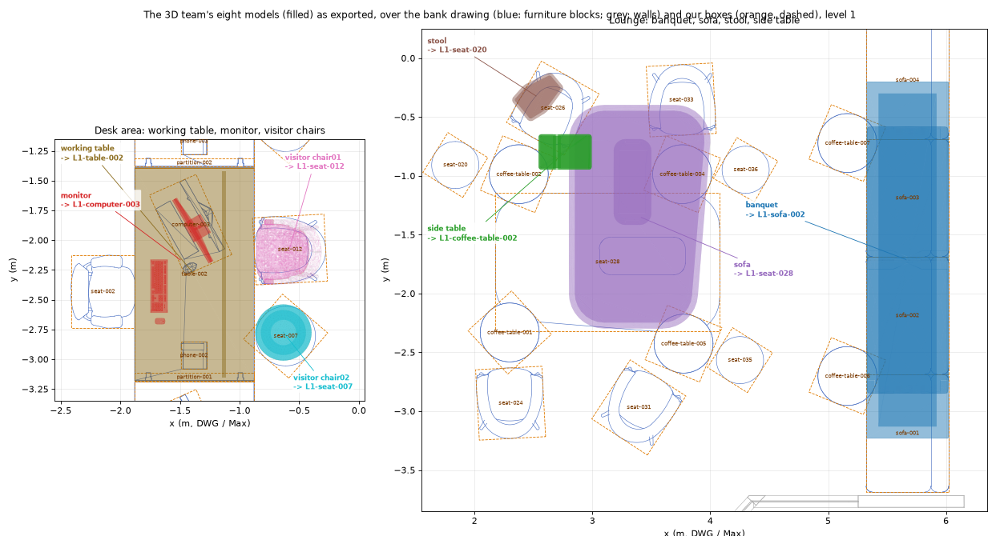
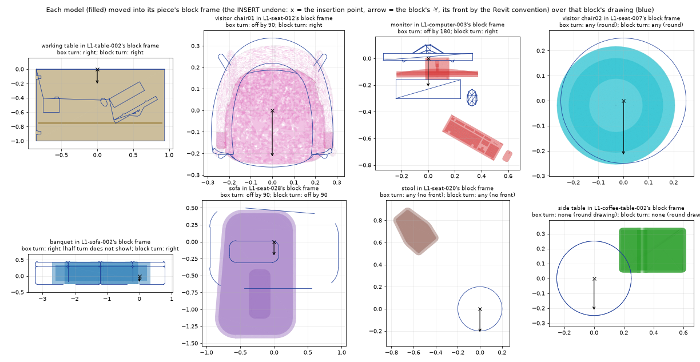

# The bank's own furniture models: what the eight files hold and where they belong

The 3D team sent furniture for this very project, the bank branch (Bangkok Bank Sampeng), in `banquet/`: eight GLB files
(9.2 MB) with the 3ds Max glTF exporter's log for each. This page reads every file, finds the piece of
`bank_test/src/bank_model.json` it was exported from, works out how to put it at every other piece of its family, and checks
which way it faces against the box's turn and against the CAD block's own turn. Analysis only: nothing was drawn in a browser
and nothing was timed, so there is no CPU load to record. Every number here is in `analysis.json`.

## Summary

| Model | Triangles | Size (m) | Matched piece, family | Pieces furnished, triangles at full detail | Box turn | Block turn | Log |
|---|---:|---|---|---|---|---|---|
| working table | 104 | 1.80 x 1.00 x 0.75 | **L1-table-002** (2 mm), IA_J15_WORKING TABLE - 1800W 1000D 750H. Sure | 5 (L1), 520 | right | right | 1 warning, 0 errors |
| visitor chair01 | 241,326 | 0.57 x 0.55 x 0.77 | **L1-seat-012** (19 mm), mollie_chair_a685_revit - A685 2. Sure | 19 (11 L1 + 8 L2), **4,585,194** | **off by 90** | right | 2, 0 |
| visitor chair02 | 6,084 | 0.47 round x 0.45 | **L1-seat-007** (36 mm), CHAIR_STOOL LOW_VITRA_VISIONA STOOL - 500W GRAY. Sure | 4 (L1), 24,336 | round: any turn | round | 2, 0 |
| monitor | 15,290 | 1.06 x 0.50 x 0.48 | **L1-computer-003** (the screen on its drawing), Enscape AssetDefinition - Computer 003. Sure for the screen | 16 (7 L1 + 9 L2), 244,640 | **off by 180** (+6°) | right (0.4°) | 8, 0 |
| banquet | 4,720 | 3.03 x 0.69 x 0.47 | the run **L1-sofa-001 to -004** (30 mm from its centre; nearest single piece L1-sofa-002), SOFA_BENCH_DIOR - TYPE 2 | 4 (L1) as **one** copy, 4,720 | right (a half turn that a backless bench does not show) | right | 3, 0 |
| sofa | 2,223 | 1.90 x 1.20 x 0.70 | **L1-seat-028** (0.47 m off and a quarter turn round), CHAIR_BENCH BACK - SE107 STOOL LOW_VITRA_VISIONA STOOL. Family sure (named in the file), piece medium | 3 (1 L1 + 2 L2), 6,669 | **off by 90** as it stands | off by 90 (the scene's, not the drawing's) | 2, 0 |
| stool | 2,680 | 0.41 x 0.29 x 0.45 | L1-seat-020 (0.92 m), CHAIR_STOOL LOW_VITRA_VISIONA STOOL - SE104 400W BLUE. **Unsure**: it stands inside a chair's box, L1-seat-026 | 5 (3 L1 + 2 L2), 13,400 | no front: any turn | no front | 2, 0 |
| side table | 1,564 | 0.45 x 0.30 x 0.55 | L1-coffee-table-002 (0.44 m), TABLE_BEDSIDE_VITRA_OCCASIONAL - TA104 600W 400H. **Unsure**: no family in the bank has its shape | 9 (6 L1 + 3 L2), 14,076 | none to judge (its CAD table is round) | none to judge | 3, 0 |

**Turns.** Of the eight, the box turn was right for 2 (the working table; the banquet, whose half turn does not show), off
by 90 for 2 (visitor chair01; the sofa as the scene has it), off by 180 for 1 (the monitor), and for 3 there is no turn to
judge (a round stool, a stool with no front, a side table whose CAD table is a circle). The block's own turn, read from the
DWG, was right for all 4 models that stand on their drawing and have a turn to check.

**Weight.** The 8 families make 65 of the bank's 185 pieces: **4.89 million triangles at full detail**, 2.4 times the
2-million laptop budget, and the mollie chair alone is 4.59 million (19 x 241,326). The other 46 pieces together are 308,361.

## The files

All eight are glTF 2.0 from the Max exporter (Autodesk's translation framework: `ATF::MaxATFProducer` to
`ATF::GLTFConsumer`), no extensions, no generator named. Every one has **positions and normals only** (32-bit indices, unit
normals, no degenerate triangles) and **every material is `fallback Material`, black** (23 materials over the 8 files), with
no textures. three.js 0.186.1's own GLTFLoader reads the same triangles, vertices and boxes (`scripts/crosscheck.mjs`).

| Model | File | Parts: triangles | Vertices | Materials | Root nodes in Max terms |
|---|---:|---|---:|---:|---|
| working table | 11 KB | top 16, modesty panel 12, frame and legs 76 | 216 | 1 | 3 roots turned 90°, local axes not z-up; **pivot 1.81 m from the table**, at (-1.580, -4.090, 0.375), on the next desk |
| visitor chair01 | 8.1 MB | 7,494 + 28,464 + 88,344 + 117,024 | 162,800 | 2 | 4 roots **scaled 6.406**, turned -90°, local y not up |
| visitor chair02 | 187 KB | base 1,764, cushion 4,320 | 3,495 | 2 | 2 roots turned -90°, **scaled 0.951 / 0.978 across and 1.004 up** (not uniform) |
| monitor | 944 KB | screen 2,638 (2,486 + 144 + 8, the last its display surface), keyboard 11,836 (keys 11,440), mouse 816 | 22,893 | 8 | screen turned -60° and tilted back 5°; **keyboard scaled 2.258**, tilted 4°; mouse turned 90° |
| banquet | 171 KB | base board 12, two cushions 4,352, frame 356 | 3,466 | 3 | 3 roots, turned 0° and -90°, two not z-up |
| sofa | 78 KB | one mesh, 2,126 + 97 | 1,539 | 2 | 1 root **scaled 304.8** (its vertices are in feet: a Revit family), turned -90° |
| stool | 89 KB | cushion 2,348, base 332 | 1,720 | 2 | 2 roots turned -50° |
| side table | 83 KB | two legs 332 each, frame 622, top 278 | 2,160 | 3 | 4 roots; **one leg mirrored** (scale -1); two parts turned -90° |

Every mesh hangs under its own root with a 0.001 scale (millimetres to metres). Every file was exported where it stands in the
team's bank scene, in the DWG's own coordinates (as `Chair.glb` was), not at the origin.

**Texture coordinates.** None are declared, but as in `Chair.glb` the vertex data has spare bytes the file does not describe:
**8 bytes a vertex** in every vertex buffer (two floats that look like texture coordinates: within 0-1 for both chairs, the
stool, the side table's legs and top and the keyboard; tiled, about -1 to 2, for the banquet, the sofa, the table's frame and
the mouse), none in the side table's frame (a 24-byte stride), and **16** in the monitor's screen (a constant pair 1, 0 and a
pair from -260 to 147, perhaps texture coordinates in real-world size). They are of no use until the materials and textures
come across.

**The logs.** Each export succeeded (`IsProcessorSucceeded true`, 0.01-0.60 s) with **no errors**. The only message is a
`GeneralWarningEvent` of severity 3, "got document version: 1.38, upgrading to 1.38...", **once per material** (1 to 8 a file,
23 in all; the count matches each file's `IRenderStyle` count). So the materials went through the exporter (`WantMaterial
true`) and came out as black fallbacks without a word about it: the logs do not say why.

## Where each one stands

The models were exported where they stand, and the team's scene is in the DWG's own coordinates (the script's default; Max x
= glTF x, Max y = -glTF z). Each model was matched on level 1 (all eight stand on level 1) by centre distance, footprint size
(a quarter or half turn allowed) and by fitting its plan silhouette to the CAD block's drawing (`fitToDrawing` in the JSON).

**Five stand on their piece:**
- **working table on L1-table-002**: centres 2 mm apart; its silhouette fits the block drawing as exported (IoU 0.97).
- **visitor chair01 on L1-seat-012**: centres 19 mm apart, footprint 0.574 x 0.553 m against the box's 0.599 x 0.563 m; it fits
  that chair's drawing as exported (IoU 0.88) and faces the desk.
- **visitor chair02 on L1-seat-007**: a 0.472 m round stool 36 mm off a 0.5 m drawn circle.
- **monitor on L1-computer-003**: the file is a 27-inch screen, a keyboard and a mouse, and the block Computer 003 draws a
  screen, a keyboard and a mouse too. The screen stands on the drawing, 0.12 m in front of the drawn screen and facing the same
  way (0.4° apart), on the desk top at 0.75 m. Its keyboard was moved 0.50 m south-south-west of where the block draws one,
  with the mouse, in front of the Aeron chair, so the whole model sits 0.36 m off the box centre.
- **banquet on the run of four**: a 3.03 m backless bench lying on the four 1.0 x 0.7 m SOFA_BENCH_DIOR - TYPE 2 modules
  (L1-sofa-001 to -004, a 4.0 m run). It fills the run's width exactly and is centred on it (30 mm off), but is 0.97 m
  shorter: it reaches from the middle of L1-sofa-001 to the middle of L1-sofa-004. It was exported from the run, not from one
  piece. Nearest single piece L1-sofa-002 (0.47 m), runner-up L1-sofa-003 (0.53 m). The drawing's module also has a 0.14 m
  band along its back (+Y) side that the model does not have.

**Three do not.** Sofa, stool and side table stand in the lounge where the drawing has other pieces; they overlap each other
and the drawing's own coffee table and chair:
- **sofa**: its mesh is named after the family 'CHAIR_BENCH BACK SE107 STOOL LOW_VITRA_VISIONA STOOL [2572013]', and its 1.900
  x 1.199 m footprint matches that family's boxes (1.900 x 1.182-1.200 m). It stands 0.47 m from L1-seat-028, the family's
  only piece on level 1, and **a quarter turn from it** (the fit to the drawing needs a turn of 270°, to half a degree). No
  runner-up on level 1; the family's other two pieces, L2-seat-024 and L2-seat-030, are on level 2.
- **stool**: it stands inside the box of L1-seat-026, a mollie chair (0.16 m from its centre; a 0.599 x 0.563 m box against the
  model's 0.413 x 0.294 m), whose own model is visitor chair01. By its name and size it is most likely a VISIONA stool, and the
  smallest of those, SE104 400W BLUE (drawn as 0.4 m circles), is nearest in size: its nearest piece is **L1-seat-020**,
  0.92 m away. Runner-up: L1-seat-026, the piece it stands in. No box on level 1 is within 25 % of its footprint.
- **side table**: it stands on no piece, between L1-seat-026 and L1-coffee-table-002 (0.44 m from that table's centre), and
  overlaps the sofa model. No table family in the bank has a 0.45 x 0.30 m top; the nearest of its kind is TA104 600W 400H,
  drawn as 0.5 m circles. Most likely **L1-coffee-table-002**, runner-up L1-coffee-table-004 (same family, 1.01 m). It may be a
  piece the drawing does not have: the 3D team should say which family it is.

## Putting a model at the other pieces of its family

Two frames are given per model, each as a 4 x 4 matrix (row-major) in Max / DWG coordinates and in three.js terms for the GLB
scene as loaded:

- **Box frame** (`relativeToBox`): origin at the box centre on its underside, x along the box's long side. On the bank page a
  model goes to piece P with `object.matrix = T(x, level + base, -y) Ry(rot) x gltfSceneToBoxFrameThree`, with P's x, y, rot from
  `bank_model.json` and its base from `base_mm` (a monitor stands on its desk's top).
- **Block frame** (`relativeToBlock`): origin at the block's insertion point, the block's own axes (the INSERT's turn undone).
  `T(insert x - 1.212, level + base, -(insert y - 0.348)) Ry(insert turn) F(P) x gltfSceneToBlockFrameThree`, where F(P) is
  the mirror between the two pieces' drawings (below). The insertion point is not the box centre: on the desk it is on the
  user's long edge, near its middle; on the DIOR module it is 0.71 m from the module's centre, 0.2 m past its end.

The model's footprint centre and turn in each frame (turn = how far the model is turned from the frame's own axes, front
= -y):

| Model | In the box frame: along, across (m); turn | In the block frame: x, y (m); turn |
|---|---|---|
| working table | -0.002, 0.000; 0° | 0.043, -0.500; 0° |
| visitor chair01 | -0.012, -0.015; 267° | 0.008, 0.025; 0° |
| visitor chair02 | 0.010, 0.034; round | -0.030, -0.019; round |
| monitor (whole model) | -0.277, 0.223; 186° | 0.272, -0.360; 0.4° |
| banquet | 0.470, -0.002 of L1-sofa-002; 180° (does not show) | -1.177, 0.093; 0° |
| sofa, as exported | 0.272, 0.385; 270° | -0.272, -0.478; 90° |
| sofa, fitted to its drawing | 0.000, -0.020; 180° | 0.000, -0.074; 0° |
| stool / side table, as exported | 0.878, -0.286 / 0.325, -0.292 | -0.591, 0.710 / 0.393, 0.189 |

For the sofa, the stool and the side table the exported place would carry the scene's error to every piece, so the JSON adds
a `suggested` transform: the sofa turned and moved onto its drawing (the fit), the stool and the side table centred on their
box with their turn kept (their drawings are round and give none). For the banquet it puts one copy on the centre of the
run, for all four modules: four copies, one per module, would be 18,880 triangles of overlapping 3 m benches.

## Which way they face

A model's real turn is read from its geometry: the chair's backrest, the screen's display surface (it faces 210°, west-south-
west, towards the Aeron chair), the desk's modesty panel, and for the rest the fit of the silhouette to the drawing. Turns
are degrees counter-clockwise from east, seen from above; a model faces its block's -Y at turn 0 (the Revit convention, true
here for the chair and the screen; for the desk the block's -Y is the modesty-panel side, where the visitor sits).

| Model | Real turn in the scene | Box turn (rot, 0-180) | Box | Block turn (INSERT) | Block |
|---|---:|---:|---|---:|---|
| working table | 90 | 90 | right | 90 | right |
| visitor chair01 | 270 (to within 4°) | 3.04 | off by 90 (-93°): the box's long side is the chair's depth | 270 | right |
| visitor chair02 | round | 49.27 | any turn | 270 | any turn |
| monitor | 300.0 | 113.99 | off by 180 (+6°): its box covers screen and keyboard, 6° off the block's axes | 299.6 | right (0.4°) |
| banquet | 270 | 90 | right: off by 180, which a backless bench does not show | 270 | right |
| sofa | 270 (to 0.5°) | 0 | off by 90 | 180 | off by 90: the scene turned it; the drawing's own turn is 180 |
| stool | no front | 57.82 | any turn | 270 | any turn (drawn as a circle) |
| side table | 0 (its long side) | 67.61 | none: its CAD table is a circle, whose box turn is arbitrary | 0 | none |

**Mirror.** No INSERT in the bank is scaled or mirrored: all 174 that could be read back have scale (1, 1, 1). But Revit
bakes a flipped family instance into the block definition it exports, so **26 pieces in 9 families are drawn as mirror images
of their family's other pieces**: 9 of the 19 mollie chairs, 6 of the 16 Aeron chairs, 4 of the 8 Fritz Hansen chairs, 2 of
the 4 Haworth chairs, 1 of the 3 SE107 benches, and one console cabinet, vase, Etta armchair and work cabinet. Every one is
flipped front to back. The eight matched pieces are not. So reading the INSERT's turn is not enough: each piece's drawing has
to be compared with its family's (`scripts/block_variants.py` does it in a few minutes).

**Across the families.** Put at all 65 pieces with the box turn instead of the block turn:
- with the turn the model has at its own piece carried over: mollie chairs 9 of 19 right, **10 a half turn wrong** (7 of them
  the flipped ones); monitors 14 of 16 right, 2 a half turn wrong (L1-computer-006 and -007, whose blocks are turned round but
  whose boxes are not); SE107 benches 2 of 3 right, L2-seat-024 a half turn wrong; the 5 desks right;
- placed as the chair test did (the model's front to -Y, turned by the box): all 19 mollie chairs a quarter turn wrong, 14 of
  the 16 monitors a half turn wrong, 2 of the 3 benches a half turn wrong; only the desks and the DIOR modules come out right.

By the block (mirror included), visitor chair01 fits every mollie chair's own drawing as well as it fits its own: mean line
distance 0.020 m and IoU 0.88-0.89 at 8 pieces checked, including 4 flipped ones; by the box, the 3 of those that come out a
half turn wrong fit at 0.033-0.035 m and IoU 0.80.

**The monitor's keyboard.** Carried by the block, the keyboard and mouse stand fully on their desk or counter at 10 of the 16
computers, partly at 3 (31 % at L1-computer-006 and -007, 67 % at L2-computer-009) and off it at 3 (L2-computer-001 to -003,
on the 0.6 m deep work cabinets). The screen is fine at all 16; the keyboard needs its own piece or the block's place.

## What it means

- **Turn every model by its block, not its box.** The block turn was right for all four models that stand on their drawing
  and have a turn to check; the box turn for two, one of them only because a backless bench looks the same turned round. The app needs each piece's INSERT turn and a check of its block drawing against
  the family's for Revit's baked-in flips. The furniture list has the DXF handle of 174 of the 185 pieces; the other 11 sit
  inside another block or are loose shapes, none of them in these 8 families.
- **Place by the insertion point, not the box centre.** A model in the library should keep its offset from the family's
  insertion point (or be exported with its origin there), since the box centre is the drawn outline's, not the family's.
- **Slim, or the bank does not fit.** At full detail these 8 families alone are 4.9 million triangles. The mollie chair is
  241,326 triangles, almost six times `Chair.glb`; at the chair test's 5,000 triangles a chair, its 19 copies would be about
  95,000.

## For the 3D team

Their note (`../FOR_3D_TEAM.md`) still holds. These files add:
- **Scale left on the objects**: 6.406 on visitor chair01, 2.258 on the keyboard, 304.8 on the sofa (a Revit family in feet),
  0.95-0.98 across and 1.004 up on visitor chair02, and a leg of the side table mirrored. Reset XForm on a copy before export.
- **Pivots far from the piece**: the working table's is 1.8 m away, on the next desk.
- **One piece per file, named after its family**: the monitor file bundles a screen, a keyboard and a mouse, with the
  keyboard 0.5 m from where the CAD draws it; only the sofa's mesh carries its family's name.
- **Say which family each one is** where it is not clear: the side table (no family in the bank has a 0.45 x 0.30 m top)
  and the stool (it stands where the drawing has a mollie chair).
- **The banquet is one 3 m bench** where the drawing has four 1 m DIOR modules, and the sofa, stool and side table were not
  placed on their pieces, so their positions in the scene could not be used.
- **Materials**: all 23 came out black again, with nothing in the logs.

## How this was worked out

- The two DWGs were converted with LibreDWG 0.14 `dwg2dxf` into a temp folder (byte for byte the same as the 26 Oct
  conversions; no DXF is kept in the project) and every furniture INSERT was read back by its handle with ezdxf 1.4.4.
- `scripts/` holds the steps, in order: `glb_read.py` (the files, by hand), `read_logs.py` (the logs), `dxf_pieces.py` (the
  inserts and drawings), `block_variants.py` (each family's drawings compared, mirrors found), `analyse.py` (matches,
  fits, transforms, turns, coverage; uses `register.py`), `crosscheck.mjs` (three.js's GLTFLoader against the reading, and
  every matrix put back at its own piece: all 8 within 0.002 mm), `plot_final.py` (the two pictures). Each takes its folders as
  arguments and writes only where it is told.
