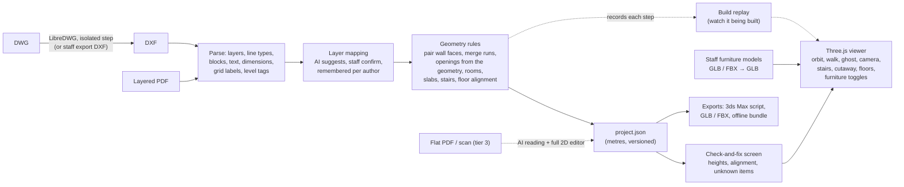

# CAD-to-3D client walkthrough tool: plan

**Version 2, 9 Oct 2026; updated 16 Oct – 4 Nov 2026** (Walk, Ghost and Camera modes and a build replay prototyped and reviewed twice; how the 3ds Max export works, section 3.6; a second office's DWG tested, then rebuilt from the owner's cleaner version; the frontend stack and "web app, not desktop" decided, decisions I and J; on 26 Oct the presidential-suite Max script run in real 3ds Max and the viewers tried on a staff laptop / PC, both good, a third drawing style received, and the door and window openings work started; on 28 Oct the 3D team ran the bank-branch Max script and found its structure satisfactory, leaving furniture; on 27 Oct the openings found automatically, 97 % of them right across three drawing styles, cut into the house and a new bank-branch model, and then a fourth drawing, run held out, scored 72 %, below the gate; on 28 Oct the detector was fixed for the causes that showed and reviewed independently, 54 of 54 on the same floors, a development-set figure; from 28 Oct to 2 Nov the furniture came in as coloured boxes, one per piece, colour = kind, with a height per kind, in the bank branch, the presidential suite and the house; on 2 Nov a fifth project came as two plan pictures with no CAD and was built from them, scaled from the one real dimension the owner gave; on 3 Nov the owner decided to start building the application, with the gate's remaining items carried into Phase 1, and how furniture models, finishes and lights will work, section 2.5; on 4 Nov the application's foundation was finished and checked, [app/docs/STATUS.md](app/docs/STATUS.md)). Version 1 (4–6 Oct) is kept as `walkthrough_app_plan_v1_2026-10-06.md`. Version 2 was rewritten after a four-lens review (editor, senior engineer, 3D-studio user, company director: 59 findings, 40 confirmed, 19 partly true, 0 refuted).

**In one paragraph:** an **internal tool** for our 3D staff. They upload a project's **CAD floor plans** (DWG/DXF; a layered PDF as a fallback) plus any of their **own furniture models**, and the tool builds an **interactive 3D house in the browser**: orbit / dollhouse view, first-person walk with collision, a ghost mode that flies through walls, a camera for still pictures, a build replay that shows the house being assembled from the drawing, stairs between storeys, hide walls and ceilings, floor switching, hide/unhide furniture. Staff use it to **present projects to clients**; a client can **buy their own project's part of the site** (payment handled offline). It is a **web app** (React + Vite, decided 19 Oct): nothing to install. The geometry is built **without AI** (CAD lines are exact); AI is used only for labelling and optional extras. **Status:** merged, aligned, two-storey walls from a real DWG are proven, and the Walk, Ghost and Camera modes and the build replay work in both prototypes (16 Oct); rooms and walking up the stairs are not yet. A second office's DWG also built (19 Oct), but its walls had to be found by shape and five furniture areas set aside by hand; a cleaner version of that drawing, with walls on their own layer, then built with no hand fixes. On 26 Oct the owner ran that drawing's 3ds Max script in real 3ds Max and tried the viewers on a staff laptop / PC: both good. A third drawing style arrived the same day (a bank branch in two levels, exported from Revit) and was built with no drawing-specific rules. On 27 Oct a detector found the **door and window openings automatically on all three drawing styles: 139 of 143 right (97 %) against checked answer keys (the gate asks for 80 %)**, and 95 % on the bank branch's first run, which was held out; the openings are cut into the house and the bank model. **A fourth drawing (two floors of an office tower, added the same day) was then run held out: 72 % right (85 % of the openings found, but some sizes off and 48 openings that are not there): below the gate.** The causes are general and are being fixed. **Next (4 Nov):** the foundation of the application is built and checked ([app/docs/STATUS.md](app/docs/STATUS.md)); next comes the DWG upload with the layer-mapping / check-and-fix screen (the owner's choice, 4 Nov; section 9, action 13), then the box editing (action 12); rooms and slabs, walking up the stairs and the openings check on a fifth drawing are carried into Phase 1.

---

## 0. Status (4 Nov 2026)

### Prototypes and what each one proves

| File | Built from | Proves | Does not yet |
|---|---|---|---|
| [cad_test/house_3d_preview.html](cad_test/house_3d_preview.html) | *Test Sukhumvit Residence.dwg* (AutoCAD 2018, mm) | DWG → DXF (LibreDWG, <1 s); walls / windows / glass / columns / stairs by layer and line type; blocks unpacked; wall face lines paired and **merged into one solid per wall run**; floor levels from the elevations (+0.90 / +4.80 / +8.30 m); the two floors aligned by 24 grid labels within 1 mm; **Orbit / Walk / Ghost / Camera** (16 Oct): walking at eye height, walls block you, you stay on the floor plates; the **build replay** (16 Oct): the drawing is read, sorted, lined up, paired, merged and raised on screen with this file's real numbers; **door and window openings** (26–27 Oct): found automatically by the detector ([detector/](detector/)) and cut into the merged walls: the 32 doors found are open from the floor to their head under a lintel (3 sliding glass doors among them are glazed like windows), the 37 windows are glass panes from the sill, and the 29 passages are left open; heights read from the elevations (ground 3.00 m, double-height glazing 3.90 m, upper floor 2.60 m); **furniture boxes** (29 Oct): 76 boxes on the two floors from the interior designer's linked drawing, coloured by kind with a height box per kind; Walk stops at them, Ghost passes, doorways stay clear | Door and window **leaves** (a door is an open gap and a window a fixed pane: nothing swings or slides); real **slabs, ceilings, roof** (the floor plates are an approximate outline traced around the walls); **real stairs** (tread outlines only, so you change floor with PgUp/PgDn or the floor buttons, not by climbing); hide-walls / cutaway; the kind of 48 of its 76 furniture boxes (29 Oct: the furniture is loose lines and blocks with scribbled names, so those boxes are grey 'other', all 750 mm high); room names (none in this DWG) |
| [cad_test/pdf_house_3d_preview.html](cad_test/pdf_house_3d_preview.html) | *DH3 TYPE L_Show house.pdf* (104 pages, printed from AutoCAD **with layers**) | Layered PDF → walls / doors / stairs by layer plus a **line-thickness rule** (27,000 hatch lines dropped); room names and ceiling heights read as text; built in <1 s | Upper-floor level **assumed** (+3.80 m, not in the set); scale from 1:100, not real units; same gaps as above |
| [srisawan-viewer/Srisawan_3D_viewer.html](srisawan-viewer/Srisawan_3D_viewer.html) | Hospital plans **traced from images** (not CAD): `srisawan-rebuild/model_geometry.json`, `floor6-dxf/` | **Merging** traced segments into one solid per wall run (273 → 65 pieces on floor 1); **smoothing** traced curves; slabs with voids and core openings; hover shows the zone; floors 1, 2 and 6; the same **Orbit / Walk / Ghost / Camera** modes and **build replay**, with the slabs as floors (16 Oct) | Not from CAD; no doors; floor 6 shown alone (different origin, unknown level, no slab to stand on) |
| [srisawan-rebuild/Srisawan_New_Layouts_Merged.ms](srisawan-rebuild/Srisawan_New_Layouts_Merged.ms) | Same | A **3ds Max script** generated from the merged walls and checked numerically (closed solids, heights, positions) | **Not yet run in real 3ds Max.** Until it is, the export idea is "scripted", not proven |
| [presidential_test/presidential_3d_preview.html](presidential_test/presidential_3d_preview.html) and [Presidential_Suite.ms](presidential_test/Presidential_Suite.ms) (19 Oct, rebuilt) | *layout presidential test.dwg*, from a **different office** (one floor, mm, Vietnamese layer names). It replaces the first try from *layout presidential xx.dwg* (kept in `previous_xx_dwg/`) | The pipeline on a second author's drawing. **Walls from the wall layer** (solid fills, outlines, paired lines) with **no hand fixes**: 12 wall runs and 2 columns. The **octagonal glass facade** comes from an `A-4. Dim` double line, and the north and south glazing is inferred from the room outlines and curtains. A **lintel** fills each of 17 doors from 2.10 m. The **corridor-side walls**, drawn on no layer, are added along the room outlines. Also built: the terrace with its glass balustrade, decks, built-in seating and pergola posts, and 16 room names. Floor to floor is 3.00 m, as given. 10 browser checks pass: all 22 doors and openings can be walked through, glass stops you, and the viewer and the Max script come from the same model data. An independent review (3 tile reviewers, a MAXScript reviewer, skeptics) found problems, and they are fixed. The **3ds Max script keeps every part live** (spline + Extrude with mesh output; Editable Mesh by collapsing; no Editable Poly), and it was **run in real 3ds Max by the owner on 26 Oct: good**. **Furniture boxes** (29 Oct): 120 boxes in 13 kinds in the viewer and the Max script (Box primitives on a layer per kind, height spinners); 37 browser checks pass (10 of the structure, 27 of the furniture) | The doors are still the **hand-written list**: the openings detector (27 Oct) finds 20 of the 21 openings in this drawing's answer key, but it is not wired into this model yet. The jacuzzi zone's level change (drawn as steps; built as 0.10 m kerbs). The kind of 41 of the 120 furniture boxes (11 blocks with scribbled names and 30 groups of loose lines: grey) and one terrace seating group drawn as a single block (left out); the furniture part of the Max script not yet run in Max. Heights the drawing does not give were assumed (doors 2.10 m, balustrade 1.10 m, terrace pieces) and **accepted by the owner on 26 Oct** |
| [bank_test/bank_3d_preview.html](bank_test/bank_3d_preview.html) and [Bangkok_Bank_Sampeng.ms](bank_test/Bangkok_Bank_Sampeng.ms) (26–28 Oct) | *I1201 - LEVEL 1* and *I1202 - LEVEL 2 GENERAL ARRANGEMENT*: a bank branch **exported from Revit** (AIA layer names, mm, one file per level), a third drawing style | The first model built with **no drawing-specific rules**: only the layer roles and the openings detector. Two levels, floor to floor **3.70 m** (from the stair: 21 risers of about 0.176 m); the levels share one origin (the grid is identical, no shift needed). 49 openings from the detector, cut in (39 doors, with heads read from the Revit door names such as `1000X2400`; 7 curtain-wall windows; 3 passages left open; the 28 Oct detector fixes took out 6 false passages and changed no door or window). Revit's glass-wall type (`GLASS WALL 2600H`) becomes 19 glass partitions 2.60 m high; also the terrace parapet, the closed ATM slot, solid stair steps, and no floor over the stairwell or the lift shaft on Level 2. **Furniture boxes** (29 Oct): 185 boxes in 14 kinds from the Revit furniture blocks, a height box per kind, Walk stops / Ghost passes, doorways kept clear, the family list (CSV) for the 3D team, and Box primitives in the Max script. 49 browser checks pass (22 of the structure, 27 of the furniture); the viewer and the Max script come from the same model data | **28 Oct: the 3D team ran the 3ds Max script in Max and the owner reports the structure is to their satisfaction; furniture is what is left** (build time and any problems were not recorded). Assumed, and standing as built because the owner had no answers on 27 Oct: floor to floor 3.70 m, glass and pivot doors 2.40 m, glass partitions 2.60 m with nothing above, the terrace parapet at the railing height (1.10 m). The two stair drawings do not line up (questions in [bank_test/README.md](bank_test/README.md)). The furniture part of the Max script (29 Oct) is not yet run in Max |
| [detector/](detector/) (26–28 Oct) | Four drawing sets (7 floors) and their answer keys, made separately from the detector | **Door, window and passage openings found automatically:** 139 of 143 right (97 %) against the keys (gate: 80 %); on the bank branch's first run, with the code frozen beforehand, **39 of 41 (95 %)**; on a fourth drawing, two tower floors (27 Oct), also run frozen, **39 of 54 (72 %)**, 85 % of the openings found: the gate (80 %) was **not** met there. Its only per-drawing input is a short layer-role file; everything else is read from the geometry, not from block names or coordinates. **On 28 Oct the detector was fixed for what the tower floors showed, and independent reviewers tried to break it; the figures after that are development-set, not held out: 139 of 143 on the older drawings and 54 of 54 on the tower floors, with 8 and 6 detections beyond the keys (26 and 48 before; all passages but one window)** | Pass on a new drawing: **not yet known.** Held out, the tower floors missed sliding doors in thin glass screens, doorless passages and two large sliders, measured doors in glass partitions across their sidelights, and reported 48 openings that are not there (curtain-wall fins read as windows, gaps beside open space). Those causes are fixed; a fifth drawing from another office is the test. Not found on the older drawings: a sliding vehicle gate, a movable glass partition, one wide sliding glass door (and one width). Rooms, slabs and stairs are not part of it |
| [hotel_test/hotel_3d_preview.html](hotel_test/hotel_3d_preview.html) and [Hotel_Lobby.ms](hotel_test/Hotel_Lobby.ms) (2 Nov) | Two rendered presentation **pictures** of a hotel's lobby floor and its F&B floor, **no CAD** (a fifth project) | The first model **read from pictures**: the walls traced on the pixels, the scale from one real dimension the owner gave (the main stair, 2.50 m clear), the two floors stacked 2.90 m apart and lined up on the lift core with a scale per axis (the pictures disagree with each other by about 4 % between x and y); doors, glazing, stairs, lifts and room names; 159 furniture boxes whose kinds were read by eye (the check-in's seat backs as the owner corrected); a 'Plan picture' tick that lays each drawing under the model; two independent reviews against the pictures | A person has to read what a picture does not say (room names, what each piece is, which gap is a door); the owner's rough 1 m lift door and the 2.50 m stair disagree by 12–28 % on the pictures, and floor 2's furniture comes out small (kept as drawn: the owner, 3 Nov); the Max script is not run in Max; this is the tier-3 input (pictures and scans), not the CAD route the gate is about |

**The application's foundation (3–4 Nov).** Built in [app/](app/) after the owner's decision of 3 Nov, and checked independently on 4 Nov; what it does, how to start it and the test results are in [app/docs/STATUS.md](app/docs/STATUS.md). One model format and one viewer for the four projects (the viewer a TypeScript package with Three.js bundled from npm, nothing from a CDN); a local server (FastAPI) and project store seeded from the prototype folders, which stay unchanged; the staff app (React): the project list, a project page with the viewer, a version picker (the bank has two versions), furniture heights saved per version, and downloads of the 3ds Max script, the furniture list (CSV) and the offline single HTML (one per version, opening from disk with no network). Start: `npm run dev` in `app/`, then http://127.0.0.1:5710. Checks on 4 Nov, all passing: 595 unit tests, 295 server tests, 214 browser checks of everything the prototype pages do plus the staff app, the prototypes' own tests unchanged, and the owner's path through the app (21 steps). Four independent checkers (parity on the CAD projects, parity on the bank and the hotel, a code review, an attempt to break it) found 37 problems; 32 were fixed with a test each, 4 deferred (phone layout; a cloud-storage detail; slower drawing under software rendering only; Excel formulas in the CSV, for the box-editing step), 1 not a defect. Not yet: DWG upload and the layer-mapping / check-and-fix screen, rooms and slabs, climbable stairs, box editing, real furniture models, login and anything online. It was built by AI agents in about 27 hours of elapsed time (3 Nov 08:20 to 4 Nov 11:40, of which about 14 hours were waits for the account's usage limit), with no hands-on hours from the owner; the plan's estimate for Phase 0.5 was ~40 h of hands-on work.

The scripts behind all of this are now in [cad_test/src/](cad_test/src/) and [srisawan-viewer/src/](srisawan-viewer/src/) with READMEs. (Until 9 Oct they existed only in a temporary folder.)

**View modes and build replay (16 Oct).** Both viewers now share [viewer-modes/](viewer-modes/) (what each feature does: section 2.3):
- `viewer_modes.js`: three ways to look around (**Orbit**, **Walk**, **Ghost**) and a **Camera** tool, with touch controls and phone layouts;
- `build_replay.js`: the **Build settings** screen and the **build replay**.

A test script in the same folder drives headless Edge with real key, mouse and touch input and runs **127 checks** on both viewers, all passing (19 Oct):
- walls stop you and you slide along them, and you stay on the floor;
- PgUp/PgDn and the floor buttons change floor;
- Ghost passes through walls;
- lens, tilt, eye height and straight verticals set the camera as chosen;
- photos come out at exactly 1920 × 1280, 3840 × 2560 or 2160 × 3840 as chosen, with no seams where the pieces of a large photo join;
- the stick and buttons work by touch, and the phone layouts (upright and on its side) keep the photo frame clear of the panels at the tested screen sizes (other phone and tablet sizes are parked, see the 19 Oct review below);
- the replay opens on the settings and runs through its steps with the real numbers. It locks the viewer keys while it plays, can be skipped or replayed, and hands over to exactly the normal viewer. A floor level changed in the settings is the one you walk on afterwards.

The checks ran with software rendering at 14–21 frames a second. On 26 Oct the owner tried the viewers on a staff laptop / PC and reported them good (no frame rates recorded). They have not been tried on a real phone (phones are parked, decided 19 Oct).

Three more test files check the other models the same way. Run from the project folder on 27 Oct, they all pass: [cad_test/test_house_openings.mjs](cad_test/test_house_openings.mjs) (13 checks of the doors and windows cut into the house: every door can be walked through, windows stop you, lintels sit at the door heads, passages are left as they were), [presidential_test/test_presidential.mjs](presidential_test/test_presidential.mjs) (10) and [bank_test/test_bank.mjs](bank_test/test_bank.mjs) (22). With the furniture boxes (29 Oct – 2 Nov) the bank's test has 49 checks and the suite's 37, the house has a new [cad_test/test_house_furniture.mjs](cad_test/test_house_furniture.mjs) (29), the shared furniture module its own [furniture/test_boxes.mjs](furniture/test_boxes.mjs) (87), and the two Max scripts are checked as text against their models (137 and 151 checks); all pass, and the house sections of the shared suite still pass 109 of 109 with the boxes in. The 127 above still pass with the openings cut into the house (on the first full run one timed walking check in the hospital viewer failed on a busy machine at 10 frames a second; it passed alone and in the next full run). On 28 Oct, after the detector fixes and the rebuilt house and bank models, the house (13), presidential (10) and bank (22) tests pass again and the viewer suite passed 127 of 127 in two full runs (the second on the final detector and models); in other runs on a busy machine (11-12 frames a second) the timed check "walk slides along a wall" failed, and on a heavily loaded one the photo downloads too, with the untouched 27 Oct house page failing the same way and the house section passing 53 of 53 when re-run alone, so these are flaky timed checks and not the change.

**Code review (16 Oct).** Four reviewers each read the viewer code from one angle: camera and photos, movement and floors, input and devices, robustness. For each angle a second reviewer tried to disprove every finding. 27 of the 30 findings held up, which came to 19 distinct problems; all 19 are fixed and covered by the checks above. The worst were:
- switching from Ghost to Walk could leave you stuck in mid-air outside the building;
- a 4K photo briefly needed far more graphics memory than the photo itself (the review measured about 2.4 GB on a high-resolution laptop), now drawn in screen-sized pieces;
- a laptop touchpad threw the lens and the Ghost speed to the ends of their ranges;
- on landscape phones the Camera panel hid most of the photo frame.

**Code review (19 Oct).** A second review, run the same way, covered the build replay and the 16 Oct fixes. 26 of the 28 findings held up, which came to 18 distinct problems. The 14 that affect laptops and PCs are fixed, each with a new check (the 127 above). The 4 phone and tablet layout problems are parked under "PC first" and listed in [viewer-modes/README.md](viewer-modes/README.md). Nothing was high severity. The worst were:
- clearing a floor-level or wall-height box silently set it to 0.00 m or 1.00 m (it now keeps the old value);
- opening a page with the Camera panel on put that panel over the Build settings screen;
- raising the ground-floor level of the DWG house lifted the house off its plinth;
- in Walk you could end up 2–3 cm from a thin partition (now never closer than 0.3 m).

### Phase 0 checklist

| Done (6 Oct) | Remaining |
|---|---|
| DWG → DXF conversion | Slabs, ceilings and **room polygons** from the wall network; room names from text, else staff |
| Layer and line-type rules; block unpacking; tiny-shape and single-line filters | Stair solids from the tread lines + riser count + floor levels; a ramp collider; the slab void |
| Wall face-line pairing and merge into solid wall runs | Walking **up and down the stairs** (needs the stair solids and a ramp collider); hide walls / ceilings |
| Floor levels from elevations; floors aligned by grid labels | Run on **more DWGs from at least 3 different authors** (received so far: the presidential suite, 19 Oct; the bank branch in two Revit files, *I1201 - LEVEL 1* and *I1202 - LEVEL 2 GENERAL ARRANGEMENT*, 26–27 Oct; and two floors of an office tower, *L29* and *L30*, 27 Oct: four drawing sets and six files, so the five-file count is met; the open point is a fifth drawing set, ideally a house with Thai labels, to check the detector after its fixes); one staff furniture GLB placed |
| Orbit viewer with floor toggle, glass toggle | Real floor plates from the room polygons (the prototype traces an approximate outline around the walls) |
| **16–19 Oct:** first-person Walk with wall collision on floor plates, Ghost fly-through, Camera tool, touch controls, Build settings and build replay (both prototypes) | Decide the gate wording for drawings like the presidential suite (proposal in section 4) |
| **19 Oct:** a second office's DWG (presidential suite) built. The first version had its walls on layer 0 with the furniture (found by shape; five furniture areas set aside by hand). The owner's cleaner version, with walls on their own layer, built with no hand fixes; its corridor-side walls and glass facades were not drawn as such and were added by rule | Use the detector's openings in the presidential-suite model (its doors are still the hand-written list) |
| **26–28 Oct:** **door and window openings found automatically** (139 of 143 right = 97 % on three drawing styles; 95 % on the bank branch's first run, held out; 72 % on the tower floors, held out: below the gate; fixed on 28 Oct, 54 of 54 on those floors as a development figure) and cut into the Sukhumvit house (lintels, sills, glass; heights from the elevations); a third drawing style, a bank branch from Revit in two levels, built with no drawing-specific rules (floor to floor 3.70 m, from its stair) | Run the detector on the next drawings received, each held out until scored, and fix what it misses (a vehicle gate, a movable glass partition) |

**Hours re-check:** the original Phase 0 was ~90 h. The 6 Oct work covered roughly its first third. The remaining items above are the genuinely unproven ones and are estimated at **~60–90 h**. The plan's own rule (if ≥70% of walls and openings come out right first time, expect the low half of later ranges) can now be checked for openings: 97 % came out right across the three drawing styles (139 of 143) and 95 % on the one drawing the detector had not seen. The fourth drawing, held out, scored 72 % (85 % found), so the two held-out figures disagree and the rule is not settled: it holds only narrowly on the harder drawing. Keep it provisional until the fixes are checked on a fifth drawing and rooms, slabs and stairs have been tried on the same files. The ~60–90 h above still includes the openings item, which is now done. The hours actually spent on Phase 0 are still to be recorded. See section 4 for the gate.

---

## 1. Decisions so far (dated)

| Date | Decision | Notes |
|---|---|---|
| 5 Oct | **Automated build**, not a bespoke one-off house like the reference site | The reference site (`house.sumsum.world`) is hand-built room by room; see Appendix A |
| 5 Oct | **Purpose: internal tool** to present projects to our clients; a client can **buy their own project's part of the site**, payment offline, **no in-app billing** | What the client receives was defined on 9 Oct: hosted link + offline bundle (decision E) |
| 5 Oct | **Users: our 3D staff**, usually with CAD plans (DWG) plus **some** of their own furniture models; sometimes no furniture models yet | Not a public product. A finished whole-house Max model as input was deferred to a later add-on on 9 Oct (decision A) |
| 5 Oct | **Walk mode: first-person**, no avatar | |
| 5 Oct | Only **build hours and AI generation cost** are costed; no competitor analysis, no labour costing | The reviewers' request for a money table is recorded in section 8 as a question, not adopted |
| 5 Oct | Core viewer features confirmed: orbit, first-person walk, stairs, cutaway (walls / ceilings), floor switching, furniture show/hide (**view only**, no moving) | |
| 6 Oct | **Input priority: DWG/DXF first, layered PDF second, flat PDF or scan last** (AI reading, weak) | From the CAD vs PDF test, Appendix B |
| 6 Oct | Layer names differ per author or office, but are consistent within a drawing. **AI suggests the layer mapping, staff confirm once, the tool remembers it per author** | |
| 6 Oct | **Walls are merged into one solid per wall run**; traced curves are smoothed | Proven on Srisawan and on the DWG house |
| 6 Oct | **Export for the 3D team** (3ds Max script, GLB/FBX) proposed as an add-on | Max script not yet run in Max |
| 9 Oct | Picture-upload SaaS idea **dropped from the main plan**; kept as history in Appendix D | |
| 9 Oct | **Builder: the project owner**, directing an AI coding assistant, part-time alongside other work. Calendar time is not fixed | Hours will be measured on Phase 0 to calibrate the estimates |
| 9 Oct | The 3D team usually **does** have some 3D model by presentation time, but we **build the no-model (CAD-first) path first**; a whole-house Max model as input comes later | Resolves decision A |
| 9 Oct | **AI models: Gemini approved.** Other vendors (Tripo, Tencent, Meshy, Rodin, World Labs) need a separate discussion | AI-made furniture is on hold until then |
| 9 Oct | **Client-facing language: English.** Thai labels in drawings are translated to English | |
| 9 Oct | **Client devices: laptop, PC and phone** | Phones set the performance floor |
| 9 Oct | **Two render styles: realistic and storybook** (painted look), like the reference site | Storybook doubles as the light mode for phones |
| 9 Oct | Client-data sign-off (PDPA / NDA) is **not the 3D team's job**. The tool keeps client drawings on our own servers unless an AI add-on is switched on | |
| 9 Oct | **Phase 0.5 added:** one self-contained HTML per project for early client presentations, before login and dashboards | Decision B |
| 9 Oct | **Add-ons: presentation features first, then the AI extras** (Photo Mode, AI textures, baked lighting) | Decision C |
| 9 Oct | **AI off by default for the core path; opt-in per project** | Decision D |
| 9 Oct | **"Client buys their project" = hosted link for an agreed period + offline bundle; a one-page terms sheet and an asset-licence register before the first sale** | Decision E |
| 9 Oct | **DWG intake: LibreDWG as an isolated server step with an entity/layer count check; DXF exported from AutoCAD as the fallback** | Decision F |
| 9 Oct | **Flat PDF / scan tier: later** (Phase 3 add-on) | Decision G |
| 9 Oct | **Hosting: Cloud Run + Cloudflare Pages + R2** (own NAS only if IT requires) | Decision H |
| 16 Oct | **Three ways to look around: Orbit, Walk and Ghost** (Ghost = fly anywhere, through walls and floors), plus a **Camera tool** for still pictures with an adjustable angle (lens, eye height, tilt, straight verticals, frame, HD/4K) | Requested by the owner; prototyped in both viewers the same day (section 0) |
| 16 Oct | The **3ds Max export is a one-way snapshot**: exact, editable geometry, but plain materials and no link back to the app | Explained in section 3.6; still to be run in real Max |
| 16 Oct | **Build replay (the "loading phase")**: after the upload, staff check a few settings (floor levels, wall heights, the layers found, replay speed) and click Generate. The tool then shows the model being built from the plan, step by step, with the real numbers; Skip at any time | Requested by the owner; prototyped in both viewers (section 2.3) |
| 19 Oct | **PC first; phones go to the bottom of the list.** Laptops and PCs are the target for now; phone and tablet layout fixes wait | The phone and tablet findings of the 19 Oct review are parked in [viewer-modes/README.md](viewer-modes/README.md) |
| 19 Oct | **Frontend: React + Vite + TypeScript, a static single-page app on Cloudflare Pages; not Next.js.** The 3D viewer stays a framework-free package, built three ways: inside the staff app, as a light client share page, and as the offline single HTML | Decision I (section 7), from a panel of three advocates and a judge. Hours unchanged: the estimates already assumed Vite + TypeScript |
| 19 Oct | **Web app only; no desktop installer.** It is still a full application (login, projects, uploads, versions, share links, exports), in the browser. Staff who want their own window install it from Edge, or IT pushes it to every PC | Decision J. Revisit only if Phase 1 shows a measured need: xrefs on the NAS, regular offline work, one-click 3ds Max |
| 19 Oct | **3ds Max export: every part stays live** (spline outline + Extrude with mesh output + Smooth), so heights and outlines can still be changed; **collapsing gives Editable Mesh, never Editable Poly** | Owner's choice. Built into the presidential-suite script ("Update heights", "Collapse all now"); section 3.6 |
| 26 Oct | **Presidential-suite heights accepted as built:** doors 2.10 m everywhere, balustrade 1.10 m, terrace seating backrests 0.90 m, pergola posts without beams, a 0.10 m kerb between the bath and the jacuzzi | Owner's answer to the 19 Oct questions. The corridor-side wall thicknesses (0.25 / 0.18 m) are still to confirm |
| 26 Oct | **Bank branch floor to floor 3.70 m**, taken from its stair (21 risers of about 0.176 m); the two levels share one origin | The owner said "just use what makes sense". To confirm: with Revit's default stair type it could be 3.80–3.99 m |
| 27 Oct | **Openings are found by one detector whose only per-drawing input is a layer-role file;** it reads the wall geometry, not block names. It is scored against answer keys that were made separately from it (two labellers working apart, a comparison, and an adjudicator for the disagreements only) | 139 of 143 right (97 %); the bank branch's first run, with the code frozen before its key existed, 39 of 41 (95 %). Gate: 80 %. [detector/README.md](detector/README.md) |
| 27 Oct | **Openings in 3D:** a door is open from the floor to its head under a lintel (no leaf drawn); a window, and a sliding glass door that may be either, is a glass pane from the sill to the head, with a sill wall only when the sill is above 0 and a lintel unless the head reaches the top; a passage is left as it is. Lintels, sills and panes stop you when you walk | Decided 26 Oct, applied to the Sukhumvit house and the bank branch on 27 Oct. Heights: from the elevations (house), from the door names (bank), else the plan's defaults |
| 27 Oct | **Fourth drawing (tower floors L29, L30) run held out: 72 % right, below the 80 % gate** (85 % of the openings found; 48 false openings). The causes are general (thin glass screens, doorless passages, large sliders, curtain-wall fins read as windows) and are being fixed; the layer mapping has to be read from what is on the layers, not from their names | The answer key (53 openings) was made blind to the detector and a blind audit found it complete. After the fixes this drawing is a development drawing and a fifth is needed. [detector/blind_run_L29_L30/README.md](detector/blind_run_L29_L30/README.md) |
| 28 Oct | **The detector was fixed for the tower test's causes and checked by independent reviewers and two blind auditors.** Development-set figures: 139 of 143 on the older drawings (detections beyond the key 26 → 8) and 54 of 54 on the tower floors (48 → 6). The house and bank models were rebuilt from the new output: 18 false passages gone, every door and window unchanged | The reviewers also found order dependence (a double door could fall apart), unit handling and two crashes; fixed. The limits that remain are written down. **Still not held out: a fifth drawing decides.** Open question for the owner: the width of a door next to fixed glass (its leaf, as the key and the detector now have it, or wall end to wall end). [detector/fix_round_28oct/README.md](detector/fix_round_28oct/README.md) |
| 28 Oct | **Furniture as coloured boxes** (the owner, after the 3D team's Max run left only the furniture): one box per piece from the CAD furniture blocks, **colour = kind**, **a height in mm typed for each kind** (the owner's examples: coffee table 450, kitchen table 750, counter top 850, bar table 1000), **boxes stop you in Walk and not in Ghost**. The kind comes from the block's name (a fixed vocabulary plus the office's own words in the project file), never from a list made for one drawing. Built for the bank branch first, then the presidential suite and the house | Added on 29 Oct after a review: a box standing in a door's approach does not stop Walk while 'Keep doorways clear' is ticked (it stays drawn), so furniture drawn beside a door cannot seal a room. Swapping the boxes for the team's own Max models by family name waits until the team names its model folder. [furniture/README.md](furniture/README.md) |
| 2 Nov | **A project from pictures only** (two presentation plans of a hotel, no CAD), built as a test of picture input with the owner's facts: picture 1 is floor 1 and picture 2 floor 2, floor to floor 2.90 m, the lift entrance about 1 m, and, after the first build, the main stair 2.50 m wide (the scale), floor 2's west side solid, the middle stair joining floors 1 and 2 and the upper one going to a floor 3, the faceted shape and the check-in's round shapes are seating, its 'monitors' seat backs | Everything else was measured on the pixels or read by eye and is written down with its assumption in [hotel_test/README.md](hotel_test/README.md); the furniture kit gained a 'seat back' kind from the owner's correction. Open: the upper stair's top, the forecourt's depth. Floor 2's furniture, small at the stair's scale, stays as drawn (the owner, 3 Nov: "keep it strictly as the drawing said") |
| 3 Nov | **Start building the application now** (the owner: "we should have more than enough testing"). The foundation comes first, in a new folder [app/](app/) (the plan's Phase 0.5 and the start of Phase 1): the viewer as one TypeScript package with Three.js bundled from npm, one model format for the four projects (house, presidential suite, bank branch, hotel), a local FastAPI store with the downloads (3ds Max script, furniture list, offline file), the staff app (React), the offline single HTML per project, and the prototype tests ported. Designed and reviewed before it is built | The gate's remaining items move into Phase 1 instead of more prototypes: rooms and slabs and climbable stairs are built in the app's builder, and the openings detector is still scored held out on the next new office's drawing (until then the held-out figures stay 95 % and 72 %). Uploading a DWG and building it in the app is the next step after the foundation. Cloud accounts (Supabase, R2, Cloud Run) come later; the owner runs every deploy |
| 3 Nov | **Furniture models, finishes and lights** (the owner, after asking how each would work: "ok sure let do it then"). **Furniture:** the 3D team's own models, not generated, kept in a company library under their CAD family names; a project's boxes become the models by family automatically, and staff pick a model for **this piece, several selected pieces, its family or its whole kind** for the rest; each model is slimmed once on import (12 % was enough by eye for the first chair, which kept 75 of them as cheap as the boxes), and Walk still stops at the box; done in the staff app after the structure is built, positions as drawn (only a 90° / 180° turn and a small nudge). **Finishes:** one Library page for models and materials; floors, walls and ceilings get materials from the room's name first, then a Finishes step. **Lights:** automatic, with the sun's direction, the time of day and a day / night switch for staff; light fittings from the drawing's lighting layer, a hanging height per kind, every fitting glowing and the nearest few lighting the room; full lamp light is the baked-lighting add-on. Details: section 2.5 | The first real model, `Chair.glb` (one chair from a round-table set), showed what an export gives: real size in metres, but 41,921 triangles, its materials lost (black fallbacks, no texture coordinates) and still at its place in the Max scene; hence the export rule in section 2.5. On the browser's limit: a desktop app would not raise it (decision J: the same engine), and clients open the links on their own laptops, so a mid-range laptop is the test machine. Adds ~25 h to Phase 1 (section 5) |
| 3 Nov | **Staff can edit the furniture boxes** (the owner: "can we have a feature for user to able to change color and name, also maybe add the box themself?"). In the staff app: rename a kind and change its colour; move one or several pieces to another kind or to a new kind (with its own name, colour and height); name a piece (the grey 'other' boxes); add a box by hand (click a floor, drag or type its size, turn it, pick its kind) and delete one. Saved with the project like the heights; hand-added boxes are marked so a new version of the drawing keeps them; the furniture list (CSV) follows, and the Max script once it is generated from the project. Clients still only look | ~20 h in Phase 1 (section 5), built right after the foundation as its first feature. It widens section 2.4: staff may now add, delete and resize boxes and change kinds, not only turn and nudge a piece |
| 4 Nov | **The DWG upload comes next, before the box editing; the offline file's Reset keeps going back to the heights saved in that file; the project folder goes under version control** (the owner's answers to the three questions in app/docs/STATUS.md) | Git on this laptop only, never pushed; the first commit (9eb2d58) is the state of 4 Nov. Drawings, the video, the PDF and the 3D models stay on disk and are not tracked. Milestone work happens on a branch and is merged when it passes. Also approved on 4 Nov: the upload milestone's drawing builder gets its own pinned Python environment inside app/ (Python 3.14.3 with ezdxf 1.4.4, shapely 2.1.2, numpy 2.4.4, matplotlib 3.11.2, pillow 12.2.0 and their dependencies, the versions the prototypes were built with), so a rebuild of the bank stays byte-identical whatever happens to the PC's general Python |
| 9 Nov | **Furniture layout round trip with 3ds Max** (the owner, for the 3D team: they keep working in 3ds Max 2025 on the scene our script built, "edit or move the box", and the real models replace the boxes in the app). The Max script gets a **Send to walkthrough** button that writes one small file: every furniture box's id, position, turn, size and floor, the boxes deleted and the boxes added (a copied box keeps its kind and family; a new Box takes its kind from the furniture layer it is on). Uploaded in the staff app, it shows what changed (moved, turned, resized, deleted, added), and saves a new version; the boxes are then swapped for the team's models by family in the app, as section 2.5 says. No geometry comes back from Max: walls and slabs stay the drawing's | The changes are kept as the project's own edits to the furniture, the same record the box editing writes in the app, matched by drawing reference, so they survive a new drawing revision; a piece the new drawing also moved is flagged for a choice. This relaxes 3 Nov's 'positions stay as the CAD draws them': staff may now move furniture freely, in Max or in the app; clients still only look. ~20 h in Phase 1 (section 5), built with the box editing after the upload milestone |
| 27 Oct | **The assumptions from the openings work stand as built:** bank floor to floor 3.70 m, glass and pivot doors 2.40 m, glass partitions 2.60 m with nothing above, the terrace parapet 1.10 m, both stair drawings as drawn; in the house, the kitchen pass-through keeps its glass pane and the gym's open side stays blocked by the line in the drawing; the detector's mappings keep layer roles only. **The fourth office's drawing comes later:** the owner will put it in the project folder, and the work carries on with the three drawing styles in hand | The owner had no answers, as with the presidential heights on 26 Oct. Change any of them when someone knows better; each is written down where it was made. The owner thinks the 3D team has already tried a Max script on their own computer; nothing is recorded yet |

---

## 2. What we build

### 2.1 Purpose and users
- **Who uploads:** our 3D staff (architectural visualisation). **Who views:** staff in client meetings, and clients through a link or a purchased copy.
- **What for:** show a client their house as a walkable 3D model, built from the project's own drawings, without a hand-made web model per project.

### 2.2 Inputs, in three tiers

| Tier | Input | How the geometry is produced | Status |
|---|---|---|---|
| **1. CAD** | DWG or DXF, one or more storeys (plans in one file, or one file per storey), plus elevations if available | Rules only, no AI: layers, line types, blocks, dimensions, grid labels, level tags. AI only *suggests* the layer mapping (staff confirm) and labels rooms | Walls proven; openings / rooms / stairs to prove (Phase 0) |
| **2. Layered PDF** | PDF printed from CAD with "include layer information" | Same rules on the PDF's layers and line thickness; scale from the print scale; floor heights entered by staff | Walls proven on one file |
| **3. Flat PDF or scan** | Any other PDF or image | AI reads the plan (Gemini), then staff correct it in a full 2D check screen | Not built. Research shows AI counts doors right only ~39% of the time: see Appendix D. **Later: a Phase 3 add-on (decided 9 Oct)** |

Plus, in every tier:
- **Furniture models** from staff (GLB preferred; FBX/OBJ converted on the server) and a **company library**. Projects with no furniture models get **one coloured box per piece from the CAD furniture blocks**: colour = kind (chair, table, cabinet ...), a height in mm per kind that staff can type, and a family list (CSV) for the 3D team (prototyped 29 Oct on the bank branch, then the presidential suite and the house). AI-made furniture is a later add-on, once a vendor is approved.
- **Later (decided 9 Oct):** a finished **whole-house model from 3ds Max** (GLB with a naming convention) as the house itself, with the CAD build used only for massing. The team usually has a model by presentation time, but the no-model path is built first.

### 2.3 Outputs

**Core viewer (confirmed):**
- **Three ways to look around (16 Oct).**
  - **Orbit**: the dollhouse view, with corner and plan presets.
  - **Walk**: first person at eye height. WASD + mouse on a computer; a stick, drag-to-look and Upstairs/Downstairs buttons on a phone. Walls and glass stop you and you slide along them; capsule collision in the product.
  - **Ghost**: fly anywhere, through walls and floors. Space/C or held Up/Down buttons to rise and sink; the wheel sets the speed.
  - Double-click a floor in Orbit to start walking there.
- **Getting around:** walking up and down stairs with automatic floor switching; hide exterior walls, cutaway walls between camera and player, hide ceilings; floor selector (Ground / Level 1 / All).
- **Furniture and labels:** furniture show/hide (all, per room, per category: prototyped 29 Oct per kind, with a height box per kind, a 'stops you' tick and 'Keep doorways clear'; boxes stop you in Walk, not in Ghost); live room name in the walk HUD.

**Camera tool (16 Oct):** a still picture of exactly the view on screen, in any of the three modes.
- **Lens:** 12–85 mm, with the angle shown in degrees. It spans the screen's short side, so a phone held upright is not cropped narrow.
- **Eye height and tilt.**
- **Straight verticals:** the view shifts like an architectural shift lens, so walls stay upright when you look up or down.
- **Frame:** whole screen, 16:9, 3:2, 4:3, 1:1, 4:5 or 9:16, with a thirds grid.
- **Size:** HD or 4K on the long side.
- **Output:** PNG named after the project, mode, floor and lens, with the recent photos kept in the panel.

The same camera settings are what a saved view will store, and what the 3ds Max export turns into a Max camera (section 3.6).

**Build replay, the "loading phase" (16 Oct):** after the upload, a **Build settings** screen shows the plan from above with what the tool read. Staff can check and change:
- the floors found, with their levels and wall heights;
- the layers it sorted into walls, glass, windows and stairs;
- the replay speed (about 9, 20 or 40 seconds), and whether each step gets a caption.

**Generate** then plays the build as a short animation. Each step's caption quotes the real numbers (for the DWG house: 1,290 wall lines kept, about 39,000 furniture, pattern and grid lines ignored, 1,495 wall pieces merged into 59 wall runs, then 32 doors and 37 windows cut in).
1. **Read the drawing:** a scan line passes over the plan.
2. **Sort the layers:** walls, glass, windows and stairs take their colours; furniture, floor patterns, grid and dimensions fade (the furniture comes back at the end of the replay as one coloured box per piece, 29 Oct).
3. **Line up the floors:** the upper plan slides from its place on the sheet onto the ground plan (matched by the grid labels) and rises to its level.
4. **Pair the wall faces:** the strips between paired face lines fill in. A line that never pairs stays visible as a thin line, which is how a missing wall shows up.
5. **Merge into wall runs:** the pieces fuse into one outline per run.
6. **Raise the walls:** the walls grow to their height in a sweep, floor by floor.
7. **Finish:** floor plates and stairs fade in and the camera settles on the usual view.

**Skip** works at any time, and **Replay the build** and **Build settings** stay in the panel afterwards.

The real build takes seconds. The replay shows the steps the builder recorded, slowed down to watch. It serves two audiences: in a client meeting it opens the presentation ("your house, from your drawings"), and for staff it is a quick visual check.

**Render styles and devices:** two render styles (decided 9 Oct), **realistic** (PBR, image-based lighting) **and storybook** (flat painted colours with outlines, like the reference site's "Sumsum Storybook"); storybook is also the default on phones because it is far cheaper to draw. **Devices:** laptop, PC and phone, in English.

**For presentations (decided 9 Oct, built before the AI extras):** saved camera views and an ordered tour; presentation mode (hidden panel, keyboard next/previous); per-room quick-jump; measure tool and pins with notes; finish name on click; design options and revisions per project, with the client link pointing at a chosen version; offline package for meeting rooms without Wi-Fi.

**Share and sell (decided 9 Oct):** read-only client link (expiring, revocable); **"client buys their project"** = a hosted link kept for an agreed period **plus** a self-contained offline bundle, with a one-page terms sheet and an asset-licence register before the first sale.

**Export for the 3D team:** the same model as a **3ds Max script** (live walls: one spline + Extrude per wall run, so heights and outlines stay editable, collapsing to Editable Mesh, never Editable Poly; spline slabs with openings; layers per floor and type; saved views as cameras) and as **GLB / FBX**. What comes across exactly and what does not: section 3.6.

**Later / nice-to-have:** auto-opening doors; AI Photo Mode (photoreal snapshot); baked lighting; garden / site layer. (The sun's direction, the time of day and a day / night switch moved into Phase 1 on 3 Nov: section 2.5.)

### 2.4 Out of scope
Public sign-up, in-app billing, moving or editing furniture in the client's viewer (staff may turn a piece by 90° or 180° and nudge it to fit its model, and, since 3 Nov, add, delete and resize boxes, move pieces to another kind and rename or recolour kinds, and, since 9 Nov, move furniture freely, in the app or in 3ds Max: section 2.5), construction-grade accuracy (the model is for presentation; drawings stay the record), Gaussian-splat "generated worlds" (cannot hide walls; Appendix D).

### 2.5 Furniture models, finishes and lights (decided 3 Nov)

**Furniture models: the 3D team's own, not generated.**
- Each piece is exported once from 3ds Max (GLB, or FBX that the server converts) into the **company library**, filed under its CAD family name: the name the furniture list (CSV) already shows.
- When a project is built, every box whose family is in the library becomes that model, at the box's place and turn. The rest stay coloured boxes until a staff member clicks one and picks a model for **this piece**, **several pieces** (shift-click them or drag a frame around them), **its family** (every piece from the same block: the usual choice, remembered in the library for the next project) or **its whole kind** (every plant, every bed). The whole kind can be done first and the odd ones changed after. A piece's choice beats its family's, and a family's beats its kind's. The choices are saved with the project and carried to its next version.
- On import each model is checked against its box and **slimmed once** for the browser (triangles cut to a fixed limit, textures shrunk and compressed); the original stays untouched for Max and never goes to the browser: the browser gets two copies made once on import, one for every piece and a close-up copy at twice the detail for the pieces within 2 m of the viewer and for an Ultra setting. Walk still stops at the piece's box. **Measured on 3 Nov** ([furniture_test/README.md](furniture_test/README.md): the owner's `Chair.glb` at the bank's 75 seats, on this laptop at 1920 × 1080): 75 full chairs are 3.1 million triangles, over the laptop budget, and on the Intel chip ran at about 92 frames a second as plain copies but 53 drawn as one; slimmed to 12 % (5,030 triangles, a 61 KB file instead of 1.8 MB) the chair looks the same at walking distance, and 75 of them cost about what the boxes cost. Drawing repeats as one did not help on the Intel chip, even after slimming, so the viewer keeps plain copies unless a test shows otherwise. **The full test, 3 Nov** ([furniture_test/bank_furnished/README.md](furniture_test/bank_furnished/README.md), checked independently): the 3D team's 8 models for the bank, placed at all 65 pieces of their 8 families, were 4.9 million triangles at full detail (one 241,326-triangle chair, 94 % of it); full detail over the whole bank cannot hold 60 frames a second in the widest view on either chip, while slimmed budgets from 2,500 to 20,000 a piece ran equally fast and the bank's furniture comes to about 0.7 million triangles. **The spec per piece** (every piece / close-up copy): chair 5,000 / 10,000; stool or pouf 3,000 / 6,000; sofa or bench 5,000 / 10,000 (not yet tried on a heavy sofa); table or desk 2,000 / 4,000; monitor and small electronics 2,500 / 5,000; by likeness, untested: cabinet 2,000, plant 5,000, sanitary fitting 2,500, ATM 5,000, TV or screen 500. A model at or under its number is kept as it is; one above is slimmed once to it (by position, normals worked out again) and checked against the original (no visible gap over 3 mm, 1.5 mm for the close-up copy, outline and area within 2 %), stepping up to 1.5, 2 or 3 times the number if it fails and flagged for the 3D team if 3 times fails; a person looks at each model once on the library page. A model's parts that share a material are merged on import (draw calls cost more than triangles here). Textures (none came yet, not measured): 1k maps by default, 2k only for a big piece's own print, 512 for small items, KTX2-compressed.
- This is done in the staff app after the structure is built. Positions stay as the CAD draws them: staff can only turn a piece by 90° or 180° and nudge it, for models whose centre is not the block's. Clients change nothing.
- **Export rule for the 3D team** (from the first sample, `Chair.glb`, 3 Nov: real size in metres, but 41,921 triangles, its materials lost as black fallbacks with no texture coordinates, and still at its place in the Max scene, about 25 m from the origin and turned): one piece per file, at the origin, facing a fixed way, base on the floor; V-Ray or Corona materials converted to Physical Material first, so that colours and textures come across; texture coordinates kept. Each piece takes its own turn and mirror from its CAD block (174 of the bank's 185 pieces have their block's DXF handle in the furniture list), because a box's turn cannot tell front from back: in the chair test two of the four chairs in the bank's meeting room faced away from the table. **After the full test (3 Nov):** each copy is placed by its CAD block's insertion point and turn, with a check for Revit's mirror, which is drawn into the block itself (9 of the bank's 19 mollie chairs are mirror images; by the boxes' turns 10 of them would face backwards). So each model is exported matching its block at 0,0,0: the insertion point at the origin, front towards -Y, base at z = 0, no turn, no scale or mirror left on it, named after its family; exporting in place in our scene works only when the model stands exactly on its own block and the file name gives the piece. The feedback for the team is [furniture_test/bank_furnished/FEEDBACK_FOR_3D_TEAM.md](furniture_test/bank_furnished/FEEDBACK_FOR_3D_TEAM.md).
- AI-made models stay a later add-on (no supplier approved).
- **Editing the boxes (3 Nov, the owner's request):** staff can rename a kind and change its colour, move one or several pieces (click, shift-click or a frame) to another kind or to a new one, name a piece, and add a box by hand where the drawing has none (click a floor, drag or type its size, turn it, pick its kind) or delete one. All of it is saved with the project like the heights; hand-added boxes are kept when a new version of the drawing comes in, and the furniture list and the Max script follow. The hotel's 'Computer / monitor' boxes that were seat backs (2 Nov) would have been a rename in the legend.
- **Arranging in 3ds Max (9 Nov):** the 3D team can move, turn, resize, delete and add furniture boxes in the scene our Max script built (3ds Max 2025), then press **Send to walkthrough**; the file it writes holds only the boxes' ids, places, turns, sizes and floors. The staff app shows what changed and saves a new version, and swaps the boxes for the team's models by family as above. It writes the same record as the box editing in the app, so both ways of arranging furniture survive a new drawing revision.

**Finishes.**
- One **Library** page in the staff app holds both the furniture models and the materials (woods, stones, tiles, paints, glass, metals), shared by every project.
- Floors, walls and ceilings get a material by rule first, from the room's name (tiles on a bathroom floor, wood in a bedroom, painted walls); staff change any room's floor, walls or ceiling on a **Finishes** step of the project. Furniture models bring their own materials. A client who clicks a surface sees the finish's name (a presentation extra, Phase 3).
- The Max script keeps plain materials; the team applies V-Ray or Corona in Max as now.

**Lights.**
- Automatic, nothing to place: soft light from the surroundings, one sun, and soft shadows in corners and under furniture.
- Staff set the **sun's direction and the time of day** (a compass arrow) and a **day / night switch**.
- **Light fittings** (bulbs, pendants, chandeliers, wall lights) come from the drawing's lighting layer the way furniture does: a kind per fitting from its block name, a hanging height per kind that staff can type, and a model from the library. Every fitting glows, and the few nearest the viewer light the room (a browser can run only a handful of real lamps at once). Full lamp light at night, with light pooling on the walls, is the **baked-lighting add-on** (Phase 3): worked out once on the server and then free to show.

**Weight in the browser.** The budget is about 2 million triangles on a laptop (section 6), and a **budget meter** in the staff app warns before a project gets slow. Clients open the links and offline copies on their own laptops, so their devices set the bar, not the 3D team's PCs; the test machine is a mid-range laptop of that kind (Intel i7-1255U, NVIDIA MX570). A desktop app would not raise the limit, because it draws with the same engine (decision J). If a project ever outgrew the browser, a native viewer (Unreal) could read the same model data without redoing the generator, the store or the staff screens.

---

## 3. How it works

### 3.1 Pipeline



### 3.2 Project data (`project.json`)

The **source of truth is wall segments** (centre line + thickness + openings), keyed to the DXF entity handles they came from, so staff fixes survive a re-import. The merged wall solids the viewer draws are a **build cache** regenerated from the segments. Units are always metres. Sketch:

```json
{
  "schemaVersion": 2,
  "units": "m",
  "source": { "file": "Test Sukhumvit Residence.dwg", "converter": "libredwg 0.14", "author": "office-A",
              "layerMapping": { "WALL": "wall", "WALL-GL": "glass", "WIN": "window", "DOOR": "door", "STAIR": "stair", "COL": "column" } },
  "floors": [{
    "id": "L1", "name": "Ground", "ffl": 0.90, "ceilingHeight": 3.00, "slabThickness": 0.25,
    "walls": [{ "id": "w12", "kind": "wall", "line": [[0, 0], [6.2, 0]], "thickness": 0.15, "sourceHandles": ["2F3A", "2F3B"],
                "openings": [{ "id": "d3", "type": "door", "offset": 1.2, "width": 0.9, "sill": 0, "head": 2.1,
                               "hinge": "left", "swing": "in", "autoOpen": true, "block": "_1D0L100" }] }],
    "columns": [], "rooms": [{ "id": "r4", "name": "Living", "nameTh": "", "polygon": [[0, 0], [6.2, 0], [6.2, 4.5], [0, 4.5]] }],
    "stairs": [{ "id": "s1", "kind": "U", "treads": 22, "direction": "up", "toFloor": "L2", "outline": [], "void": [] }],
    "furniture": [{ "id": "f1", "modelUrl": "models/sofa.glb", "position": [2.1, 3.8], "rotation": 180, "room": "r4", "category": "sofa", "visible": true }]
  }],
  "versions": "a new upload makes a new version; layer mapping, cameras, hidden sets and fixes carry over",
  "buildLog": "per version: each build step's result for the build replay (sorted lines, wall pieces, merged outlines, floor alignment, counts); 0.3–0.7 MB"
}
```

Kinds of wall: `wall`, `glass`, `core`, `railing`. Door and window **heights** are not in a plan: they come from the tags (D1, AW12…) via a per-project schedule, or project defaults (door head 2.10 m; window sill 0.90 m, head 2.10 m; glass wall full height) that staff can override.

### 3.3 Geometry rules

**Proven (6 Oct):** keep only continuous lines on wall layers (grid, hidden and centre lines are ~1.6 km of noise in the test file); unpack all blocks with their transforms; drop tiny closed shapes (decorative patterns); pair each wall face line with its nearest parallel partner 4–45 cm away, fill, fuse, close corners; smooth traced curves; read floor levels from elevation level tags; align storeys by matching grid labels; check the units flag against dimension values (the test file said inches but was drawn in millimetres).

**Tried on a second office's drawing (19 Oct, presidential suite):** this office draws walls on layer 0 together with loose furniture, so the layer cannot pick them out. The walls were found **by shape**: lines drawn directly on the layer (not inside blocks), each paired with a parallel partner 60–330 mm away (450–520 mm for a thick edge band), then merged as usual. Wall line work under a balcony railing (its own layer) became a 1.10 m parapet. Five furniture areas also paired up like walls (a dining table and the ring around it, a terrace dining set, a bar, a bath tub, stair treads) and were set aside by hand. In the product that is a **set-aside tool** in the check-and-fix screen: staff box or click the pieces, which are remembered by their DXF handles so a re-import keeps the choice.

**Then the owner's cleaner version of the same drawing (19 Oct):** walls on their own layer with solid fills; the wall layer's fills, thin outlines and paired lines gave every wall with no hand fixes. Three things still had to be added by rule, and the product needs the same rules (they belong to the robust builder in Phase 1, no extra hours):
- **Walls not drawn on any layer** on the corridor / core side: only the designer's room outlines (Defpoints) mark them. The builder closes rooms along those outlines and flags the added walls in the check-and-fix screen.
- **Glass not drawn as glass:** the octagonal facade is a double line on a dimensions layer; the north and south glazing is not drawn at all and shows only as room outlines ending at the balustrade with curtains behind. The builder infers facade glazing from these and flags it.
- **Doors drawn two ways:** door blocks, and plain arcs with a leaf line on the visible-line layers.

**Proven for openings (27 Oct):** block names differ from office to office, so the detector does not use them (the bank's Revit doors carry their size, e.g. `1000X2400`; that is used only for their heights in the model). It builds the wall solid, finds the gaps along the wall strips and reads what stands in each gap: door swings (arcs on any layer), glazing bands, sliding and pocket leaves, lift doors, frame-only units, or nothing (a passage). For the detection itself a new drawing needed only its layer-role file (which layers are wall, glass, window, door, screen, stair, ignore), read from what is on the layers and not only from their names; where each plan sits on a sheet that holds several is still set in code for the first three drawings (an `areas` entry in the file would do it: open question). Door and window heights come from the elevations where there are any (the house), from the size in the door's block name where there is one (the bank), else from the plan's defaults (2.10 m door, 0.90–2.10 m window). Scores, method and the openings it still gets wrong: [detector/README.md](detector/README.md). On a fourth drawing, two Revit tower floors, the same method found 85 % of the openings but scored 72 % right and reported 48 false ones: [detector/blind_run_L29_L30/README.md](detector/blind_run_L29_L30/README.md). After the fixes of 28 Oct (development-set, not held out) the same floors score 54 of 54 with 6 detections beyond the key.

**To prove (Phase 0):**
- ~~**Openings:** door block names encode leaf count, hinge and width (`_1D3R90`, `_1D0L100`); mirrored inserts give the swing. Unknown blocks get a default 0.9 × 2.1 m opening at the insert point and a flag for staff.~~ **Done 26–27 Oct, from the geometry instead of block names** (see above). Each opening carries its kind, the evidence for it and a confidence, so the check-and-fix screen can flag the doubtful ones; that screen is not built yet.
- **Rooms and slabs:** union the wall and column footprints, close door gaps with virtual walls, polygonise the plan so every bounded face is a room; the outer ring is the slab; stair voids are slab holes; the ceiling is the room polygon at ffl + ceiling height. Room names from TEXT/MTEXT inside the polygon, else AI from the furniture, else staff.
- **Stairs:** order the tread lines along the walking line (straight, L, U, curved), riser count = tread count, rise from the floor levels, direction from the UP arrow; build step solids and a ramp collider; staff click the bottom tread when no arrow is found.
- **Single-line items** (2–6% of wall lines by length in the test): shown in amber; staff choose wall, railing or edge.

### 3.4 Where AI is used

| Step | Model | When | Notes |
|---|---|---|---|
| Suggest the layer / block mapping; name rooms | `gemini-3.5-flash` (or `-lite`, ~5× cheaper) | Tier 1–2, first file from a new author | After that the saved mapping is used: ~$0 |
| Read a plan from a flat PDF or scan | `gemini-3.1-pro-preview` | Tier 3 only | Preview model: see the model policy below |
| Textures | `gemini-3.1-flash-image` | Optional | Or a shared library made once (~$7) |
| Photo Mode | `gemini-3.1-flash-image` / `gemini-3-pro-image` | Add-on | |
| Furniture layout / AI-made furniture | `gemini-3.1-pro-preview` / Tripo V3 | Add-on, only when a project has no models | Quality caveats in section 6 |

**The CAD path works with AI switched off, and that is the default (decided 9 Oct):** staff pick the layer mapping from a dropdown once per office and the tool remembers it; a per-project switch turns the Gemini steps on. So the typical project costs $0 in AI and no client drawing leaves our servers unless someone opts in.

**Model policy:** all model IDs live in one config block (below). As of 7 Oct 2026 none of these IDs has a shutdown date, but `gemini-3.1-pro-preview` is still a preview. Rule proposed: core phases use GA models or no AI; preview models only in add-ons, each with a named fallback and a monthly check. **Approved (9 Oct): Gemini models.** Non-Google vendors (Tripo, Tencent HY3D, Meshy, Rodin, World Labs) need a separate discussion, so the AI-made-furniture add-on is on hold; Gemini-only steps (labels, translation of Thai labels to English, textures, Photo Mode, furniture layout) are allowed.

```ts
// src/config/ai-models.ts
export const AI_MODELS = {
  FAST:     'gemini-3.5-flash',          // layer/block labels, room names (gemini-3.5-flash-lite ~5x cheaper)
  PRO:      'gemini-3.1-pro-preview',    // tier-3 plan reading; AI furniture layout (PREVIEW: fallback needed)
  IMAGE:    'gemini-3.1-flash-image',    // textures, Photo Mode
  PHOTO_HQ: 'gemini-3-pro-image',        // optional higher-quality Photo Mode
  // AI-made furniture: Tripo V3 image-to-3D API (separate account, pay as you go)
} as const;
```

### 3.5 Tech stack

| Layer | Choice | Licence | Why |
|---|---|---|---|
| DWG → DXF | **LibreDWG** `dwg2dxf`, run as an **isolated command-line step** on the server; fallback: staff export DXF from AutoCAD (decided 9 Oct) | GPL-3.0 | Free, <1 s. Never linked into our code or shipped in a client bundle. ~90% coverage per its README; the product compares entity and layer counts and warns on loss |
| DXF parsing | **ezdxf** | MIT | Used in the tests |
| PDF layers (tier 2) | PyMuPDF in the tests; for the product either the **Artifex commercial licence** or an MPL/Apache reader (pikepdf, pdf.js) | PyMuPDF is AGPL-3.0 / commercial | AGPL is awkward in a web backend |
| Geometry | **shapely** (pairing, union, buffering) | BSD-3 | Used in the tests |
| 3D engine | **Three.js**, pinned and bundled from npm, not loaded from a CDN (r186 at the 19 Oct check). The prototypes and the reference site use r160; the move up is part of the Phase 1 viewer port | MIT | |
| Collision / walk | **three-mesh-bvh** | MIT | Capsule on ramps and steps; its character-movement example is the starting point. The 16 Oct prototype uses BVH raycasts instead: 10 short rays across the shoulders at knee and chest height for walls, one down for the floor |
| Lighting | `RoomEnvironment` IBL + SSAO / contact shadows on desktop ("REAL / Ultra" tiers); baked lighting is an add-on | | |
| Frontend | **Decided 19 Oct (decision I): React 19 + Vite 8 + TypeScript (strict), a static single-page app; not Next.js.** React Router in data mode (`/projects`, `/projects/:id`, `/projects/:id/v/:n`, `/projects/:id/check`, `/share/:token`); TanStack Query for API calls and job status; shadcn/ui on Tailwind for forms, tables and dialogs; a typed API client generated from FastAPI's OpenAPI description (Hey API), so data shapes are defined once in Python. The **viewer stays a framework-free TypeScript package** (`packages/viewer`, no react-three-fiber) with `createViewer(container, project)` and `dispose()`. Vite builds it three ways: inside the staff app (a thin React wrapper), a light client share page with no React, and the **offline single HTML** (vite-plugin-singlefile). Repository: `apps/web`, `packages/viewer`, `services/api`, plus a CLAUDE.md that freezes the library list | MIT | The frontend has no server job (FastAPI, Supabase and R2 do that), so a folder of static files is the simplest correct form. Addresses made at run time (projects, versions, share tokens) work directly. One build tool also makes the offline file: a 19 Oct test built Three.js, three-mesh-bvh and a model loader into one 700 KB HTML that opened from disk in Edge, rendered and walked. It is the most common, best-documented path for an AI coding assistant |
| Check-and-fix screen | 2D CAD view per layer (ezdxf → SVG) + mapping, heights, alignment, unknown items, and a **set-aside tool** for furniture that pairs up like walls (19 Oct). Each layer is drawn on a canvas or as one SVG string, never one React element per line (20,000–40,000 lines per floor). A full 2D wall editor only if tier 3 is in scope | | |
| Backend | **Python FastAPI**: CAD geometry pipeline, AI labelling, asset conversion; **background jobs** (Cloud Run Jobs) with status; direct-to-storage uploads with a size limit (Cloud Run's request limit is 32 MiB; interior sets reach 100 MB+) | | |
| DB / auth / storage | **Supabase** (projects, versions, auth); 3D files on **Cloudflare R2** (free egress). Login through supabase-js in the browser; FastAPI checks each token against Supabase's published signing keys; row-level security on every table. Share-link tokens (expiry, revocation) are issued and checked by FastAPI, which hands out short-lived signed R2 links for built models only, never the source DWG. Browsers upload straight to a private R2 bucket in parts, with resume and progress | | Costed in section 5 |
| Asset pipeline | **gltf-transform** (dedup, instancing, Meshopt, KTX2); FBX → GLB via a server-side Blender job | Blender GPL (separate process) | Asset spec: GLB, PBR materials; the browser copies made on import follow the per-kind spec of section 2.5 (measured 3 Nov: about 5,000 triangles a chair, 2,000 a table, a close-up copy at twice that), 1k textures by default (2k at most); project budgets per device tier |
| Hosting | Cloud Run (API) + Cloudflare Pages (frontend) + R2 (files), decided 9 Oct; own NAS only if IT requires. The frontend is static files only (no data, no secrets), served as a single-page app with a strict Content-Security-Policy in `_headers`. Cloudflare now points new projects to Workers; the same build moves to Workers static assets by configuration only. **Web app only, no desktop installer** (decision J, 19 Oct): staff can install the site from Edge to get its own window, or IT can push that to every PC | | |

### 3.6 The 3ds Max export: what comes across (16 Oct)

**Short answer:** yes, the geometry comes across exactly and is editable: same shapes, sizes, heights and positions as in the app. The look does not: materials are plain, and the export is a one-way copy.

**How it is used.** The prototype is [srisawan-rebuild/Srisawan_New_Layouts_Merged.ms](srisawan-rebuild/Srisawan_New_Layouts_Merged.ms); the product would write the same kind of script from `project.json`.
1. Click *Export → 3ds Max script*. The browser downloads one `.ms` file.
2. In 3ds Max, open a new empty scene, then *Scripting → Run Script…* (or drag the file onto a viewport).
3. A small window opens with a **Build** button and the main numbers (scale, floor levels, wall heights), which can be changed before building.
4. Build sets the units to metres, creates the layers and builds every wall and slab.
5. Each wall is checked as it is built: a closed solid, the right height, the right position. A wall that fails is kept on its own layer (`…_Check_Failed`) and named at the end, and the rest is still built. (This is how the 19 Oct presidential-suite script works; the older Srisawan script stops at the first failure.) Nothing else in the scene is touched.
   - **Every part stays live (owner's choice, 19 Oct):** an editable spline outline + an **Extrude** modifier with mesh output + Smooth. Heights change with the Extrude amount, or for all walls at once with **Update heights**. Outlines change at the spline level. **Collapse** gives an Editable Mesh; there is never an Editable Poly. Each object's pivot is at the middle of its own outline.
6. *Save As* keeps the `.max` file.

**What comes across exactly:**

| In the app | In 3ds Max |
|---|---|
| A merged wall run (no seams) | **One live object per wall run** (spline outline + Extrude with mesh output), the same outline; door openings cut through with a lintel object over each door, and window panes as glass objects (done in the bank script, 27 Oct; the house has no Max script yet). Curved walls and round columns shade as one surface; corners stay sharp (auto-smooth 25°). Height = the Extrude amount; collapses to an **Editable Mesh**, never an Editable Poly (owner's choice, 19 Oct). The Srisawan prototype still uses Editable Poly |
| A slab or floor plate | An editable **spline + Extrude** modifier with the real holes (voids, stair and core openings); the slab thickness is the Extrude amount |
| Floor levels and wall heights | The same values (Srisawan: floor 2 at +5.00 m, walls 4.00 m) |
| Position | Same origin and orientation, in metres; checked to 2 mm. A marker at the origin (the lift core on Srisawan) |
| Wall types and floors | One layer per floor and type (e.g. `SR_L1_Partitions`, `SR_L1_Core`, `SR_L2_Glazing`) |
| Saved views (planned, Phase 3 export) | A **Physical Camera** per view with the same position, aim and lens in mm; "straight verticals" becomes the camera's vertical tilt correction. A render from Max frames the same shot as the photo taken in the app |

**What does not come across, or not the same:**
- **Materials** are plain Standard materials, one colour per wall type. V-Ray / Corona materials are applied in Max (a material-mapping step could automate this later).
- **Furniture:** **placeholder boxes come across (29 Oct):** one Box primitive per piece (parametric, never Editable Poly) on a layer per level and kind, coloured like the viewer, named and tagged with the piece's family, block, layer and DXF handle, its height set per kind in the script's window ('Apply furniture heights' afterwards; 'Furniture boxes only' adds them to a scene built earlier). For the real models a choice is still open:
  - place the team's **original Max files** by reference, swapping each box by its family name (a script for that waits until the team names its model folder): keeps their materials, but needs a shared library path;
  - or import the **GLB/FBX** the app used: self-contained, but the materials need fixing.
- **Walls are extruded outlines, not Max's parametric Wall objects** (AEC Extended): the height is the Extrude amount (or "Update heights" for all), not a wall-height parameter, and there are no wall-to-wall joins to edit.
- **One-way copy:** changes made in Max do not flow back to the app (except the furniture layout since 9 Nov: the 'Send to walkthrough' button, section 2.5), and changes made in the app need a new export. A re-export should build into a new scene or new layers, never overwrite (the prototype script never overwrites).
- AI extras (textures, Photo Mode pictures) are not part of the export.

**Why a script as well as FBX/GLB:** an FBX/GLB import gives triangle meshes that are awkward to edit. The script builds clean polygons, splines with modifiers, layers and cameras that the team can keep working on. Both exports are planned (Phase 3, ~45 h).

**Status:** the Srisawan script (179 merged walls, 2 slabs) has been generated and checked numerically but **not yet run in real 3ds Max** (section 9, action 1). A second script, from a real DWG, was made on 19 Oct and rebuilt the same day from the owner's cleaner drawing: [presidential_test/Presidential_Suite.ms](presidential_test/Presidential_Suite.ms). It has 12 wall runs, 2 columns, 17 lintels, 15 glass pieces, the balustrade, terrace pieces, the slab and 16 room names, all as live objects, at the DWG's own coordinates (or centred on the origin). An independent review against the MAXScript reference found problems, and they are fixed: each part's pivot is now at the part instead of the drawing origin 3.5 km away, Zoom Extents frames the suite, corners stay sharp, and Update heights finds the Extrude by type. **The owner ran it in real 3ds Max on 26 Oct and reported it good**, so the scripted export is now proven on one real model. How long the build took, and whether the team prefers the script or a plain FBX, were not recorded. The Srisawan script has still not been run in Max. A third script, for the bank branch ([bank_test/Bangkok_Bank_Sampeng.ms](bank_test/Bangkok_Bank_Sampeng.ms), 27 Oct), builds the two levels with their openings (door lintels, glass panes, 2.60 m glass partitions, steps) as the same kind of live objects (regenerated on 28 Oct from the fixed detector's 49 openings); it was checked as text, and **on 28 Oct the 3D team ran it in 3ds Max: the owner reports the structure is to their satisfaction and that furniture is all that is left** (build time and any problems were not recorded). **29 Oct:** the bank and the suite scripts now also build the furniture as boxes (185 and 120 Box primitives, a height spinner per kind, 'Apply furniture heights', 'Furniture boxes only'); without furniture each generator still writes, byte for byte, the script that was run in Max, and the furniture part has been checked as text only (a lint, a mock interpreter and the geometry worked out again), **not yet run in Max**. The scripts that were run are kept beside them as a fallback.

---

## 4. Phases and gates

Hours are hands-on work for one developer using an AI coding assistant, not calendar time. **The builder is the project owner, directing an AI coding assistant, part-time alongside other work** (decided 9 Oct), so calendar time is not fixed. The estimates were made for a hands-on developer; the reviewers' multiplier for AI-directed work is **2–3.5×**, but the prototypes were built faster than that suggests, so the honest answer is to **record the hours spent on Phase 0 and use the measured ratio** for Phases 1–2.

| Phase | Deliverable | Est. |
|---|---|---|
| **0. Close the unknowns (gate)** | The "Remaining" column of the section 0 checklist, run on **5 real DWGs from ≥3 authors** (Sukhumvit + 4 more, plus their PDFs). **Pass criteria (proposed):** ≥90% of walls and ≥80% of door/window openings right without manual fixing; every room closed on both floors; one staircase walkable up and down; floors aligned; a second author's file needs only a layer-mapping change; staff fix time ≤30 min per project; first view loads in ≤10 s at ≥30 fps on a staff laptop. **Fail → stop, or bring the whole-house Max model input forward.** *19 Oct:* the "only a layer-mapping change" criterion did not hold for the presidential suite, whose walls are on layer 0 with the furniture. **Proposed wording:** "a second author's file needs only a layer-mapping change, or walls found by shape plus furniture set aside in the check-and-fix screen, within the 30-minute fix time" *27 Oct:* the openings criterion is met on the development drawings (97 % right, no manual fixing; a new drawing needed only its layer-role file for the detection) and on the bank's held-out run (95 %), **but not on the fourth drawing's held-out run (72 % right, 85 % found)**. *28 Oct:* the detector was fixed for the causes that run showed (development-set: 139 of 143 and 54 of 54; 14 detections beyond the keys instead of 74); whether the criterion is met on a drawing the detector has not seen is decided by a fifth drawing. *3 Nov:* the owner decided to start the application; the remaining items (rooms and slabs, a walkable staircase, the openings on a new drawing, the hours) move into Phase 1 rather than holding it. | ~60–90 h remaining, which still includes the openings item |
| **0.5. First client presentation** | One self-contained HTML per project (Three.js bundled, not from a CDN) with the core viewer, including Orbit / Walk / Ghost / Camera from the 16 Oct prototype, shared as a file or on our web space. No login, no database yet. It is built from the viewer package by Vite's single-file build, with Three.js bundled from npm. The Python builder fills in each project's data, and the browser tests open the file straight from disk. This is where the repository layout and the viewer package are first set up (section 3.5) | ~30–50 h |
| **1. First working version** | Check-and-fix screen (layer mapping dropdown per office, heights, alignment, unknown items, and the **set-aside tool** for furniture that pairs up like walls, ~10 h of this, added 19 Oct); **furniture boxes** from the CAD blocks, one per piece, colour = kind, a height per kind (~20 h of this, added 29 Oct); robust builder (openings, rooms, slabs, stairs); all core controls, including **Orbit / Walk / Ghost and the Camera tool** (port of the 16 Oct prototype, ~35 h of this). The port gives the viewer a create/dispose interface, removes its page-wide globals and panels, adds the React wrapper and a mount/unmount leak test; today the prototype adds 28 event listeners and removes none. Also the **Build settings screen and build replay** (~25 h of this, prototyped 16 Oct); furniture import (GLB; FBX via server job) + company library; materials and lighting (how these three work: section 2.5, 3 Nov; ~25 h of this for the light fittings, the sun, the piece / family / kind choice and the budget meter); **editing the furniture boxes** (kinds' names and colours, pieces moved to another kind, boxes added by hand: ~20 h of this, 3 Nov); **versions per project**; saved views and presentation mode; layered-PDF tier | +~495 h |
| **2. Internal rollout** | Staff login, project dashboard, client share links with expiry, "client buys their project" (hosted link + offline bundle; terms sheet and asset-licence register first), hardening, **phone/touch controls and performance tiers**, **storybook render style** (~40 h, also the phone mode) | +~190 h |
| **3. Add-ons, in this order** | **Presentation extras first:** measure and pins, finish names, design-option compare (~60 h); export for 3ds Max + GLB/FBX (~45 h); whole-house Max model as input (naming convention, validator, auto-tagging; ~80 h, rough). **Then the AI extras** (opt-in per project, Gemini only): Photo Mode (~45 h), AI textures, baked lighting (~105 h). **Later:** flat-PDF/scan tier (~60–110 h); AI furniture (~75 h) once a vendor is approved | ~470 h |

> [!IMPORTANT]
> Phase 0 is a **go/no-go gate**, not just a test. Record the hours actually spent on it (including the 5–6 Oct work) and re-derive Phases 1–2 from what the five files show.

---

## 5. Hours and AI cost

### Build hours (likely, with range)

| What you build | Likely | Range | Notes |
|---|---|---|---|
| Phase 0 remaining | ~75 h | 60–90 h | 6 Oct work already covered ~1/3 of the original 90 h |
| Phase 0.5 file-first presentation | ~40 h | 30–50 h | New (9 Oct), rough |
| View modes and Camera tool (inside Phase 1, added 16 Oct) | ~35 h | 25–50 h | Ghost mode, the Camera panel and photo capture, touch controls, browser tests. Prototyped on 16 Oct; the product port adds saved views, presentation-mode hooks and the hand-over to Max cameras |
| Build settings screen and build replay (inside Phase 1, added 16 Oct) | ~25 h | 15–40 h | Recording each step's result in the pipeline, the replay player, captions with the real numbers, phone layout. Prototyped on 16 Oct |
| Furniture boxes from the CAD blocks (inside Phase 1, added 29 Oct) | ~20 h | 12–35 h | Replaces the grey massing: kinds from the block names and the office's words, a height per kind (viewer and Max), what stands on tables, doorways kept clear, the family list (CSV), tests. Prototyped 28 Oct – 2 Nov on three drawings; reading each office's furniture layers (blocks, loose lines, nameless blocks) is the uncertain part |
| Set-aside tool for furniture that pairs up like walls (inside Phase 1, added 19 Oct) | ~10 h | 5–20 h | From the presidential-suite test: box or click pieces in the check-and-fix screen, remembered by DXF handle, merge re-run. Includes the "walls by shape" option in the layer mapping |
| Furniture models, finishes and lights: what 3 Nov added (inside Phase 1) | ~25 h | 15–40 h | Light fittings from the lighting layer (kinds, hanging heights, the glow, the nearest few lit), the sun's direction and time of day with a day / night switch, the this piece / several pieces / its family / its kind choice, the budget meter, each piece's turn and mirror read from its block, the full model close up. The library, the import, the slimming and the materials were already in Phase 1 (section 2.5) |
| Editing the furniture boxes: kinds' names and colours, pieces moved to another kind, boxes added by hand (inside Phase 1, added 3 Nov) | ~20 h | 13–32 h | Kinds about 8 h (rename, recolour, new kind, re-kind one or several pieces, name a piece), boxes about 12 h (place on a floor, size, turn, delete, kept across versions, Walk collision, CSV and Max output). Staff app only |
| Upload milestone (designed 4 Nov): what Phase 1's items turned out to need beyond their share | ~90 h | 50–140 h | The milestone's design ([app/docs/upload/DESIGN.md](app/docs/upload/DESIGN.md), reviewed twice) comes to ~205 h (155–275 h) for DWG intake with the 'nothing lost' check, background jobs, the drawing reader, the layer-mapping and floors screens, the general builder, the outputs (replay recorded from the real build, the Max script generated from the model), the first check-and-fix screen with the set-aside tool, integration and an independent review. It uses about 187 h of Phase 1's ~250 h that were not broken down, so Phase 1 is about 90 h over |
| Furniture layout round trip with 3ds Max (inside Phase 1, added 9 Nov) | ~20 h | 12–30 h | The 'Send to walkthrough' button in the Max script (the boxes' ids, places, turns, sizes; deleted and added boxes), the upload and the 'what changed' screen in the staff app, conflicts with a new drawing revision, tests. It reuses the box editing's record of furniture edits |
| First working version (Phases 0–1) | ~610 h | 407–957 h | From the 5 Oct estimates (two methods agreed), plus the view modes, Camera tool, build replay, set-aside tool, furniture boxes, the 3 Nov furniture models, finishes and lights, the box editing, the upload milestone's overrun (4 Nov) and the furniture layout round trip with 3ds Max (9 Nov) |
| Full internal tool (Phases 0–2) | ~815 h | 557–1,277 h | Same, plus the storybook style (~40 h, 30–60, rough) |
| All add-ons | ~470 h | 340–720 h | Export 45, presentation extras 60 (rough), Max model input 80 (rough), Photo Mode 45, AI furniture 75 (on hold), baked lighting 105, tier 3 ~60–110 |
| **Everything** | **~1,245 h** | 897–1,987 h | For a hands-on developer. For AI-directed work, calibrate on Phase 0 (reviewers' guess: ×2–3.5) |

**Frontend and desktop (19 Oct):** the stack decision changes no hours, because the estimates already assumed Vite + TypeScript. React for the form-heavy screens may save 20–60 h against hand-written page code; that saving is not counted until Phase 1 shows it. A **desktop app is not included**: a desktop shell would add about 40–100 h once (80–350 h with the 2–3.5× multiplier) plus 10–20 h a year.

### AI generation cost per 2-storey project (official prices, read 5 Oct 2026; 23 of 26 confirmed by a second check: the Tripo P-series tier and a Hyper3D licence wording were only partly right, and one line was opinion)

| Situation | Typical | Range |
|---|---|---|
| CAD + our own furniture models, incl. 5 Photo Mode snapshots | ~$1.80 | $0.35–3 |
| CAD, no furniture models (AI layout + free library + 5 AI-made items) | ~$5 | $2–7 (up to ~$11 with retries or Tripo's P2 tier) |
| Flat PDF only (tier 3) | ~$2.80 | $0.60–5.20 |
| **CAD with AI switched off** (the default since 9 Oct) | **$0** | |

| Step | Model | Calls per project | Cost per project |
|---|---|---|---|
| Layer / block labels, room names | `gemini-3.5-flash` ($1.50 / $9 per 1M tokens; `-lite` $0.30 / $2.50) | 3–5 small calls, ~0 once the mapping is saved | $0.01–0.13 |
| Read a flat PDF plan | `gemini-3.1-pro-preview` ($2 / $12 per 1M; thinking billed as output) | 1 per floor, up to 2 retries | $0.25–2.25 |
| Textures | `gemini-3.1-flash-image` ($0.045–0.151 per image) | ~15, or 0 with a shared library | $0–1.54 |
| Photo Mode | `gemini-3.1-flash-image` / `gemini-3-pro-image` ($0.134 per 1K/2K) | ~5 snapshots | $0.34–1.30 |
| Furniture layout | `gemini-3.1-pro-preview` | 1 per floor | $0.27–0.79 |
| AI-made furniture | Tripo V3 ($0.30 textured; P2 tier $1.10) | ~5 items | $1.50–5.50 |

- **Nothing to self-host.** All AI is pay-per-use APIs. We host only the app (website, small backend, database, file storage). Baked lighting runs Blender as a server job, not an AI model.
- **Monthly AI cost** = projects per month × cost per project: 10 projects/month ≈ $18–50, or $0 with AI off.
- **While building:** ~$60–330 of AI calls for testing, plus the coding-assistant subscription (Claude Pro $20/month or Max $100–200/month).
- **Hosting:** a few dollars a month at our volumes with files on R2 (Supabase Pro $25/month if used; Cloud Run inside the free tier at 10–100 projects/month).
- **Not costed, by decision:** labour, staff time per project, maintenance (see question 8.1–8.3 if that changes).

---

## 6. Risks

### Tier 1, CAD input (from the real file, 6 Oct)
| Risk | Handling |
|---|---|
| Layer names differ per author (`WALL`/`WIN`/`DOOR` vs `A-WALL`/`A-DW`/`I-DOOR`), and names can mislead (`RNAME` held door tags) | AI suggests, staff confirm once, remembered per author; never trust names blindly |
| **No wall layer at all:** the presidential-suite office (19 Oct) draws walls on layer 0 together with loose furniture | Find walls by shape (lines drawn directly on the layer, paired with a parallel partner a wall's thickness away). Furniture that pairs up like walls (tables, a bath tub, stair treads) is set aside with the check-and-fix tool, remembered per DXF handle |
| **Walls or glass not drawn as such** (presidential suite, 19 Oct): corridor-side walls only as room outlines; facade glazing as a double line on a dimensions layer or not at all | Close rooms along the designer's room outlines; infer glazing from room outlines, curtains and the balustrade; show both as added items in the check-and-fix screen for staff to confirm |
| Blocks with random names; dynamic and mirrored blocks; attribute text | Unpack all blocks with full transforms; read hinge side from mirroring |
| **Xrefs:** the test furniture came from a linked file; an upload can silently lack furniture or walls | Detect xref records; ask staff to bind / eTransmit; multi-file upload |
| ~1.6 km of grid, hidden and centre lines on wall layers; decorative patterns on the wall layer | Continuous lines only; drop tiny closed shapes |
| Units flag wrong (file said inches, drawn in mm) | Check against dimension values; staff confirm |
| **Conversion loss:** the LibreDWG run on the test file logged 82 errors (attribute flags), 1,004 missing-handle warnings, 385 wrong-layer polyline warnings and 46 skipped hatches. The wrong-layer ones hit only the floor-pattern layer, so the walls were unaffected, but another file may differ | Compare entity and layer counts DWG vs DXF; warn on loss; fallback = DXF exported from AutoCAD; reject AEC proxy objects with a clear message |
| No room names in the DWG; Thai text encoding through DWG → DXF untested | Names from text (translated to English by Gemini, approved), else AI from furniture, else staff; test one Thai-labelled DWG in Phase 0; labels as HTML overlays |
| ~~Door openings from blocks~~ **Proven 26–27 Oct** (from the geometry: 97 % right on three drawing styles, 95 % on one held-out run). **Stairs from tread lines are unproven** | Phase 0 gate |
| **The detector's figures come mostly from the drawings it was tuned on** (139 of 143); the two held-out figures are the bank branch's first run (39 of 41) and the tower floors (39 of 54, below the gate); after the 28 Oct fixes the tower floors are development set too (54 of 54) | Keep every new drawing held out: run the frozen code on it, score it against a key made without the detector, and only then fix. The improved detector needs a fifth drawing to be checked |
| Single-line walls / railings / edges (2–6% of wall lines) | Amber in the viewer; staff decide |
| Hatch-filled or wide-polyline walls; curved walls as arcs/splines; georeferenced coordinates; paper-space plans; plans without grid labels | Flatten curves with a tolerance; re-centre and store the offset; ignore paper space; manual two-point floor alignment |

### Tier 2, layered PDF
No real units (scale from the print scale); doors and windows are lines, not objects; hatch lines need the thickness rule; grid labels print as shapes (manual alignment); floor levels often absent (staff enter them).

### Tier 3, flat PDF or scan
AI plan reading is weak (Appendix D: walls coarse, doors counted right ~39%). Needs a full 2D editor and a careful check. Deferred to a Phase 3 add-on (9 Oct). **2 Nov, the hotel test (two rendered plans, no CAD):** walls, glazing and furniture could be measured on the pixels, but the two pictures of one building disagreed by about 4 % between x and y and their lift doors by up to 28 % from the owner's 1 m; one real dimension (the stair) settled the scale, and a person still had to say what each piece and gap is (the first reading took seat backs for monitors). So the tier stands as planned: an editor and one or two dimensions from staff are part of it.

### Product and viewer
- **Wall joins:** solved by merging (section 3.3); corners stayed within 0.18 m of the traced lines.
- **Performance:** staff models can be huge (one designer sofa can be 500k triangles; on 3 Nov one real chair was 41,921, and 75 of them, the bank's seats, came to 3.1 million, so slimming on import is required: [furniture_test/README.md](furniture_test/README.md)). Asset spec and per-device budgets (desktop ~2M triangles; **phone ~300–500k, 1k textures**), per-floor loading, REAL / Ultra tiers on desktop and **storybook as the phone mode**. The reference site needed its low-quality mode for the same reason.
- **Offline and phones:** the prototypes load Three.js from a CDN and do not work offline; the hover label has no touch equivalent. The CDN part will be resolved in Phase 0.5 by bundling Three.js into the viewer package (a single-file test build opened from disk on 19 Oct). Touch-first controls (tap to select, two-finger pan, on-screen walk stick); the offline bundle is part of the client deliverable. Since 16 Oct the prototypes have a move stick, drag-to-look, Upstairs/Downstairs and Up/Down buttons and a phone layout, **tested only in an emulated phone so far**.
- **Build replay data:** the drawing's ignored lines are the bulk (19,000–23,000 per floor in the DWG house). The prototype keeps the longest 9,000 per floor, about 0.5 MB for the whole replay; the product should cap this per device and load the replay data only when someone plays it.
- **Walking on approximate floors:** the prototype's floor plates are an outline traced around the walls, and the stairs cannot be climbed until stair solids exist (PgUp/PgDn and the floor buttons stand in). Both are Phase 0 items.
- **Photos on phones:** a 4K photo is drawn in screen-sized pieces and stitched together, so it needs no more graphics memory than the screen itself; the stitched picture is about 40 MB of ordinary memory while it is saved.
- **Login tokens and untrusted drawing text (19 Oct):** the browser holds login tokens, and layer and room names come from other offices' drawings. A strict Content-Security-Policy, and drawing text always inserted as text, never as HTML.
- **Graphics memory on page changes (19 Oct):** a viewer that is not disposed keeps its WebGL context and GPU memory. The viewer package gets `dispose()`, one viewer per page, and a test that mounts and unmounts it repeatedly.
- **Offline single file (19 Oct):** no code loaded on demand; Meshopt compression rather than Draco or KTX2, which need separate decoder files; embedding adds about a third to the size, so the ~100 MB cap holds about 75 MB of models.
- **Revisions:** without versions, every revision re-does the fixes and clients may see stale links. Versioned projects keyed to DXF handles (section 3.2).
- **AI models:** preview IDs can be withdrawn; one ID already vanished during planning week. Config block + policy (section 3.4).
- **Licences:** register in section 3.5. Also: Tencent HY3D may use uploaded inputs (client photos) to improve its service, may watermark, and requires AI labelling, so prefer Tripo and keep models private; **TRELLIS.2** must not be self-hosted (its exporter uses nvdiffrast, non-commercial only); third-party furniture assets may not be redistributable in a client bundle (register per asset; CC0 and our own models only in bundles).
- **Client data sent to AI:** Google's API terms (28 Apr 2026) for paid services: prompts are not used to improve products, but are logged "for a limited period" for abuse detection and "may be stored transiently or cached in any country". Tripo's terms are not yet verified. Tier 3 sends the whole plan; Photo Mode sends screenshots. Formal sign-off is not the 3D team's job (9 Oct), so the tool's default is **AI off for the core path**: client drawings stay on our servers unless an add-on is switched on for that project.
- **"Proven" claims:** the presidential-suite Max script has been run in real 3ds Max (owner, 26 Oct: good); the Srisawan script is still only checked numerically. The Srisawan model proves the merge idea, not the CAD pipeline. The presidential suite's doors were listed by hand, so automatic door finding is not yet proven on any drawing (Phase 0).

---

## 7. Open decisions (owner's call)

A–H were decided on 9 Oct 2026, and I and J on 19 Oct. The options, pros and cons are kept here for the record.

**A. Input direction: ~~keep CAD-first, or add a "finished Max model as the house" mode?~~ Decided 9 Oct:** build the no-model (CAD-first) path first; a whole-house Max model as input is a later add-on (Phase 3, ~80 h rough), and `project.json` is designed so it can be a second input. (The team usually has a model by presentation time, so this add-on will matter.)

**B. Phase order: ~~insert "Phase 0.5, file-first presentation"?~~ Decided 9 Oct: yes.**
Pros: clients can be shown a project right after Phase 0 instead of after ~365 h; no login, dashboard or hosting on the critical path; "buy the project" becomes "receive the file". Cons: no central list, access control or revocation; updates mean re-sending files; files can be forwarded.

**C. Phase 3: ~~AI features or presentation features?~~ Decided 9 Oct: both, presentation features first, then the AI extras.**
*Trade* ~225 h of AI add-ons (Photo Mode, AI furniture, AI textures, Blender bake) for saved views + presentation mode, versions and option compare, measure and pins, finish names, offline package, and bring the Max export forward. Pros: everything added is used in every meeting; removes vendor-terms exposure and most per-project AI cost; AI changing finishes in front of a client is a liability. Cons: loses the photoreal "wow" button; AI furniture helps the rare project with no model; changes the written Phase 3.
Order adopted: presentation features in Phases 1–2, then Photo Mode, AI textures and baked lighting in Phase 3; AI furniture stays on hold until its vendor is approved.

**D. AI in the core path: ~~on, or opt-in?~~ Decided 9 Oct: off by default, opt-in per project.**
*Opt-in* — pros: zero data-privacy exposure and zero AI cost for the core path; deterministic, testable; no preview-model dependence. Cons: staff map layers by hand for each new office (minutes); flat PDFs out of scope until tier 3 is built; loses the "AI" label internally.
Staff pick the layer mapping once per office from a dropdown; the tool remembers it. A per-project switch turns the Gemini steps on.

**E. ~~What does "client buys their project" deliver?~~ Decided 9 Oct: a hosted link for an agreed period plus an offline bundle, with a terms sheet and an asset-licence register before the first sale.**
*Hosted link for N months* — pros: assets, licences and updates stay under control. Cons: hosting and support obligations. *Offline single-file bundle* — pros: clean handover, works in meeting rooms. Cons: no updates; ~100 MB cap; only CC0 / own assets may be included. *Defer until a terms sheet exists* — pros: avoids selling something undefined. Cons: postpones a revenue line.
The terms sheet covers the deliverable, hosting period, support, price, IP, a "not for construction" disclaimer and AI-content labelling. Only our own and CC0 assets go into bundles.

**F. DWG intake. Decided 9 Oct: LibreDWG as an isolated step with a count check; DXF exported from AutoCAD as the fallback.**
Options considered: *LibreDWG isolated + count check* — free, fast, clean GPL boundary; ~90% coverage. *Staff/architect export DXF* — the reference implementation, but a manual step and this PC has no AutoCAD. *ODA File Converter* — more faithful; licence terms not on its page; revisit if the count check shows losses on the Phase 0 files.

**G. Flat PDF / scan tier (tier 3): ~~Phase 1 or later?~~ Decided 9 Oct: later (Phase 3 add-on).**
Pros: our own work starts in CAD; AI reading is weak; saves the full 2D editor (~60–110 h). Cons: scans from outside architects come back as a change request.

**H. Hosting: Decided 9 Oct: Cloud Run + Cloudflare Pages + R2** as costed; own NAS only if IT requires.

**I. Frontend stack: ~~Next.js or something else?~~ Decided 19 Oct: React + Vite + TypeScript as a static single-page app on Cloudflare Pages; not Next.js.** Three advocates (Next.js, React + Vite, a desktop app) each made a case from current documentation, and a judge checked the load-bearing claims and scored the options.
- *React + Vite single-page app* (8.5/10). Pros: the frontend has no server job, because FastAPI, Supabase and R2 do it all; addresses made at run time (`/projects/:id/v/:n`, `/share/:token`) work directly; the same tool builds the offline single HTML (tested 19 Oct: one 700 KB file, opened from disk, rendered and walked); no re-planning, since the estimates already assumed Vite + TypeScript; the most common, best-documented path for an AI coding assistant. Cons: no server rendering, so rich link previews in LINE or email would need one small extra function.
- *Next.js as a static export* (6.5/10). Pros: well documented, and it ships docs written for coding assistants. Cons: without a server, Next's own docs list dynamic routes, cookies, redirects, Server Actions and ISR as unsupported, so it becomes a single-page app inside a heavier toolchain. Its pages are pre-rendered at build time, so every 3D and browser-only piece needs guards. It has no single-file output, so the offline viewer needs a second build tool. About +5–15 h for nothing a user would see.
- *Next.js with a server* (2.5/10). A second backend beside FastAPI that holds credentials, re-opens decision H, and needs frequent critical security patches (several in 2025–26).

**What would change it:** client pages that must be rendered on a server (public, search-indexed showcase pages; rich per-project link previews), or an outside developer who will maintain the tool and works only in Next.js. Moving later is possible; Next publishes a guide for bringing a Vite app across.

**J. Web app or desktop application: Decided 19 Oct: web app only.** It is still a full application (login, dashboard, uploads, check-and-fix, build replay, versions, share links, offline bundle, exports); it just runs in the browser.
- *Web app.* Pros: every client deliverable is web anyway (hosted link, offline HTML, phones later). A desktop shell (Electron or Tauri) draws with the same engine as Edge, so it adds no 3D capability. The CAD pipeline stays on the server, which keeps the GPL converter (LibreDWG) out of any installer. Staff who want their own window install the site from Edge, or IT pushes it to every PC by policy. Cons: browsers cannot follow real file paths for xrefs, watch files for changes or start 3ds Max.
- *Desktop app (Electron) for staff, web viewer for clients* (3.5/10). Pros: real file paths, file watching, launching Max, a fixed browser version. Cons: about +40–100 h once (80–350 h with the 2–3.5× multiplier) plus 10–20 h a year; a new Electron version every 8 weeks; Windows code signing from Thailand is awkward; IT has to package and approve it; client models end up on laptops; and it removes no web work.

**Revisit only if** Phase 1 use on real projects shows a measured need: xrefs on the NAS keep going missing despite folder uploads, staff must work without internet regularly, or a one-click start of 3ds Max is wanted. A live link with Max would be a Max plugin, not a desktop app.

---

## 8. Open questions (answered 9 Oct 2026)

1. ~~Who builds it, how many hours a week?~~ **The project owner, with an AI coding assistant, part-time; hours depend on other work.** Calendar time stays open; Phase 0 hours will be recorded.
2. ~~Baseline?~~ **The team usually has some 3D model already, but the no-model path is built first.** Still useful later: projects per year and the input mix.
3. **Staff time target per project:** still open. This is the **time a staff member spends** getting a project into the tool (upload, confirm the layer mapping, fix heights, place furniture), not the computer's build time, which is seconds. Proposed target: ≤60 min for a new project, ≤15 min per revision, to be measured in Phase 0.
4. ~~Approved AI model list?~~ **Gemini approved; other vendors to be discussed.**
5. ~~Who signs off client-data handling?~~ **Not the 3D team's job.** The tool defaults to AI off for the core path, so nothing is blocked.
6. ~~Language?~~ **English.**
7. ~~Devices?~~ **Laptop, PC and phone.**
8. ~~Render style?~~ **Both realistic and storybook.**

---

## 9. Next actions

1. ~~Run a Max script in real 3ds Max~~ **Done 26 Oct** for `presidential_test/Presidential_Suite.ms` (owner: good). Still to try: `Srisawan_New_Layouts_Merged.ms` and `bank_test/Bangkok_Bank_Sampeng.ms` (built 27 Oct), and converting the walls to V-Ray/Corona materials and exporting GLB, to learn the round trip. **28 Oct:** the owner had the 3D team run the bank script in 3ds Max: the structure is good, to their satisfaction; what is left is the furniture (build time, problems and how the team will place furniture were not recorded). **29 Oct – 2 Nov:** the furniture is now boxes in both scripts: ask the 3D team to run `bank_test/Bangkok_Bank_Sampeng.ms` again in a new, empty scene (it should say 331 objects, 0 failed checks) and report any error line in the Listener or any object on `BB_Check_Failed`; then the suite's (198 objects). Once the team names its model folder, a script that swaps each box for their model by family name.
2. ~~Try the build replay and the view modes on a staff laptop and a PC~~ **Done 26 Oct** (owner: good).
3. Collect **3 more DWGs** (with their PDFs and elevations), so the gate has five from at least three authors (the Sukhumvit house and the presidential suite are two), including one with Thai labels. **26 Oct:** the owner added a bank branch in two files (*I1201 - LEVEL 1* and *I1202 - LEVEL 2 GENERAL ARRANGEMENT*, exported from Revit), a third drawing style. Still wanted: at least one more, ideally a house with Thai labels. Run it held out, as the bank branch was: the frozen detector first, score it, then fix. **27 Oct:** the owner added the fourth drawing (two floors of an office tower, *L29* and *L30*) the same day; it was run held out (72 %). A fifth is wanted to check the fixes.
4. Agree the gate wording for drawings with no wall layer (proposal in section 4).
5. Phase 0 gate (section 4), with hours recorded. **Door and window openings: found automatically on 27 Oct, not yet passed:** 139 of 143 right (97 %) on the development drawings, 95 % on the bank branch held out, **72 % on the tower floors held out (below the 80 % gate)**; the fixes were made on 28 Oct (development-set: 54 of 54 on the same floors, reviewed independently). Still to do for the gate: re-check the openings on a fifth drawing, rooms and slabs, walking up the stairs, and the hours recorded.
6. ~~At the start of Phase 0.5, not before the gate passes: create the repository layout (`apps/web`, `packages/viewer`, `services/api`) and a CLAUDE.md that freezes the library list (decision I).~~ **Started 3 Nov**, when the owner decided to begin the application (the gate's remaining items go into Phase 1), and **done 4 Nov**: the foundation is in [app/](app/), designed, reviewed, built, checked by four independent checkers, fixed and checked again from a clean start ([app/docs/STATUS.md](app/docs/STATUS.md)).
7. ~~Put the project folder under version control.~~ **Done 4 Nov:** a git repository on this laptop only (first commit 9eb2d58); drawings, video, PDF and 3D models stay on disk, untracked.
8. Write the one-page terms sheet before the first client purchase (section 7, E).
9. ~~Look at the assumptions that came out of the openings work.~~ **27 Oct: the owner had no answers, so every one stands as built** until someone who knows says otherwise. None of them blocks anything, and each is written down where it was made: [bank_test/README.md](bank_test/README.md) (floor to floor 3.70 m, glass and pivot doors 2.40 m, glass partitions 2.60 m with nothing above, the terrace parapet at 1.10 m, which stair drawing is right, keep the north stair?), [cad_test/OPENINGS_CHANGES.md](cad_test/OPENINGS_CHANGES.md) (the kitchen pass-through with a glass pane, the gym's open side blocked by a line in the drawing, grilles drawn as glass), [detector/README.md](detector/README.md) (whether a mapping may carry where each plan sits on the sheet).
10. **Hotel from pictures (2 Nov):** answer the questions in [hotel_test/README.md](hotel_test/README.md) (the upper stair's top, the forecourt, the plan picture on by default?; floor 2's furniture stays as drawn, 3 Nov) and ask the 3D team to try `hotel_test/Hotel_Lobby.ms` with the bank's.
11. **Furniture models (3 Nov):** ask the 3D team for 10–20 of their real furniture models, exported to the rule in section 2.5, and where their model folder lives (the same folder the Max box-swap script needs). The first sample, `Chair.glb`, was measured in the bank branch on 3 Nov ([furniture_test/README.md](furniture_test/README.md)). The owner has asked the 3D team for the rest of the furniture, for a full test that sets the spec per kind; the export note and the bank's 54 families are in `furniture_test/FOR_3D_TEAM.md` and `furniture_test/bank_families_for_3d_team.csv`. **The full test of the team's 8 bank models is done (3 Nov)**: the spec is in section 2.5, and the team's next step is in `furniture_test/bank_furnished/FEEDBACK_FOR_3D_TEAM.md` (convert the materials, one family per file at its block's origin, send one file first).
12. **Box editing (3 Nov):** right after the foundation, as its first feature: rename and recolour kinds, move pieces to another kind, name pieces, add and delete boxes by hand (section 2.5, ~20 h).
13. **The next milestone (4 Nov):** designed and reviewed twice on 4 Nov ([app/docs/upload/](app/docs/upload/): DESIGN.md, ACCEPTANCE.md, WORK_BREAKDOWN.md; ~205 h, Phase 1 about 90 h over). Upload a DWG in the staff app and build it there: the DWG → DXF step, the bank's builder made general, the layer-mapping and check-and-fix screen, the result saved as a new version, and the Max script made from the model. **The owner chose this first (4 Nov)**; the box editing (action 12) follows.
14. **Furniture layout round trip with 3ds Max (9 Nov):** the 'Send to walkthrough' button and its upload, built with the box editing (action 12) after the upload milestone (section 2.5, ~20 h). The team uses 3ds Max 2025.

---

## Appendix A. Reference site analysis (`house.sumsum.world`, 5 Oct 2026)

### Confirmed tech stack (from DevTools)
| Evidence | Meaning |
|---|---|
| `<canvas data-engine="three.js r160">` | Three.js r160 WebGL renderer |
| `vendor/three.module.js`, `<script type="importmap">` | Plain ES modules, no React, no bundler |
| `vendor/three-mesh-bvh` | Fast raycasting and collision for walk mode, stairs and click-to-focus |
| `addons/GLTFLoader.js` | Loads `.glb` models (furniture, the garage cars) |
| `addons/environments/RoomEnvironment.js` | Image-based lighting (reflections) |
| `addons/postprocessing` | SSAO, contact shadows, the "Ultra" mode |
| `floors.js`: *"meshes without uv1 get uv1" for AO* | Baked ambient occlusion |
| `viewer/detail/rooms/*.js`, `rooms/<room_name>/` | One code module and texture set per room (31 rooms, 5.8M triangles) |
| `*_albedo` / `*_normal`, `oak_limed_atlas.jpg` | PBR colour + normal maps, texture atlases |
| Cloudflare beacon, "NAS receiver" telemetry | Self-hosted on a home NAS behind Cloudflare, password page |
| "Detailed House" vs "Sumsum Storybook" | Same geometry, two render styles (realistic and painted, for weak devices) |

### UI features
Floor: Both / Ground / Upstairs. View: SW, SE, NE, NW, Plan, House, Exterior, Spin, Walk. Show: Ceilings, Walls, Cutaway, Outline. Garden toggles. Quality: REAL / Ultra. Load just one room. Explore a room (dropdown + quick buttons). Controls: drag orbit, wheel/pinch zoom, click room to focus, R for whole house. Header: "31 rooms · 5,848,928 tris". No furniture show/hide toggle (ours is our own addition).

### Screen recording (46 s)
Walk mode is **third-person** with an animated avatar whose head dissolves when the camera is close; doors swing open on approach; the HUD shows the live room name (`Walk · stairs · Exit`); the camera clips through door frames in tight spots; Exit cuts back to the overview. Heavy hand-made detail: wood-veneer panels, marble, LED strips on the stairs, chrome pendants, keypad locks, three car models, the whole garden and street. **Key insight:** no splat files; the house is hand-structured per room, most likely written room by room with an AI coding agent. That is why a bespoke house looks this good and why an automatic tool will look plainer. Use the site only for inspiration; don't copy textures, models or code.

## Appendix B. CAD vs PDF test (6 Oct 2026)

### Expected vs found

| Question | CAD (DWG/DXF) | Layered PDF | Flat PDF / scan |
|---|---|---|---|
| Exact lines | ✓ expected, ✓ found | ✓ found (vector) | ✗ |
| Walls, doors, stairs separable by layer | ✓ found (names differ per author) | ✓ found (all 336 layers kept) | ✗ |
| Doors and windows as objects | ✓ found (door blocks, frame blocks, tags D1/AW12) | ✗ lines only | ✗ |
| Real units | ✓ found (mm; units flag was wrong) | ✗ scale from 1:100 | ✗ |
| Room names as text | **✗ none in this file** (expected ✓) | ✓ found (CARPORT, MASTER BEDROOM…) | ✗ |
| Floor heights | ✓ from elevation level tags | ✗ upper level not in 104 pages | ✗ |
| Floor alignment | ✓ 24 grid labels, within 1 mm | only because both sheets shared a frame | ✗ |
| Easy to open | DWG via LibreDWG (expected "needs a converter": resolved) | ✓ | ✓ |

### DWG: *Test Sukhumvit Residence.dwg*
AutoCAD 2018, 2 plans + 2 elevations, 55 layers, 11,365 entities (32,683 after unpacking blocks). Walls / windows / glass / columns / stairs built for both floors in ~15 s with no AI. Ground floor: 457 wall lines, 241 window lines, 63 stair lines; upper floor: 594 / 231 / 46. Mess handled: wrong units flag; upper floor pasted as blocks with random names (`A$C02E95B23`, `hjhjj`); ~1.6 km of centre/hidden lines on wall layers; a pebble pattern (171 tiny shapes) on the wall layer; `RNAME` holding door tags; furniture as ~21,000 loose lines from an xref; Thai labels. **Conversion warnings** (LibreDWG 0.14, log in `cad_test/src/dwg2dxf_convert_log.txt`): 82 errors (`Invalid ATTRIB.keep_duplicate_records`), 1,004 "object handle not found", 385 "wrong POLYLINE.layer" (all on the floor-pattern layer; no effect on walls), 46 hatches skipped, 1 buffer-overflow warning. Walls, openings and stairs were unaffected in this file.

### PDF: *DH3 TYPE L_Show house.pdf*
A different house (650 m², 104-page interior set), printed from AutoCAD 2019 with layers. Kept: all layers per line, vector lines, room names and ceiling heights as text, 1:100 scale. Lost: real units, door/window objects, floor levels (upper floor assumed +3.80 m); hatch patterns became 27,000 thin lines on the wall layer, dropped by line thickness. Built in <1 s.

### Verdict
1. DWG/DXF best. 2. Layered PDF a good second (extra rules, some guessed values, but it had room names). 3. Flat PDF or scan: poor; every line looks the same, so AI must guess.

## Appendix C. Srisawan hospital (6 Oct 2026)
Plans traced from images by the 3D team (`srisawan-rebuild/`), not CAD. Built into a 3-floor web viewer and a 3ds Max script. Proved the **wall-merge** step (floor 1: 273 boxes → 65 solids; floor 2: 394 → 83; lift core 44 → 8) with every corner within 0.18 m of the traced lines, **curve smoothing** (315 vertices smoothed, no walls split), slabs with 2 voids and 6 core openings, and zone labels on hover. The Max script (`Srisawan_New_Layouts_Merged.ms`, 179 wall objects, Smooth modifier at 40°) is generated and checked numerically but **not yet run in 3ds Max**. Floor 6 is measured from a different origin with no level given, so it is shown unstacked.

## Appendix D. The picture-upload idea (4 Oct 2026, dropped)
The first draft was a public product: anyone uploads a **picture** of a floor plan and AI (Gemini) reads walls, doors and rooms into a scene JSON, with image-to-3D furniture and AI textures. Three build options were compared: **A** procedural Three.js + AI assets (recommended), **B** generative Gaussian-splat worlds (World Labs Marble; rejected because walls and furniture cannot be hidden), **C** = A + Photo Mode. Estimates: full product ~710 h (500–1,100); one simple hand-built house ~130 h; one detailed house like the reference ~560 h.

Why it was dropped: our users have CAD, and AI plan reading is still weak. An August 2026 study of Gemini 3.1 Pro on 200 plans scored walls 0.811 at a loose tolerance but 0.472 at a strict one ([arXiv 2608.25608](https://arxiv.org/html/2608.25608)); a September 2026 benchmark of 10 models on 120 plans found the best counted **doors right 39%** and **windows 34%** of the time ([AECV-Bench](https://www.aecfoundry.com/blog/can-ai-really-read-your-building-plans-aecv-bench-gets-a-major-upgrade)). Those facts still apply to tier 3.
