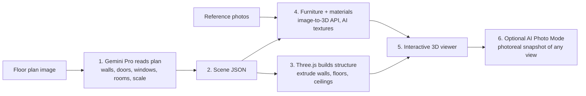

# AI Interactive 3D House Model: Idea & Plan

**Goal:** the user uploads a **floor plan + photos**, and AI builds a **controllable 3D model of the whole house** in the browser. The user can orbit it, walk inside, **walk up the stairs**, hide walls or the roof, and **hide/unhide furniture**.

> [!NOTE]
> **Direction update (5 Oct 2026):** the people uploading are **3D professionals**, usually with **CAD plans** plus some of their own furniture models. Sections 1–4 still describe picture uploads. They'll be rewritten after the CAD vs PDF test (section 12).

## ✅ Confirmed requirements
| Requirement | Decision |
|---|---|
| Output | Interactive 3D model (not video) |
| Project type | **Product:** anyone uploads their floor plans (decided 5 Oct 2026) |
| Purpose | **Internal tool to present projects to our clients.** A client can buy their own project's part of the site, with payment handled offline. No competitor analysis or labour costing needed: only build hours and AI generation cost (5 Oct 2026) |
| Walk mode | **First-person** only, no avatar (decided 5 Oct 2026) |
| Who uploads | **3D professionals**, usually with **CAD plans** (DWG) plus some of their own furniture models. Sometimes there are no furniture models yet at this stage (5 Oct 2026) |
| Multi-storey | ✅ Yes, and the user can **walk up and down the stairs** in first-person |
| Hide walls | ✅ Yes (cutaway / dollhouse) |
| Furniture | **View only:** hide/unhide, no move/edit |
| Reference | `house.sumsum.world`, analysed from DevTools screenshots (section 9) and a 46-second screen recording (section 10) |

## 1. Can we build it?

**Yes.** The trick is that **AI doesn't generate the whole 3D house in one go.** It generates *structured data* plus *individual 3D objects*, and a 3D engine (Three.js) assembles them. That is also why everything stays controllable: every wall, door, and sofa is a separate object.



---

## 2. Three ways to build it

| | **A. Procedural + AI assets** (recommended) | **B. Generative world** (Gaussian splats) | **C. Hybrid** |
|---|---|---|---|
| How | AI produces scene JSON, Three.js builds the house, and image-to-3D makes the furniture | Gemini renders the rooms, then World Labs Marble API turns them into a 3D splat world | A as the base, plus "Photo Mode" that turns any view photoreal with Gemini image |
| Hide walls/roof | ✅ Easy (each wall is an object) | ❌ Very hard (it's one blob of points) | ✅ |
| Move/remove furniture | ✅ | ❌ | ✅ |
| Accurate to floor plan | ✅ Exact dimensions | ⚠️ Approximate | ✅ |
| Photorealism | 🟡 Good (PBR + HDRI lighting) | ✅ Very high | ✅ Real-time view is good, and snapshots are photoreal |
| Effort | Medium | Low–medium | Medium+ |

> [!TIP]
> **Recommendation: build A first, then add C's Photo Mode.** You get exact geometry, full control (remove walls, move objects), and a "wow" photoreal button. Option B only makes sense if you just want a pretty, non-editable walk-through world.

---

## 3. Core idea: the Scene JSON

Everything comes from one AI-generated, user-editable file:

```json
{
  "scale": { "unit": "m", "pixelsPerMeter": 42 },
  "floors": [{
    "level": 0, "height": 2.8,
    "walls": [
      { "id": "w1", "start": [0, 0], "end": [6.2, 0], "thickness": 0.15, "exterior": true }
    ],
    "openings": [
      { "id": "d1", "type": "door",   "wallId": "w1", "offset": 1.2, "width": 0.9, "height": 2.1,
        "hinge": "left", "swing": "in", "autoOpen": true },
      { "id": "win1", "type": "window", "wallId": "w1", "offset": 3.5, "width": 1.5, "sill": 0.9 }
    ],
    "rooms": [
      { "id": "r1", "name": "Living Room", "polygon": [[0,0],[6.2,0],[6.2,4.5],[0,4.5]],
        "floorMaterial": "oak_wood", "wallMaterial": "warm_white" }
    ],
    "furniture": [
      { "id": "f1", "type": "sofa", "roomId": "r1", "position": [2.1, 3.8], "rotation": 180,
        "size": [2.2, 0.9, 0.85], "modelUrl": "storage/models/sofa_user_ref.glb",
        "group": "living_furniture", "visible": true }
    ],
    "stairs": [
      { "id": "s1", "type": "straight", "fromLevel": 0, "toLevel": 1,
        "start": [7.0, 1.0], "direction": 90, "width": 1.0, "steps": 16,
        "riser": 0.175, "tread": 0.27, "floorOpening": [[7.0,1.0],[8.0,1.0],[8.0,5.3],[7.0,5.3]] }
    ]
  }, {
    "level": 1, "height": 2.8, "elevation": 3.0,
    "walls": [], "openings": [], "rooms": [], "furniture": []
  }]
}
```

- **Gemini 3.1 Pro** turns the floor plan image into walls, openings, and rooms.
- **Gemini 3.1 Pro** suggests the furniture layout for each room, based on the style and room type.
- The user can **correct anything in a 2D editor** before the 3D model is built. This is the key to accuracy.

---

## 4. Where the "very accurate objects" come from

| Item | Source |
|---|---|
| Walls, floors, doors, windows | **Generated procedurally** from the JSON in Three.js, so they are always exact |
| User's own furniture (from photos) | **Image-to-3D API** (Tripo / Meshy, or self-hosted Hunyuan3D) returns a GLB, rescaled to real-world size |
| Generic furniture | Free/paid **GLB library** (Poly Haven, Sketchfab CC0) chosen by type and style. This is cheaper and faster than generating everything |
| Floor/wall textures | **`gemini-3.1-flash-image`** generates seamless PBR textures ("seamless light oak parquet, top-down") |
| Photoreal views | **`gemini-3.1-flash-image`** takes a screenshot of the 3D view and returns a photoreal render with the same layout |

> [!NOTE]
> Gemini models don't output 3D meshes directly, so we need a dedicated image-to-3D service for custom furniture. All *Gemini* calls stay on the approved 3.1 models.

---

## 5. Viewer controls (what "controllable" means)

**Core (confirmed):**
- **Orbit / Dollhouse view:** rotate around the whole house from above.
- **First-person walk:** WASD/mouse on desktop, joystick on mobile, with capsule collision against walls (`three-mesh-bvh`).
- **Walk up the stairs:** stairs get an invisible ramp collider, so the player glides up smoothly with a little head-bob. The active floor switches automatically by player height.
- **Hide walls:** a toggle for exterior walls, auto-hide for walls between the camera and the player (dollhouse cutaway), and a ceiling/roof toggle.
- **Floor selector:** buttons for Ground / Level 1 / Level 2 / All. Floors above the selected one fade out.
- **Furniture show/hide:** a master toggle, per-room toggles, and per-category toggles (beds, sofas, decor…). No editing.

**Nice-to-have:**
- **Auto-opening doors:** door leaves swing open as you walk up to them.
- **Live room name** in the walk HUD ("Walk · kitchen · Exit").
- **Room jump:** a minimap per floor; click a room to teleport there.
- **Day/night lighting** and a time-of-day sun.
- **AI Photo Mode:** a button that renders the current view photoreal.
- **Share link:** read-only viewer for clients.
- **Export for the 3D team (proposed 6 Oct 2026):** download the same model as a **3ds Max script** or as a **3D file** (GLB/FBX) for any 3D program.
  - The 3ds Max script builds editable walls, one Editable Poly per wall run, plus spline slabs with openings, layers per floor and type, and materials. The artist runs it and the model appears.
  - The 3D team can then detail the model in Max (materials, furniture) and upload it back for the client walkthrough.
  - Proven on Srisawan: `srisawan-rebuild/Srisawan_New_Layouts_Merged.ms`.

---

## 6. Recommended tech stack

| Layer | Choice | Why |
|---|---|---|
| 3D engine | **Three.js r160+** (vanilla, ES modules) | **The same thing the reference site uses** (confirmed). No React |
| Collision / walk | **three-mesh-bvh** | Also used by the reference site, for walk mode and stairs. Its *character movement* example (capsule collision on ramps and steps) is a ready-made starting point for the walk |
| Lighting | `RoomEnvironment` IBL + postprocessing (SSAO / contact shadows) + baked AO (`uv1`) | Matches its "Ultra" quality |
| Frontend | **Plain HTML + vanilla JS + importmap** (Vite optional) | The reference site has no framework and no bundler |
| 2D plan editor | Konva.js or plain Canvas/SVG | Correct the walls and rooms the AI detected |
| Backend | **Python FastAPI** | Orchestrates the Gemini and image-to-3D calls, and leaves room for OpenCV plan cleanup |
| DB / Auth / Storage | **Supabase** | Stores projects, scene JSON, GLB models, and textures |
| Asset optimization | `gltf-transform` (Draco/Meshopt) | AI meshes are heavy, and compression keeps the viewer fast |
| Hosting | **Cloud Run** (API) + static hosting (frontend) | |

```ts
// src/config/ai-models.ts
export const AI_MODELS = {
  PRO: 'gemini-3.1-pro-preview',           // PDF fallback: plan → scene JSON; AI furniture layout
  FAST: 'gemini-3.5-flash',                // CAD layer/block labels, room names (gemini-3.5-flash-lite is ~5x cheaper)
  IMAGE: 'gemini-3.1-flash-image',         // textures, Photo Mode (the -preview id is gone; checked 5 Oct 2026)
  PHOTO_HQ: 'gemini-3-pro-image',         // optional higher-quality Photo Mode
  // AI-made furniture: Tripo V3 image-to-3D API (separate account, pay as you go)
} as const;
```

---

## 7. Build phases (CAD version, internal tool)

Hours are hands-on work for one developer using an AI coding assistant (see section 11). Each phase builds on the one before.

| Phase | Deliverable | Est. |
|---|---|---|
| **0. Quick test** | Staff upload **DXF plans for 2 storeys**. Walls, doors, windows and stairs are read from the CAD layers. Three.js shows both floors with stairs, orbit, first-person walk and hide-walls | ~90 h |
| **1. First working version** | Check-and-fix screen (layer mapping, heights, floor alignment), robust 3D builder, all viewer controls, import of our own furniture models + a company library, materials and lighting, PDF fallback | +~275 h (~365 h total) |
| **2. Internal rollout** | Staff login, project dashboard, client share links, "client buys their project" export, hardening and mobile | +~165 h (~530 h total) |
| **3. Add-ons (optional)** | Photo Mode (~45 h), AI furniture for projects without models (~75 h), baked realistic lighting (~105 h), export for 3ds Max + GLB/FBX (~45 h) | ~270 h |

> [!IMPORTANT]
> **Phase 0 is the key test.** If our real DXF files turn into accurate walls, doors and stairs, the rest is standard engineering. Re-check the later estimates after it: if about 70% or more of walls and openings come out right first time, expect the low half of each range.

---

## 8. Risks

> [!WARNING]
> - **Floor plan parsing accuracy:** low-res or cluttered plans cause errors, so the 2D correction editor is mandatory.
> - **Scale detection:** the app needs a dimension on the plan, or the user draws one known length.
> - **AI 3D model weight:** generated GLBs can be 10–50 MB, so compress them and use LODs.
> - **Image-to-3D cost:** about a few cents to ~$0.50 per object, depending on provider. Use the library for generic items.
> - **Wall joins:**
>   - *Problem:* building one box per drawn line leaves seams along walls and overlapping squares at corners. This is very visible from above in cutaway and dollhouse views (seen in the Srisawan test, 6 Oct 2026).
>   - *Fix:* turn the lines into a clean wall network, then merge each wall run into **one solid**. That means joining connected lines, closing L/T corners (only where walls touch, so door openings stay open), and fusing overlaps. Lintels, sills and columns get fused the same way.
>   - *For CAD files:* walls are drawn as two face lines, so first pair them into a centre line + thickness, or close the outline between them.
>   - *Proven:* on Srisawan it took ~1.5 s for both floors, with no AI, and every corner stayed within 0.17 m of the traced lines.
>   - *Hours:* already included (the Phase 0 wall step and the Phase 1 3D builder).
---

> [!WARNING]
> - **Multi-storey alignment:** each floor plan is a separate image, so the floors must be aligned using the stair position and the outer walls. The 2D editor needs an "align floors" step.

## 9. Reference site analysis (`house.sumsum.world`), from your DevTools screenshots

### Confirmed tech stack
| Evidence | Meaning |
|---|---|
| `<canvas data-engine="three.js r160">` | **Three.js r160** WebGL renderer |
| `vendor/three.module.js`, `<script type="importmap">` | Plain ES modules, **no React, no bundler** |
| `vendor/three-mesh-bvh` | Fast raycasting and collision, used for walk mode, stairs, and click-to-focus a room |
| `addons/GLTFLoader.js` | Loads `.glb` models (likely furniture and cars, e.g. `garage-cars.js`) |
| `addons/environments/RoomEnvironment.js` | Image-based lighting, which gives the reflections |
| `addons/postprocessing` | SSAO, contact shadows, and the "Ultra" quality mode |
| `floors.js` comment: *"meshes without uv1 get uv1" for AO* | **Baked ambient occlusion** is part of why it looks so realistic |
| `viewer/detail/rooms/*.js`, `rooms/<room_name>/` folders | **Each room is its own code module plus its own texture set** (31 rooms, 5.8M triangles) |
| `l1m_boucle.jpg` + `l1m_boucle_n.jpg`, `*_albedo` / `*_normal` | PBR materials with **color + normal maps**, and texture atlases (`oak_limed_atlas.jpg`) |
| Cloudflare beacon, plus a telemetry comment about a "NAS receiver" | **Self-hosted on a home NAS** behind Cloudflare, with a simple password login |
| "Detailed House" vs "Sumsum Storybook" | **The same geometry with 2 render styles**: realistic PBR, and a painted/toon style for weak devices |

### UI features to match
- **Floor:** Both / Ground / Upstairs
- **View:** SW, SE, NE, NW corner presets, Plan (top-down), House, Exterior, Spin, Walk
- **Show:** Ceilings, Walls, Cutaway, Outline
- **Garden:** Garden, Table & chairs, View garden
- **Quality:** REAL / Ultra (Ultra adds room reflections + contact shadows)
- **Load just one room**, which saves memory
- **Explore a room:** a dropdown plus quick buttons (Sofa, Kitchen, Formal, Office)
- **"Walk the house"**: a **third-person** walk with an animated avatar (see section 10)
- **Controls:** drag to orbit, wheel/pinch to zoom, click a room to focus, R for the whole house

### 🔑 Key insight: how the "AI" is probably used
There are **no** `.splat`/`.ply` files, and the house is **hand-structured per room in JS modules**. That suggests the AI was most likely an **AI coding agent that wrote Three.js code room by room** from the floor plan and photos, with textures sourced or AI-generated. It was probably **not** a one-click "floor plan in, 3D out" model. That is why the accuracy is so high: it was iterated on room by room.

> [!IMPORTANT]
> This means there are **two very different projects** you could do:
> 1. **Bespoke house (like his):** we build *one specific house* together, room by room, in Three.js. This is very achievable, with high quality, and it's what he did.
> 2. **Automated product (SaaS):** anyone uploads a floor plan and gets a 3D house. Much harder, and the quality will be lower than a hand-tuned build at first.
>
> **Decision (5 Oct 2026): option 2, the automated version, as an internal tool for presenting to clients.** Clients can buy their own project's part of the site.

> [!CAUTION]
> Use his site only for **inspiration about features and the stack**. Don't copy his textures, models, or code.

## 10. Screen recording findings (46-second clip)

The clip shows **Walk mode** going from the upstairs corridor into a pink office ("joys office"), down the U-shaped stairs, through the kitchen and a corridor into the garage. It then presses **Exit** to return to the dollhouse overview. It does **not** show the Walls/Floor toggles or the Storybook style being used.

### Walk mode is third-person, not first-person
| Seen in the clip | How he probably did it (Three.js) |
|---|---|
| A **girl avatar** (ponytail, white T-shirt, floral skirt) walks with a walk-cycle animation, with the camera following a few metres behind | Rigged `.glb` character + `AnimationMixer`, with a capsule collider on `three-mesh-bvh` |
| The camera **pulls in close** in tight spots (stairs, doorways) and sometimes clips through door frames and curtains | A ray from her head to the camera shortens the camera arm when a wall is in the way. It's not perfect, hence the clipping |
| When the camera is right behind her, her **head dissolves into speckles** so it doesn't block the view | Dithered fade: `material.alphaHash = true` plus lower `opacity` as the camera gets close. Her hair always looks slightly grainy, which also points to alpha-hash |
| She **walks smoothly down the stairs**, with no jumps | Invisible ramp collider over the steps (as in our plan) |
| **Doors swing open on their own** as she approaches (office door, 5.6 s → 6.2 s) | Each door leaf is its own object with its pivot on the hinge, rotated open by a proximity check |
| Top-left HUD: **`Walk · <room name> · Exit`**. The room name updates live: *upstairs corridor → stairs → joys office → corridor → carpark* | Point-in-polygon test of her position against each room's footprint. The lowercase names look like internal room IDs (matching the per-room folders) |
| The mouse cursor stays visible while walking | No pointer lock, so she's probably moved with the keyboard (WASD/arrows). The exact controls aren't visible in the clip |
| **Exit** cuts instantly back to the overview | Restores the saved orbit camera and panel, with no fly-back animation |

### Look and detail
- **Heavy interior detail:** wood-veneer wall panels with visible grain, marble floors, linear ceiling lights and downlights, warm LED coves, **LED strips along the stairs**, glass balustrades, a double-height stairwell with a **cluster of chrome globe pendants**, large artworks, sheer curtains, black-framed glazing.
- **Sunlight patches with window-frame shadows** on the floors (real-time sun shadows or baked light). This adds a lot of realism.
- Small items are modelled too: **keypad door locks**, a smart-home wall panel, perforated acoustic panels, built-in ovens, a kitchen tap.
- The garage holds **three detailed car models** (an MPV, a sports coupé and a red hatchback). These are the `garage-cars.js` GLBs.
- The overview includes the **whole site**: road, hedges, pool, lawn, garden furniture, trees, and a glass courtyard with an olive tree.

### Panel details (readable at full resolution)
- **Header:** **Detailed House**, a link **← Original house**, a counter **31 rooms · 5,848,928 tris**, and a **Hide** button.
- **Footer:** "Ultra · room reflections + contact shadows".
- **Bottom hint bar:** **drag** orbit · **wheel / pinch** zoom · **click room** focus · **R / House** whole house.
- **No furniture show/hide toggle.** The only similar one is *Table & chairs* (garden). Hiding furniture will be **our own addition**.

### What this changes in our plan
1. **No avatar:** we chose a first-person walk (5 Oct 2026). The avatar notes above are kept for reference only.
2. Doors become **separate swinging objects** that open automatically. Door entries in the scene JSON get `hinge`, `swing` and `autoOpen` (section 3).
3. The walk HUD shows the **current room name**, using the room polygons we already have.
4. The **site** (plot, garden, pool, driveway) becomes its own layer with a Garden toggle.

## 11. Build hours and AI cost (CAD version, internal tool, 5 Oct 2026)

**How these were made:**
- **Hours:** two separate estimates (task by task, and a cautious risk-based one) came out close, and the table shows their middle. Hours are hands-on work for **one developer using an AI coding assistant**, not calendar time. If the builder mostly directs the AI rather than coding, multiply by about **2–3.5×**.
- **AI prices:** from official pricing pages, read on 5 Oct 2026. 23 of 26 were confirmed by a second check.

| What you build | Build hours (likely) | Range | AI generation cost |
|---|---|---|---|
| **Quick test:** CAD → walkable 2-storey 3D | ~90 h | 55–150 h | ~$0.01–0.13 per project (AI only labels CAD layers and rooms) |
| **First working version** (includes the quick test) | ~365 h | 260–570 h | ~$0.01–1.70 per project (labels + ~15 AI textures; ~$0 textures with a shared library) |
| **Full internal tool** (includes the first version) | ~530 h | 380–830 h | Same as above |
| + **Photo Mode** | +~45 h | 30–80 h | $0.07–0.11 per snapshot (standard), $0.14–0.26 (high quality) |
| + **AI furniture** for projects without models | +~75 h | 42–130 h | $0.27–0.79 layout per house, + $0.23–1.10 per AI-generated item |
| + **Baked realistic lighting** | +~105 h | 60–190 h | No AI cost: server time only, roughly $0.20–0.75 per bake |
| + **Export for 3ds Max / 3D file**\* | +~45 h | 35–70 h | No AI cost: same merged geometry, written as a .ms script (~25 h incl. testing in real 3ds Max), GLB (~6 h) and FBX via a server-side Blender job (~15 h) |
| **Everything** | **~800 h** | 545–1,300 h | |

\*Rough estimate made on 6 Oct 2026. It was not part of the earlier estimate runs.

**AI cost for a typical 2-storey project:**

| Situation | Typical | Range |
|---|---|---|
| CAD + our own furniture models (incl. 5 Photo Mode snapshots) | ~$1.80 | $0.35–3 |
| CAD, no furniture models yet (AI layout + free library + 5 AI-generated items) | ~$5 | $2–7 (up to ~$11 with retries or the premium 3D tier) |
| PDF only, no CAD | ~$2.80 | $0.60–5.20 |

**Which AI model does what (per 2-storey project):**

| Step | Model (via API) | Used in | Calls per project | Cost per project |
|---|---|---|---|---|
| Label CAD layers, blocks and room names | `gemini-3.5-flash` (or `-lite`) | Every phase | 3–5 small calls; about 0 once our layer mapping is saved | $0.01–0.13 |
| Read a plan from a PDF (only when there's no CAD) | `gemini-3.1-pro-preview` | Phase 1 on | 1 per floor, up to 2 retries | $0.25–2.25 |
| Textures | `gemini-3.1-flash-image` | Phase 1 on | ~15 images, or 0 with a shared library | $0–1.54 |
| Photo Mode | `gemini-3.1-flash-image`, or `gemini-3-pro-image` for higher quality | Add-on | ~5 snapshots (staff choose) | $0.34–1.30 |
| Furniture layout (only when there are no furniture models) | `gemini-3.1-pro-preview` | Add-on | 1 per floor | $0.27–0.79 |
| AI-made furniture items | Tripo V3 (image-to-3D) | Add-on | ~5 special items; the rest from the free library | $1.50–5.50 |

- **Nothing to self-host.** All AI runs through these APIs, pay per use. We only host the app itself (website, small backend, database, file storage), with no GPU servers. The optional baked lighting runs Blender as a server job, which is not an AI model.
- **Monthly AI cost** = projects per month × cost per project. For example, 10 projects a month ≈ $18–50.
- **One-off:** a shared library of ~200 AI textures costs about $7 to make once (Batch price). After that, textures cost about $0 per project.
- **While building:** roughly $60–330 of AI calls for testing in total, plus the AI coding assistant subscription (Claude Pro $20/month, or Max $100–200/month).
- **Client data:** on Gemini's paid tier, Google's pricing page states the data is not used to improve its products.

**Notes:**
- **Hours are the real cost.** AI generation is a few dollars per project.
- **CAD saves time.** Compared with the picture-upload product (~710 h), CAD input plus the internal scope saves about **180 h**.
- **Furniture generation (image-to-3D):**
  - Use a pay-as-you-go service: **Tripo** ($0.30 per textured item; its newer P2 tier is $1.10) or **Tencent HY 3D** ($0.23–0.70). Meshy and Rodin need monthly plans ($20 and $96–120).
  - Expect retries. A June 2026 furniture study found current image-to-3D "insufficient" for interior design: broken chair legs, missing handles, noisy surfaces. Use library or CAD-built geometry for built-ins and thin metal or glass pieces.
  - **Tencent's terms:** Tencent may use uploaded inputs, including client photos, to improve its service. It may add visible watermarks, and published output must be labelled as AI-made. Prefer Tripo for client work, and keep models set to private.
  - **Don't self-host TRELLIS.2.** Its 3D export uses nvdiffrast, whose licence is non-commercial only.
- **Cheaper or better models**, if your approved model list allows:
  - `gemini-3.5-flash-lite` for small tasks: $0.30 / $2.50 per 1M tokens, versus $1.50 / $9.00 for `gemini-3.5-flash`.
  - `gemini-3-pro-image` for high-quality Photo Mode: $0.134 per 1K/2K image. It's half price in Batch mode, but that can take up to 24 h.
- **Hosting** (for reference): a few dollars a month at our volumes if the 3D files go on Cloudflare R2.
- **Earlier comparison:** one simple house built by hand ~130 h; one detailed house like his ~560 h.

## 12. CAD vs PDF test (done 6 Oct 2026)

**What we already know (sources checked 5 Oct 2026):**
- **Gemini 3.1 Pro reading plan images:** an August 2026 study tested it on 200 plans. It got the layout roughly right but placed walls coarsely: wall score 0.811 with a loose tolerance, and 0.472 with a strict one ([arXiv 2608.25608](https://arxiv.org/html/2608.25608)).
- **Door and window counting:** a September 2026 benchmark tested 10 AI models on 120 plans. The best model counted **doors correctly 39%** of the time and **windows 34%**. The authors' verdict: *"Current AI works well as a document assistant but lacks robust drawing literacy."* ([AECV-Bench](https://www.aecfoundry.com/blog/can-ai-really-read-your-building-plans-aecv-bench-gets-a-major-upgrade))
- So reading a *picture* of a plan is still the weak point. A CAD file skips that guesswork, because the lines, doors and measurements are already exact data.

**What the test will check on one real plan.** Every ✓ and ✗ below is an expectation that the test will confirm or disprove:

| Question | CAD (DWG/DXF) | PDF exported from CAD | Scanned PDF |
|---|---|---|---|
| Exact lines? | ✓ | ✓ if it kept vector lines | ✗ only pixels |
| Walls kept apart from furniture and text (layers)? | ✓ if layers are tidy | Sometimes (PDF layers) | ✗ |
| Doors and windows as objects (position, swing)? | ✓ blocks | ✗ just lines | ✗ |
| Real-world units? | ✓ | Needs the print scale | Needs the print scale |
| Room names as text? | ✓ | Usually | ✗ |
| Easy for a product to open? | DXF ✓, DWG needs a converter | ✓ | ✓ |

**Results (6 Oct 2026):** tested on *Test Sukhumvit Residence.dwg*, saved in AutoCAD 2018 format. The file has 2 floor plans and 2 elevations. Output is in [cad_test/](cad_test/). Open `house_3d_preview.html` in a browser to see the 3D.

- **Opening the file:** the free, open-source **LibreDWG** converted the DWG to DXF in under 1 second, on this PC. Nothing was uploaded anywhere. This PC has DWG TrueView but not AutoCAD, so it can't export DXF itself.
- **3D from CAD, with no AI:** walls, windows, glass walls, columns and stairs for both floors were built automatically in about 15 seconds.

| Item | What the CAD file gave us | What a PDF would give |
|---|---|---|
| Walls, windows, glass walls, stairs, columns | Separate layers. Ground floor: 457 wall lines, 241 window lines, 63 stair lines. Upper floor: 594 / 231 / 46 (after unpacking its blocks) | Lines only, all looking the same, unless the PDF kept layers |
| Doors | Door blocks (`_1D3R90`, `_1D0L100`), 32 door-frame blocks, door/window tags (D1, D3, AW1, AW12…) | Lines and text only |
| Real sizes | Dimensions in millimetres (1000, 2900, 7000…) | Needs the print scale |
| Floor heights | From the elevations' level tags: floor 1 **+0.90 m**, floor 2 **+4.80 m**, roof beam **+8.30 m** | Only as text, if the elevations are in the PDF |
| Lining up the floors | The 24 grid labels in both plans give the exact shift (74.021 m). Edges line up within 1 mm | Grid labels must be read from the picture |
| Room names | None in this file | None |

**Real-world mess we found, and the simple rule that handled each one:**

| Mess | Rule |
|---|---|
| The units setting says inches, but the drawing is in millimetres | Check against the dimension values |
| The upper floor was pasted in as blocks with random names (`A$C02E95B23`, `hjhjj`) | Unpack all blocks first |
| ~1.6 km of centre and hidden lines (grid, beams overhead) drawn on the wall and column layers | Keep only solid lines as walls |
| A decorative pebble pattern on the wall layer (171 tiny shapes) | Drop tiny closed shapes |
| Layer names don't always mean what they say: `RNAME` holds door/window tags, not room names | Don't trust layer names blindly; let AI help map layers per project |
| Furniture is ~21,000 loose line pieces from a linked interior file | Positions are usable, but AI must recognise what each piece is (bed, sofa…) |
| Labels are in Thai | No problem for Gemini |

**PDF results (6 Oct 2026):** tested on *DH3 TYPE L_Show house.pdf*. This is a **different house** (DH3 Type L, 650 m², a 104-page interior set), printed from AutoCAD 2019 **with layer information turned on**. That makes it a best-case PDF.

- **Kept:**
  - all 336 CAD layers, and every line knows its layer (`A-WALL`, `A-DW`, `I-STAIR`, `I-FURN`…);
  - real vector lines, not a scan;
  - **room names as real text** (CARPORT, FORMAL LIVING, MASTER BEDROOM…);
  - ceiling heights as text (CH +2800 / +3000 / +3300);
  - the 1:100 scale.
- **Lost:**
  - real units: everything must be scaled from 1:100;
  - doors and windows are just lines, not objects;
  - hatch patterns turn into loose lines on the wall layer. 27,000 thin lines had to be dropped using **line thickness**;
  - grid labels are printed as shapes, not text;
  - there's **no upper-floor level** anywhere in 104 pages, so +3.80 m was assumed;
  - the floors only line up because both sheets were printed with the same framing (29 columns match).
- **3D from the PDF:** worked in under 1 second, using its layers plus the line-thickness rule. See `cad_test/pdf_house_3d_preview.html`.

> [!TIP]
> **Verdict, ranked:**
> 1. **DWG/DXF: best.** Exact geometry, door/window objects, real floor heights, floors aligned by grid labels.
> 2. **PDF printed from CAD *with layers*: a good second.** Walls, doors and stairs can be separated by layer. It needs extra rules (line thickness, scale) and some guessed values (floor heights), but it has room names, which our DWG didn't.
> 3. **PDF without layers, or a scan: poor.** Every line looks the same, so AI has to guess, and that's the weak point (see the studies above).
>
> **For the product:** take DWG/DXF first and layered PDFs as a fallback. When a PDF is uploaded, check whether it has layers, and warn staff if it doesn't. Flat PDFs and scans go to AI reading plus a careful check screen.

## 13. Remaining open questions
1. ~~Bespoke house or automated product?~~ **Decided: automated product** (5 Oct 2026).
2. If bespoke: which house? Please share the **floor plans (each storey)** and **photos/renders**.
3. Do you want both styles (**realistic + storybook**), or realistic only?
4. Hosting: your own server/NAS like him, or cloud (Cloudflare Pages / Cloud Run)?
5. ~~Walk mode: first-person, third-person avatar, or both?~~ **Decided: first-person** (5 Oct 2026).
6. ~~Who uploads the plans?~~ **Answered: 3D professionals**, usually with CAD files (DWG), who often have their own 3D models too (5 Oct 2026).
7. ~~What do the 3D people usually have?~~ **Answered:** usually CAD plans plus some furniture models. Sometimes there are no furniture models yet at this stage (5 Oct 2026). So furniture comes from their own models when they exist, and from a library (or AI) when they don't.
8. ~~Which CAD program and units? Same layer names on every project?~~ **Answered:** it depends on who drew it, but each drawing's layers say which line is which (names and colours). Our two test files use different conventions (`WALL`/`WIN`/`DOOR` vs `A-WALL`/`A-DW`/`I-DOOR`). **So:** AI suggests the layer mapping for each file, staff confirm it once, and the tool remembers it per author or office (6 Oct 2026).
